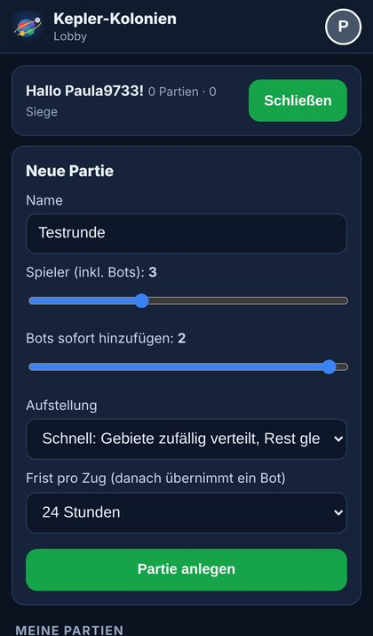
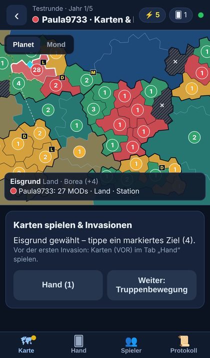
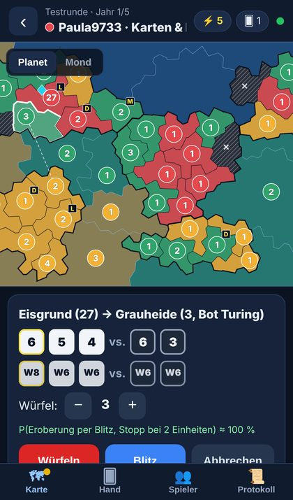
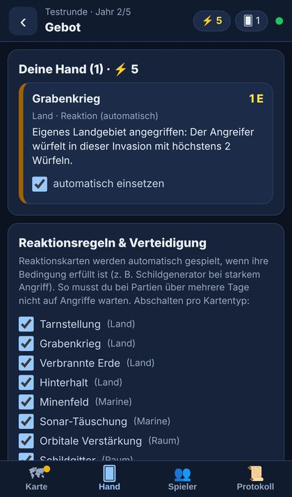
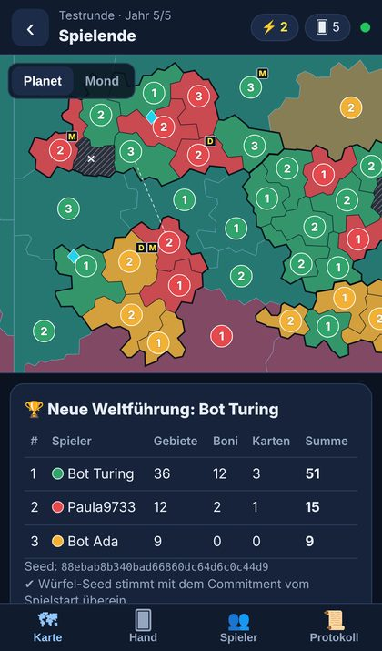
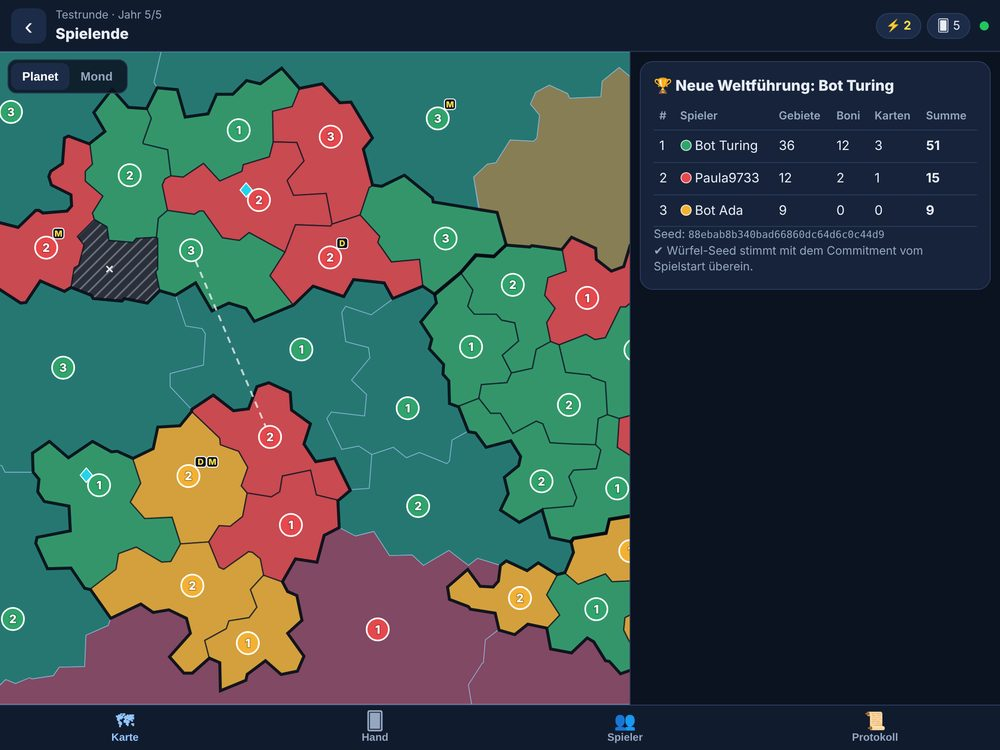

# Kepler-Kolonien

Selbst gehosteter Multiplayer-Server für ein rundenbasiertes Strategiespiel (2–5 Spieler, Planet, Ozeane und Mond, Kommandanten, Energie, 100 Kommandokarten). Läuft als **ein Docker-Container** (z. B. auf Unraid). Gespielt wird auf **Smartphone oder Tablet** im Browser bzw. als installierte Web-App (PWA): mit eigenem Profil, gegen andere Spieler auf dem Server und/oder Bots, live oder über mehrere Tage.

| Lobby | Invasion | Kampf | Hand & Reaktionen | Spielende |
|---|---|---|---|---|
|  |  |  |  |  |

Tablet (Querformat): 

- **Regeln:** nach dem Regelheft, mit eigener Karte, eigenen Namen und eigenen Kartentexten. Der Regelabgleich steht in [`docs/KONZEPT.md`](docs/KONZEPT.md) §2, der Kartenkatalog in [`docs/KARTEN.md`](docs/KARTEN.md).
- **Umsetzungsstand und offene Punkte:** [`docs/STATUS.md`](docs/STATUS.md).

---

## Installation auf Unraid

### Variante A: fertiges Image (GitHub Container Registry)

Bei jedem Push baut die GitHub Action `.github/workflows/docker.yml` ein Multi-Arch-Image (amd64/arm64) nach `ghcr.io/pneumann1980/kepler-kolonien:latest`.

> Neue GHCR-Pakete sind zunächst **privat**. Entweder stellst du das Paket auf GitHub unter *Packages → kepler-kolonien → Package settings → Change visibility* auf „Public“, oder du meldest dich auf Unraid mit `docker login ghcr.io` an.

1. Kopiere das Template [`deploy/unraid/kepler-kolonien.xml`](deploy/unraid/kepler-kolonien.xml) nach `/boot/config/plugins/dockerMan/templates-user/` (z. B. per SMB auf den Flash-Share).
2. *Docker → Add Container → Template: kepler-kolonien* auswählen.
3. **Admin-Passwort** setzen. Appdata bleibt `/mnt/user/appdata/kepler-kolonien`, Port 8210.
4. Starten und `http://<unraid-ip>:8210` im Handy-Browser öffnen. Das erste angelegte Profil wird automatisch Admin.

### Variante B: selbst bauen (auf Unraid oder einem anderen Docker-Host)

```bash
git clone https://github.com/pneumann1980/kepler-kolonien.git
cd kepler-kolonien
docker build -t kepler-kolonien:latest .
docker run -d --name kepler-kolonien --restart unless-stopped \
  -p 8210:8210 -v /mnt/user/appdata/kepler-kolonien:/data \
  -e ADMIN_PASSWORD='bitte-aendern' -e PUID=99 -e PGID=100 -e TZ=Europe/Berlin \
  kepler-kolonien:latest
```

Alternativ startet `docker compose up -d --build` das Referenz-Setup aus [`docker-compose.yml`](docker-compose.yml).

## Zugriff von außen: Cloudflare Tunnel

Ohne HTTPS funktionieren die App-Installation und Push-Benachrichtigungen nicht; spielen geht trotzdem. Empfohlen ist ein Cloudflare Tunnel, für den kein Port am Router geöffnet werden muss:

1. In Cloudflare Zero Trust unter *Networks → Tunnels* einen Tunnel anlegen und den Token kopieren.
2. Auf Unraid ein eigenes Docker-Netz anlegen: `docker network create kepler-net`. Unter *Settings → Docker* muss „Preserve user defined networks“ aktiv sein.
3. Den Container `kepler-kolonien` sowie einen `cloudflared`-Container (`cloudflare/cloudflared`, Post Arguments `tunnel --no-autoupdate run`, Variable `TUNNEL_TOKEN`) beide ins Netz `kepler-net` hängen.
4. Im Tunnel einen *Public Hostname* `kepler.deine-domain.de` mit Service `HTTP` auf `kepler-kolonien:8210` anlegen.
5. Im Spielcontainer setzen: `PUBLIC_URL=https://kepler.deine-domain.de`, `TRUST_PROXY=cloudflare`.
6. In Cloudflare **Rocket Loader ausschalten**. Bot Fight Mode für `/api/*` und `/ws` deaktivieren oder per WAF-Regel ausnehmen. Cloudflare Access höchstens für `/admin*` einsetzen. Hintergründe stehen in KONZEPT §11.3–11.5.

Alle Mitspieler sollten immer dieselbe Adresse (`https://kepler.deine-domain.de`) nutzen, auch im WLAN. Das Profil-Login ist an die Adresse gebunden.

## Spielen

- **Profil anlegen:** Name und Passwort. Das Profil zeigt Statistik und letzte Partien; dort lassen sich Wunschfarbe, Passwort und Push-Benachrichtigungen einstellen.
- **Lobby:**
  - Partie anlegen: 2–5 Plätze, Bots, Schnell- oder klassische Aufstellung, Frist pro Zug.
  - Mitspieler sehen die Partie live und treten bei; der Host startet.
  - Laufende Partien anderer Spieler kann man als Zuschauer verfolgen.
- **Partie:**
  - **Karte:** Erde (Küsten: Natural Earth) und Mond (NASA-LROC-Mosaik) mit eigener Gebietsaufteilung. Tippen wählt Gebiete, zwei Finger zoomen, Wischen verschiebt die Karte. Sie ist an Ost- und Westrand verbunden (Beringstraße); per Umschalter geht es auf den Mond. Ältere Partien behalten ihre ursprüngliche Karte.
  - **Aktionsleiste:** führt durch alle Phasen. Die Zugfolge ist Gebot → Platzwahl → Einsetzen → Anheuern/Bauen → Karten kaufen → Karten spielen und Invasionen → Truppenbewegung → Zugende.
  - **Hand:** Karten spielen und Reaktionsregeln ein- oder ausschalten.
  - **Spieler:** öffentliche Informationen aller Spieler.
  - **Protokoll:** alle Ereignisse inklusive Würfel.
- **Reaktionskarten:** Sie werden automatisch gespielt, wenn ihre Bedingung erfüllt ist. So wartet niemand auf Antworten, auch bei Partien über mehrere Tage.
- **Fristen:** Läuft die Frist ab (Standard 24 h), spielt ein Bot den Zug defensiv zu Ende. Über „Kontrolle an Bot abgeben“ (Befehl `Resign`) übernimmt ein Bot dauerhaft.
- **Fairness:** Der Server würfelt. Der Fingerabdruck (SHA-256) des Würfel-Seeds ist ab Spielbeginn sichtbar. Nach Spielende wird der Seed offengelegt, und der Client prüft ihn automatisch.

## Konfiguration (Umgebungsvariablen)

| Variable | Standard | Bedeutung |
|---|---|---|
| `PORT` | `8210` | HTTP-Port |
| `DATA_DIR` | `/data` | SQLite-Datenbank, Backups (`/data/backups`) |
| `ADMIN_PASSWORD` | – | Admin-Rechte im Profil freischalten (Partien löschen) |
| `PUBLIC_URL` | – | z. B. `https://kepler.deine-domain.de`; aktiviert sichere Cookies |
| `TRUST_PROXY` | `false` | `true` (X-Forwarded-For) oder `cloudflare` (CF-Connecting-IP) |
| `TURN_DEADLINE_HOURS` | `24` | Standard-Frist für neue Partien (0 = keine) |
| `REGISTRATION_OPEN` | `true` | `false` sperrt neue Profile |
| `REGISTRATION_CODE` | – | Einladungscode für die Registrierung |
| `BOT_DELAY_MS` | `700` | Pause zwischen Bot-Aktionen (sichtbares Mitverfolgen) |
| `MAX_ACTIVE_GAMES` | `30` | Schutz vor Missbrauch |
| `VAPID_SUBJECT` | `mailto:admin@localhost` | Kontakt für Web Push |
| `BACKUP_RETENTION_DAYS` | `14` | Aufbewahrung der täglichen Backups |
| `PUID` / `PGID` | `99` / `100` | Benutzer, unter dem der Server läuft (Unraid-Standard) |
| `TZ` | `Europe/Berlin` | Zeitzone |

## Entwicklung

Voraussetzung ist Node.js ≥ 22.18. TypeScript läuft per Type-Stripping direkt, ohne Build-Schritt für den Server.

```bash
npm install
npm run build          # Client (PWA) nach dist/public bündeln
npm start              # Server auf :8210 (Daten in ./data)
npm test               # Engine-Unit-Tests, Bot-Simulationen, Server-Integrationstest
npm run typecheck
node src/tools/simulate.ts 50 4 quick                         # 50 Bot-Partien à 4 Spieler (Robustheit/Balancing)
node tests/e2e/mobile-playthrough.cjs http://localhost:8210   # E2E iPhone-Emulation (Playwright)
node tests/e2e/multiplayer.cjs http://localhost:8210          # E2E zwei Spieler gegeneinander
```

### Aufbau

```
src/engine/     Regel-Engine (rein, deterministisch): Regeln, Kampf, Karten, Bot, Projektion
src/server/     HTTP-API, WebSocket, SQLite, Profile, Lobby, Fristen, Web Push
src/client/     PWA (Preact): Lobby, Profil, Spielbrett (SVG), Aktionsleiste, Service Worker
content/board/  Karte (map.json) und Geometrie (geometry.json), erzeugt von tools/board-generator/earth_board.py;
                legacy/ = Kepler-Fantasiekarte für alte Partien
docs/           Konzept, Kartenkatalog, Status, Grafiken
deploy/unraid/  Unraid-Template
```

## Quellen

- Küsten- und Ländergrenzen: [Natural Earth](https://www.naturalearthdata.com/) 1:50 Mio., gemeinfrei (über `world-atlas`).
- Mond: NASA/GSFC/Arizona State University, LROC WAC Nearside-Mosaik, gemeinfrei.
