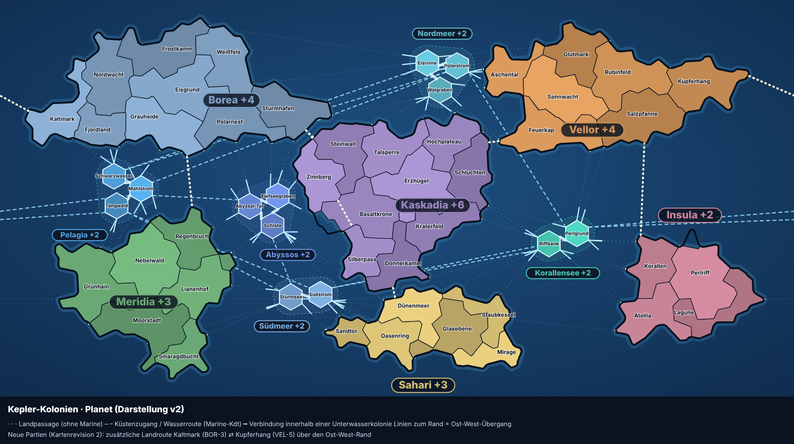
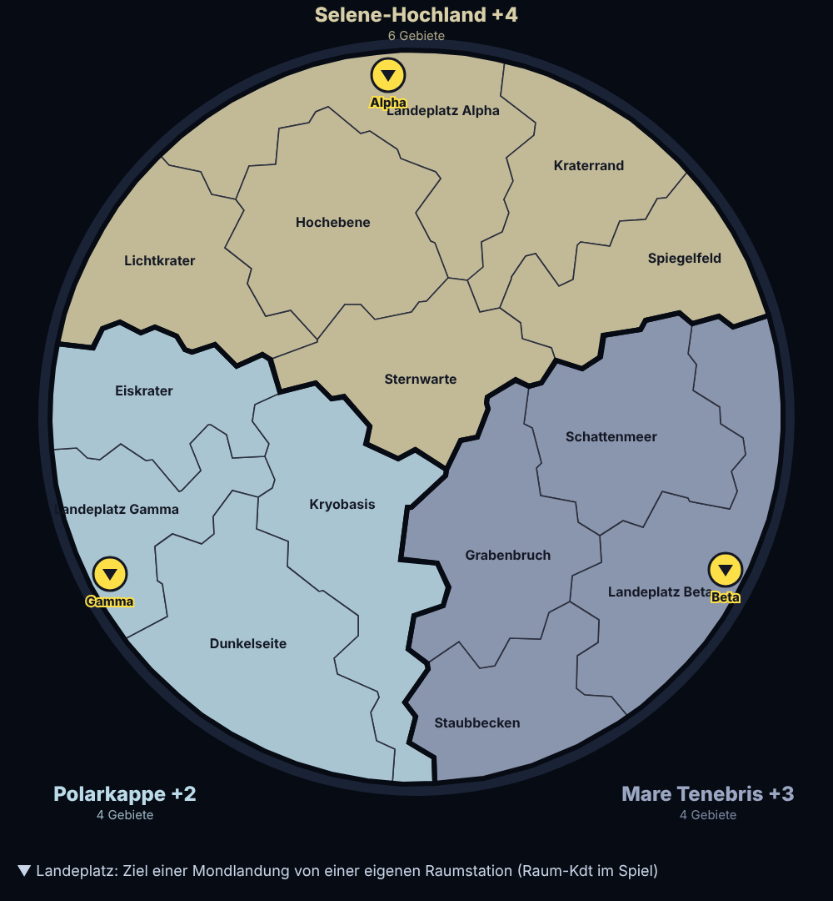
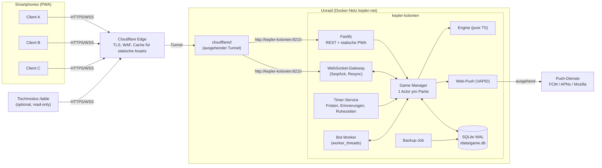
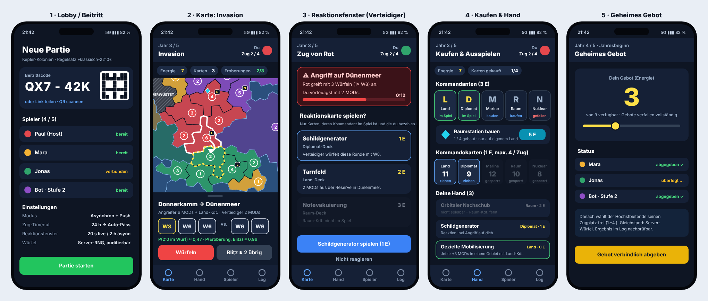

# Konzept: Selbst gehosteter Multiplayer-Server für ein 2210-artiges Strategiespiel (Unraid / Docker, Smartphone-Clients)

**Arbeitstitel:** *Kepler-Kolonien*
**Status:** Konzept v1.3 (2026-11-11). Die Regeln sind gegen das offizielle Regelheft abgeglichen, die Einkommenstabelle der Score Chart ist hinterlegt, alle Entscheidungen des Auftraggebers sind eingearbeitet (§0.1). Es ist noch nichts implementiert.
**Projekt:** Kepler-Kolonien · Repository und Docker-Image `kepler-kolonien` · Tunnel-Hostname `kepler.<domain>` (Domain wird beim Deployment gesetzt; Platzhalter in diesem Dokument: `kepler.deine-domain.de`).
**Zielplattform:** ein Docker-Container auf Unraid, öffentlich erreichbar über einen Cloudflare Tunnel. Clients sind Smartphones (PWA im Browser, keine App-Store-Installation).
**Begleitdokument:** [`KARTEN.md`](KARTEN.md) mit dem vollständigen Katalog aller 100 Kommandokarten (5 Decks à 20).

---

## Inhalt

0. [Kurzfassung und Kernentscheidungen](#0-kurzfassung-und-kernentscheidungen)
1. [Abgrenzung: Mechanik vs. geschützte Inhalte](#1-abgrenzung-mechanik-vs-geschützte-inhalte)
2. [Regelabgleich mit dem Regelheft](#2-regelabgleich-mit-dem-regelheft)
3. [Formales Regelmodell](#3-formales-regelmodell)
4. [Spielbrett: Unterlage, Datenmodell, Generator](#4-spielbrett-unterlage-datenmodell-generator)
5. [Kommandokarten](#5-kommandokarten)
6. [Systemarchitektur](#6-systemarchitektur)
7. [Game-Engine](#7-game-engine)
8. [Netzwerkprotokoll und API](#8-netzwerkprotokoll-und-api)
9. [Client (PWA), UX und Asynchron-Betrieb](#9-client-pwa-ux-und-asynchron-betrieb)
10. [Persistenz, Backup, Migration](#10-persistenz-backup-migration)
11. [Sicherheit, Zugang, Cloudflare Tunnel](#11-sicherheit-zugang-cloudflare-tunnel)
12. [Docker-Image und Unraid-Integration](#12-docker-image-und-unraid-integration)
13. [Betrieb und Observability](#13-betrieb-und-observability)
14. [Teststrategie](#14-teststrategie)
15. [Roadmap und Aufwand](#15-roadmap-und-aufwand)
16. [Risiken, Limitationen, offene Punkte](#16-risiken-limitationen-offene-punkte)
17. [Quellen](#17-quellen)

---

## 0. Kurzfassung und Kernentscheidungen

| Thema | Entscheidung | Begründung / Trade-off |
|---|---|---|
| Spielinhalt | Regelmechanik nach dem offiziellen Regelheft als **parametrisierter Regelsatz**. Karte, Namen, Kartentexte und Grafik sind **eigene Inhalte**. | Spielmechaniken sind urheberrechtlich nicht geschützt, Marke, Brettgrafik und Kartentexte dagegen schon (§1). Durch die Parametrisierung lassen sich Hausregeln ohne Codeänderung abbilden. |
| Laufzeit | **Ein** Spielcontainer: Node.js 22 LTS (TypeScript), Fastify (HTTP) + `ws` (WebSocket), SQLite (WAL) unter `/data`. Daneben `cloudflared` als zweiter Container. | Kein Datenbank-Container nötig, Backup per Dateikopie, < 150 MB RAM. Der Preis ist ein einzelner Schreibprozess; bei < 50 parallelen Partien ist das kein Engpass. |
| Engine | Rein funktionale, deterministische TypeScript-Bibliothek (`state + command → events`), läuft auf Server **und** Client | Der Server ist autoritativ, der Client nutzt die Engine nur zur Vorschau (gültige Ziele, Wahrscheinlichkeiten). Eine Codebasis, replaybare Partien. |
| Persistenz | Event-Sourcing (Append-only-Eventlog plus Snapshots) | Lückenloses Audit, Replays, Crash-Sicherheit, Klärung von Regelstreitigkeiten. Etwas mehr Aufwand als reine State-Dumps. |
| Zufall | Server-RNG (ChaCha20) pro Partie mit Seed-Commitment: Der Hash wird beim Start veröffentlicht, der Seed nach Spielende. | Würfel sind im Nachhinein für alle prüfbar; der Client würfelt nie. |
| Client | PWA (React + Vite), SVG-Karte mit Pinch-Zoom, auf dem Homescreen installierbar, Web Push | Läuft auf iOS und Android ohne App Store. HTTPS kommt über den Cloudflare Tunnel. |
| Spielmodus | **Primär asynchron** über mehrere Tage: Fristen, Erinnerungen, Ruhezeiten, Reaktionsregeln statt Wartefenster, Bot-Vertretung bei Fristablauf. Live am Tisch bleibt als zweiter Modus. | Gleiche Engine; Defaults, UX-Priorität und Roadmap richten sich nach asynchronem Spiel (§9.6). |
| Bots | Heuristik-Bot ist Teil des MVP | Gegner, Vertretung bei Abwesenheit, Werkzeug für das Karten-Balancing (§7.6) |
| Zugang | Keine Benutzerkonten. Partien anlegen nur mit `ADMIN_PASSWORD`; Beitritt per Code, Link oder QR, danach Geräte-Token. | Minimaler Betrieb. Weil der Server öffentlich erreichbar ist, kommen Rate-Limiting anhand von `CF-Connecting-IP` und optional Cloudflare Access nur für `/admin` hinzu (§11). |
| Netzwerk | **Cloudflare Tunnel**, ein öffentlicher Hostname mit TLS von Cloudflare | Kein offener Port am Router, gültiges Zertifikat, dadurch funktionieren PWA-Installation und Web Push. Der Preis: Cloudflare terminiert TLS und sieht den Spielverkehr im Klartext (§11.4). |
| Unraid | Community-Applications-Template (XML), `/data` → `appdata`, internes Docker-Netz `kepler-net`, PUID/PGID 99/100 | Unraid-Standardkonventionen |

### 0.1 Getroffene Entscheidungen

| # | Frage | Entscheidung | Auswirkung im Konzept |
|---|---|---|---|
| E1 | Netzwerkzugang | Cloudflare Tunnel | §11.3–11.5 Einrichtung, Cloudflare-Einstellungen, Fallstricke; §12 `cloudflared` neben dem Spielcontainer; `TRUST_PROXY=cloudflare` |
| E2 | Spielmodus | Asynchron über mehrere Tage | §7.4 Reaktionen über vorab hinterlegte **Reaktionsregeln**, ohne Wartefenster; §9.6 Fristen, Erinnerungen, Ruhezeiten, Bot-Vertretung, Urlaubsmodus |
| E3 | Regelheft | Liegt vor (Regelheft Wizards of the Coast/Avalon Hill, 16 Seiten, Druckstand 2007) | §2 vollständig abgeglichen. Mehrere Annahmen aus v1.0 wurden korrigiert (§2.2) |
| E4 | Bots im MVP | Ja | Bot Stufe 1 im MVP; jede Karte hat eine Bot-Heuristik (`KARTEN.md`) |
| E5 | Kartenumfang | Alle Karten von Beginn an | Nach Regelheft **100 Karten** (5 × 20), nicht 65 wie in v1.0 angenommen. 67 eigene Kartentypen mit Mehrfachexemplaren, siehe `KARTEN.md` |
| E6 | Name und Domain | Projekt **Kepler-Kolonien**; Repository und Image `kepler-kolonien`; Tunnel-Hostname `kepler.<domain>` | Docker-Netz `kepler-net`, Container `cloudflared-kepler`, WS-Subprotokoll `kepler.v1`; die Domain ist eine reine Deployment-Variable (`PUBLIC_URL`) |
| E7 | Nachschub | Score Chart als **Tabelle** hinterlegen, keine Formel | §3.4: Tabelle aus der Score Chart des Regelhefts (S. 3). Sie weicht bei 45 Gebieten von ⌊n/3⌋ ab (14 statt 15) |

---

## 1. Abgrenzung: Mechanik vs. geschützte Inhalte

- **„RISK“ und „Risk 2210 A.D.“** sind Marken von Hasbro. Brettgrafik, Kartentexte, Artworks und das Regelheft sind urheberrechtlich geschützt.
- **Nicht geschützt** sind Spielmechaniken: Bieten um die Zugreihenfolge, Energie als Währung, Kommandanten mit W8, Wasser- und Mondgebiete, fünf Spieljahre.
- **Folgerungen:**
  1. Es gibt **keine Screenshots oder Scans des Originalbretts**. Stattdessen enthält das Projekt eine **eigene, generierte Spielbrett-Unterlage** (§4) mit derselben *strukturellen* Topologie: 42 Land-, 13 Wasser- und 14 Mondgebiete; Kontinente mit 4–12 Gebieten; 5 Wasserkolonien; 3 Mondkolonien mit 6, 4 und 4 Gebieten.
  2. **Keine Kartentexte aus dem Original.** Das eigene Kartensystem (`KARTEN.md`) übernimmt die Rahmenmechanik: 5 Decks à 20 Karten, Power-up-Kosten 0–4, Spielzeitpunkte.
  3. **Das Regelheft bleibt außerhalb des Repositorys.** Daraus werden nur Regelparameter abgeleitet, z. B. „35/30/25 Start-MODs“; Textpassagen werden nicht übernommen.
  4. Projekt- und Imagename enthalten weder „Risk“ noch „2210“. Vorschlag: `kepler-kolonien`. Das Repository `risk_docker` sollte vor einer Veröffentlichung umbenannt werden.
  5. Die Engine ist als **generische Engine für Area-Control-Spiele** angelegt. Karte, Karten und Regelsatz sind austauschbare Inhaltspakete.

---

## 2. Regelabgleich mit dem Regelheft

### 2.1 Ergebnis

Quelle: offizielles Regelheft, 16 Seiten. Die 2210-Regeln stehen auf S. 1–9; S. 10–13 enthält die Classic-Regeln, die nur bei Lücken gelten (RH S. 1). „RH S. x“ verweist auf die Seite. Status: ✅ = im Regelheft belegt, ⚠️ = Regelheft schweigt oder ist mehrdeutig, daher als Parameter mit begründetem Default umgesetzt.

| # | Regel | Status | Parameter |
|---|---|---|---|
| R1 | 2–5 Spieler, 5 Jahre | ✅ RH S. 1, 3 | `years: 5` |
| R2 | Erde: 6 Kontinente mit 42 Gebieten (4–12 je Kontinent), 13 Wassergebiete in 5 Kolonien; Mond: 3 Kolonien mit 4 bzw. 6 Gebieten (14) | ✅ RH S. 1 | Kartendatei |
| R3 | Start mit 3 Energie | ✅ RH S. 2 | `startEnergy: 3` |
| R4 | Start-MODs: 3 Spieler 35, 4 Spieler 30, 5 Spieler 25; 2 Spieler je 30 plus neutrale Armee | ✅ RH S. 2, 8 | `startMods` |
| R5 | Setup: Landgebietskarten aufdecken, bis 4 Landgebiete verwüstet sind. Sie sind für das ganze Spiel unpassierbar, die Karten werden abgelegt. | ✅ RH S. 2 | `devastatedAtSetup: 4` |
| R6 | Startreihenfolge per W6, dann im Uhrzeigersinn. Erst je 1 MOD in unbesetzte, nicht verwüstete **Landgebiete**, bis alle besetzt sind; dann je 3 MODs in eigene Gebiete (in der letzten Runde ggf. weniger). Keine Startplatzierung auf Wasser oder Mond. | ✅ RH S. 2 | `placement` |
| R7 | Danach in Spielreihenfolge: Land-Kommandant, Diplomat und Raumstation **zusammen** in eigene Gebiete setzen | ✅ RH S. 2 | `startUnits` |
| R8 | Vor jedem Jahr: geheimes Gebot (0 bis alles), gleichzeitig aufdecken. Höchstbietender wählt einen beliebigen Zugplatz, dann der nächste. Gebote verfallen vollständig. | ✅ RH S. 3 | `bidding` |
| R9 | Gleichstand: Die Beteiligten würfeln W6, der höhere Wurf wählt zuerst | ✅ RH S. 3 | `bidding.tieBreak: rollD6` |
| R10 | Zugphasen in fester Reihenfolge: 1 Einkommen und Einsetzen → 2 Kommandanten anheuern und Stationen bauen → 3 Karten kaufen → 4 Karten spielen → 5 Invasionen → 6 Truppenbewegung; danach Karten mit Zeitpunkt „Zugende“ | ✅ RH S. 3, 8 | `turnPhases` |
| R11 | Einkommen: Gezählt werden kontrollierte Gebiete inklusive Wasser und Mond. Der Wert in der Score Chart liefert die Anzahl **MODs und dieselbe Menge Energie**. | ✅ RH S. 3 inklusive Abbildung der Score Chart; Felder 5/10/15 dort verdeckt (§3.4) | `income.table` (Tabelle §3.4) |
| R12 | Boni für vollständig kontrollierte Kontinente, Wasser- und Mondkolonien: **MODs und Energie**. Verwüstete Gebiete zählen beim Kontrollieren nicht mit; es gibt trotzdem den vollen Bonus. | ✅ RH S. 3 | `income.regionBonus: {mods: true, energy: true, ignoreDevastated: true}` |
| R13 | +1 MOD pro kontrollierter Raumstation, eingesetzt im Gebiet der Station | ✅ RH S. 3, 4 | `station.modProduction: 1` |
| R14 | Kontrolle: Ein Gebiet ist kontrolliert, wenn dort eigene Einheiten stehen **oder** eine eigene Station steht. Einheiten sind MODs und Kommandanten; die Station zählt nicht als Einheit. | ✅ RH S. 3, 5, 6 | Engine-Kern |
| R15 | Kommandant 3 Energie, jeder Typ nur einmal im Spiel, gefallene beliebig oft neu anheuerbar, Platzierung in kontrollierte Gebiete. Station 5 Energie, nur auf eigenem Land, maximal 1 pro Gebiet und 4 pro Spieler. Erst Kommandanten, dann Stationen. | ✅ RH S. 4 | `costs`, `station` |
| R16 | Kommandokarten: 1 Energie, bis zu 4 pro Zug, nur aus Decks, deren Kommandant im Spiel ist. **Alle Käufe vor dem Ansehen** (ein Kaufvorgang pro Zug). Ein leeres Deck bleibt leer, es wird nie neu gemischt. | ✅ RH S. 1, 4 | `cards` |
| R17 | Karte ausspielen nur mit passendem Kommandanten im Spiel, gegen Power-up-Kosten von 0–4 Energie. Karten nacheinander abhandeln. Zeitpunkte: „vor der ersten Invasion“ (vor jeder Bewegung, auch in leere Gebiete), „in fremden Zügen“, „Zugende“ (nach der Truppenbewegung), „Spielende“. | ✅ RH S. 5, 8 | Kartendaten |
| R18 | Öffentlich sind Energie sowie **Typ und Anzahl** der Handkarten; der Karteninhalt bleibt geheim | ✅ RH S. 1 | Projektion (§7.3) |
| R19 | Angriff nur auf benachbarte Gebiete; die Karte ist an Ost und West verbunden. Im Quellgebiet stehen mindestens 2 Einheiten. Beliebig viele Invasionen pro Zug; jede Paarung Quelle → Ziel gilt als **eigene Invasion**. | ✅ RH S. 5 | – |
| R20 | Würfel: Angreifer wählt 1–3, braucht mindestens Würfel + 1 Einheiten. Verteidiger wählt 1–2, braucht für 2 Würfel mindestens 2 Einheiten. Angreifer kündigt zuerst an. Paarweiser Vergleich, Gleichstand gewinnt der Verteidiger, maximal 2 Verluste pro Wurf. | ✅ RH S. 5, 6 | `dice` |
| R21 | W8 im Angriff, ein W8 je Kommandant im Quellgebiet: Diplomat nie; Land bei Invasion **von oder in** ein Landgebiet; Marine von oder in Wasser; Raum von oder in Mond; Nuklear immer. Mehrere W8 möglich, bis zu drei. | ✅ RH S. 6 | `dice.commanderRules` |
| R22 | Verteidigung: Kommandanten verteidigen **immer** mit W8; in einem Gebiet mit Station verteidigen **alle** Einheiten mit W8 | ✅ RH S. 6 | `dice.defense` |
| R23 | Verluste wählt der Betroffene selbst, auch bei W8-Würfen. Kommandanten müssen nicht zuerst fallen. | ✅ RH S. 6 | `casualtyPolicy` |
| R24 | Eroberung: Mindestens so viele Einheiten nachziehen, wie im letzten Wurf Würfel geworfen wurden, **inklusive der Kommandanten, die W8 geliefert haben**. Mindestens 1 Einheit bleibt zurück. | ✅ RH S. 6 | – |
| R25 | Station im eroberten Gebiet: Der Angreifer ersetzt sie durch eine eigene. Hat er schon 4 auf dem Brett, wird sie zerstört. | ✅ RH S. 6 | `station.captureMode` |
| R26 | Leere Gebiete (Wasser und Mond am Start, sonst durch Karten) werden **ohne Wurf** besetzt; das zählt als Invasion. Durch Angriffe entstehen keine leeren Gebiete. | ✅ RH S. 7 | – |
| R27 | Wasser: Marine-Kommandant muss **im Spiel** sein, nicht anwesend, um in oder aus Wasser zu invadieren. Ohne ihn verteidigen Einheiten im Wasser nur. Fällt er mitten im Zug, gilt das sofort. | ✅ RH S. 7 | `water.requires: navalInPlay` |
| R28 | Mond: Raum-Kommandant muss im Spiel sein. Invasion vom Gebiet einer **eigenen Station**, nur mit den dortigen Einheiten, auf **jeden** der 3 Landeplätze. Mond → Mond ebenfalls nur mit Raum-Kommandant. **Mond → Erde nur per Karte.** | ✅ RH S. 7 | `moon` |
| R29 | 3-Gebiete-Bonus: Wer 3 **umkämpfte** Gebiete (mit gegnerischen Einheiten) in einem Zug erobert, erhält sofort 1 Energie und 1 Karte nach Wahl (Deck mit Kommandant im Spiel). Nur einmal pro Zug. | ✅ RH S. 6 | `conquestBonus` |
| R30 | Abbrechen einer Invasion erst nach mindestens einem Wurf | ✅ RH S. 7 | `combat.minRollsBeforeRetreat: 1` |
| R31 | Ausscheiden: Wird die letzte Einheit eines Spielers vernichtet, scheidet er aus; seine Kommandokarten werden **abgelegt** | ✅ RH S. 7 | `elimination.cards: discard` |
| R32 | Truppenbewegung: einmal pro Zug, beliebig viele Einheiten aus **einem** Gebiet in **ein** anderes über einen **durchgehenden Pfad kontrollierter Gebiete**. Erde ↔ Mond über eigene Station ↔ Landeplatz. Keine Marine- oder Raum-Kommandanten nötig. Mindestens 1 Einheit bleibt zurück. | ✅ RH S. 8 | `fortify.mode: connectedPath` |
| R33 | Wertung nach Jahr 5 in Zugreihenfolge: 1 Punkt pro kontrolliertem Gebiet (Land, Wasser, Mond) + Kontinent- und Kolonieboni + Wertungskarten (nur mit passendem Kommandanten im Spiel) | ✅ RH S. 8 | `scoring` |
| R34 | Gleichstand: mehr Energie → mehr Einheiten auf dem Brett → geteilter Sieg | ✅ RH S. 8 | `scoring.tieBreak: [energy, units, shared]` |
| R35 | 2 Spieler: Nach der Verwüstung erhalten 16 Land-, 6 Wasser- und 6 Mondgebiete (aufgedeckte Gebietskarten) je 3 neutrale MODs. Neutrale verteidigen nur. Danach normales Setup mit je 30 MODs, nur auf Land. | ✅ RH S. 8 | `twoPlayer` |
| R36 | Wer würfelt für Neutrale, mit wie vielen Würfeln? | ⚠️ nicht geregelt | `twoPlayer.neutralDice: autoMax` |
| R37 | Angriff auf ein Gebiet, in dem **nur** eine Station steht | ⚠️ nicht geregelt (Kontrolle laut R14, Verteidiger fehlen) | `station.undefendedCapture: noRoll` (zählt nicht für R29) |
| R38 | Gebietskarten-Decks (Land mit 42 Karten ohne Joker, Wasser 13, Mond 14) für Verwüstung, 2-Spieler-Setup und Karteneffekte; werden nie neu gemischt, außer beim 2-Spieler-Setup | ✅ RH S. 2, 5, 8 | Engine |

### 2.2 Korrekturen gegenüber v1.0

| Thema | v1.0 (Annahme) | v1.2 (Regelheft) |
|---|---|---|
| Truppenbewegung | ins Nachbargebiet | über einen durchgehenden Pfad eigener Gebiete, inklusive Station ↔ Landeplatz |
| Station: MOD-Produktion | Default aus | **+1 MOD pro Zug** |
| Kontrolle | nur über Einheiten | Einheiten **oder eigene Station** |
| Bedingung für Land-W8 | Ziel ist Land | Quelle **oder** Ziel ist Land (analog Marine und Raum) |
| Wasser- und Mond-Bedingung | offen | Kommandant muss nur **im Spiel** sein |
| Energie-Einkommen | widersprüchliche Quellen | entspricht dem MOD-Wert der Score Chart; Boni gelten für MODs **und** Energie |
| Grundwert Einkommen | Formel ⌊n/3⌋, min. 3 | **Tabelle** der Score Chart; Abweichung bei 45 Gebieten (14 statt 15) |
| Gleichstand Wertung | Energie → Gebiete | Energie → **Einheiten** → geteilt |
| Ausscheiden | Karten an den Eroberer | Karten **abgelegt** |
| Karten öffentlich? | Rückseite sichtbar | Typ und Anzahl öffentlich, Inhalt geheim (unverändert) |
| Kartenumfang | 65 | **100** (5 × 20) |
| Mondkolonien | 5/5/4 | **6/4/4** |
| Karten kaufen | mehrere Kaufvorgänge | **ein** Kaufvorgang pro Zug, bis zu 4 Karten, aufgedeckt wird danach |
| Dritte Spieler | nicht vorgesehen | Reaktionskarten dürfen **auch Unbeteiligte** spielen (Zeitpunkt „in fremden Zügen“), §7.4 |

---

## 3. Formales Regelmodell

### 3.1 Spielobjekte

```
Player      { id, color, energy, hand: CardId[], commanders: Map<CommanderType, TerritoryId|null>,
              stationsOnBoard: int, eliminated, turnOrderSlot, contestedConquestsThisTurn,
              cardsBoughtThisTurn: bool, fortifyUsed: bool, invasionsDeclared: int }
Territory   { id, type: land|water|moon, region, mods: Map<PlayerId,int>*, commanders: CommanderRef[],
              station: PlayerId|null, devastated: bool, landingSite?: bool, markers: Marker[] }
              * praktisch genau ein Besitzer; Map nur, damit Neutrale sauber modelliert sind
controller(t) = Besitzer der Einheiten in t, sonst Besitzer der Station in t, sonst null
Commander   ∈ { LAND, NAVAL, SPACE, NUCLEAR, DIPLOMAT }   // max. 1 je Typ und Spieler
Region      { id, kind: continent|waterColony|lunarColony, bonus }
CommandDecks{ [CommanderType]: CardId[] }                  // je 20 Karten, verdeckt
TerritoryDecks { land: 42, water: 13, moon: 14 }            // Verwüstung, 2er-Setup, Karteneffekte
Marker      { kind: harbor|moonBase|ceasefire|shield|..., owner, expires }  // durch Karten
```

**Invarianten** (geprüft in jedem Test):
- Ein kontrolliertes Gebiet enthält ≥ 1 eigene Einheit oder eine eigene Station.
- Energie ≥ 0 und MODs ≥ 0.
- In verwüsteten Gebieten gibt es weder Einheiten noch Station.
- Jeder Kommandanten-Typ ist pro Spieler höchstens einmal auf dem Brett.
- Stationen stehen nur auf Land, höchstens 1 pro Gebiet und 4 pro Spieler.
- Kein Deck wird neu gemischt (Ausnahme: das 2-Spieler-Setup mischt die Gebietskarten).

### 3.2 Ablauf (Zustandsautomat)

```mermaid
stateDiagram-v2
    [*] --> Lobby
    Lobby --> Setup: start
    state Setup {
        [*] --> Verwüstung: 4 Landkarten aufdecken
        Verwüstung --> Neutrale: nur 2 Spieler
        Verwüstung --> Startwurf: 3-5 Spieler
        Neutrale --> Startwurf
        Startwurf --> Erstplatzierung: je 1 MOD, nur Land
        Erstplatzierung --> Auffüllen: alle Landgebiete besetzt
        Auffüllen --> Starteinheiten: je 3 MODs
        Starteinheiten --> [*]: Land-Kdt + Diplomat + Station
    }
    Setup --> Jahr
    state Jahr {
        [*] --> Gebot: geheim, simultan
        Gebot --> Platzwahl
        Platzwahl --> Zug
        state Zug {
            [*] --> Einkommen: MODs + Energie + Stations-MODs
            Einkommen --> Anheuern: Kommandanten, dann Stationen
            Anheuern --> Kartenkauf: 1 Kaufvorgang, max. 4
            Kartenkauf --> VorInvasion: Karten "vor der ersten Invasion"
            VorInvasion --> Invasion
            Invasion --> Invasion: weitere Invasionen
            Invasion --> Bewegung: 1 Pfadbewegung
            Bewegung --> Zugende: Karten "Zugende"
            Zugende --> [*]
        }
        Zug --> Zug: nächster Spieler
        Zug --> [*]: alle gezogen
    }
    Jahr --> Jahr: Jahr < 5
    Jahr --> Wertung: nach Jahr 5
    Wertung --> [*]
```



Reaktionskarten („in fremden Zügen“) sind keine Phase. Sie öffnen an definierten **Triggerpunkten** eine Decision für alle berechtigten Spieler (§7.4).

### 3.3 Kampfauflösung

1. **Zulässigkeit** einer Invasion Q → Z:
   - Q wird vom Angreifer kontrolliert und enthält ≥ 2 Einheiten. Z ist nicht verwüstet und nicht vom Angreifer kontrolliert.
   - Q und Z sind benachbart; Ost-West-Umlauf und Seewege zählen mit. Alternativ: Q hat eine eigene Station und Z ist ein Landeplatz (Raum-Kommandant im Spiel).
   - Ist Q oder Z ein Wassergebiet, muss ein Marine-Kommandant im Spiel sein. Ist Q oder Z ein Mondgebiet, ein Raum-Kommandant.
   - Mond → Erde nur über einen Karteneffekt.
   - Laufende Karteneffekte prüfen (Waffenstillstand, Sperrzonen …).
2. **Leeres Ziel:** keine Würfel, Einheiten nachziehen (mindestens 1). Das zählt als Invasion, aber **nicht** als umkämpft im Sinne von R29.
3. **Ankündigung:** Event `InvasionDeclared`, danach Triggerpunkt `onInvasionDeclared` für Reaktionskarten aller Spieler (§7.4).
4. **Würfelwahl:**
   - Angreifer: `a ∈ [1, min(3, units(Q) − 1)]`; Default ist das Maximum, im Command wählbar.
   - Verteidiger: `d ∈ [1, min(2, units(Z))]` nach dessen voreingestellter **Würfelpolitik** (Default: maximal).
   - Im Asynchron-Modus gibt es keine Rückfrage pro Wurf (§9.6).
5. **Würfeltypen:**
   - Angreifer: Jeder Kommandant in Q, dessen Bedingung erfüllt ist (R21), ersetzt einen W6 durch einen W8, maximal a.
   - Verteidiger: Jeder Kommandant in Z ersetzt einen W6 durch einen W8. Steht in Z eine Station, sind alle Würfel W8.
6. **Vergleich:** Würfel absteigend sortieren, paarweise vergleichen, Gleichstand gewinnt der Verteidiger.
7. **Verluste:** Jede Seite verliert nach ihrer `casualtyPolicy`. Default: MODs zuerst; Kommandanten erst, wenn keine MODs mehr da sind (R23). Gefallene Kommandanten können für 3 Energie neu angeheuert werden.
8. **Eroberung:**
   - Nachziehen: mindestens `a_letzter_Wurf` Einheiten, darunter die Kommandanten, die im letzten Wurf W8 geliefert haben. Mindestens 1 Einheit bleibt in Q.
   - Die Zahl gibt der Spieler **vorab im Command** an (`advance: "max" | n`), damit es keinen zusätzlichen Round-Trip gibt.
   - Station in Z: ersetzen oder zerstören (R25). War Z umkämpft, steigt `contestedConquestsThisTurn`; bei 3 gibt es einmalig den Bonus (R29).
   - Wird die letzte Einheit eines Gegners vernichtet, scheidet er aus und seine Karten werden abgelegt (R31).
9. **Fortsetzen oder Abbrechen:** Nach jedem Wurf ist ein Abbruch erlaubt (R30). **Blitz:** automatisch wiederholen, bis Z erobert ist, der Angreifer ≤ k Einheiten hat oder eine Reaktion den Ablauf ändert. Jeder Einzelwurf wird geloggt.

**Beispielrechnung** (Wireframe, Monte-Carlo mit 2·10⁵ Läufen): 6 MODs + Land-Kommandant (1×W8 + 2×W6) gegen 2 MODs (2×W6). P(Verteidiger verliert im Einzelwurf beide) ≈ 0,47. P(Eroberung im Blitz bis 2 Resteinheiten) ≈ 0,96. Im Client werden diese Werte exakt per Markov-Kette berechnet (§9.3).

### 3.4 Einkommen und Wertung

```
territories(p) = |{ t : controller(t) = p }|                        // Land + Wasser + Mond
base(p)        = income.table[territories(p)]                        // Score-Chart-Tabelle (unten)
bonus(p)       = Σ region.bonus  für alle Regionen, deren nicht verwüstete Gebiete alle p kontrolliert
mods(p)        = base(p) + bonus(p) + stationsControlled(p)          // Stations-MOD in der Station
energy(p)      = base(p) + bonus(p)
score(p)       = territories(p) + bonus(p) + Σ Wertungskarten(p | Kommandant im Spiel)
```

Wertung in Zugreihenfolge. Gleichstand: Energie → Einheiten → geteilt (R34).

**Score-Chart-Tabelle** (Grundwert = MODs = Energie). Quelle: Abbildung „Army Status Report“ im Regelheft, S. 3 (PDF-Seite 5), Feld für Feld abgelesen.

| Kontrollierte Gebiete | Grundwert | | Kontrollierte Gebiete | Grundwert |
|---|---:|---|---|---:|
| 0–11 | 3 | | 39–41 | 13 |
| 12–14 | 4 | | **42–45** | **14** |
| 15 ⚠️ | 5 | | 46–47 | 15 |
| 16–17 | 5 | | 48–50 | 16 |
| 18–20 | 6 | | 51–53 | 17 |
| 21–23 | 7 | | 54–56 | 18 |
| 24–26 | 8 | | 57–59 | 19 |
| 27–29 | 9 | | 60–62 | 20 |
| 30–32 | 10 | | 63–65 | 21 |
| 33–35 | 11 | | 66–68 | 22 |
| 36–38 | 12 | | 69–70 | 23 |

Anmerkungen:
- **Abweichung von ⌊n/3⌋ nur bei 45** (Tabelle 14, Formel 15). Laut Auftraggeber ist der Wert auch auf dem Spielmaterial so abgedruckt. Die Engine verwendet deshalb ausschließlich die Tabelle, nie eine Formel.
- **Verdeckte Felder:** In der Abbildung verdeckt die Vergrößerung „20 / 6“ die Felder 5, 10 und 15.
  - 5 und 10 sind durch die Nachbarfelder eindeutig 3 (4 → 3, 6 → 3, 9 → 3, 11 → 3).
  - 15 liegt zwischen 14 → 4 und 16 → 5 und könnte 4 oder 5 sein. Gesetzt ist **5** (konsistent mit ⌊n/3⌋). Bitte am Spielmaterial gegenprüfen (§16.3).
- Erreichbar sind höchstens 65 Gebiete (69 minus 4 verwüstete). Die Tabelle reicht bis 70.
- Die Tabelle ist Teil des Regelsatzes (`income.table`) und versioniert. Eine Hausregel, z. B. 45 → 15, ist eine neue Regelsatz-Version.

**Beispiel:** 20 Gebiete, Kontinent Sahari (+3) vollständig, 2 Stationen → 6 + 3 = 9 Energie; 9 MODs frei verteilbar plus je 1 MOD in jedes der beiden Stationsgebiete.

### 3.5 Varianten (schaltbar)

- **2 Spieler** (R35/R36): wie im Regelheft. Neutrale verteidigen mit maximaler Würfelzahl und sind keine Bots.
- **Alternierende Phasen** (Fan-Variante): verkürzt Wartezeiten im Asynchron-Modus, verändert aber das Spielgefühl. Default aus.
- **Schnellspiel:** 3 Jahre, 5 Start-Energie.
- **Eigene Karten** (Gegenstück zu den Blankokarten im Original): Host kann zusätzliche Karten-YAMLs für eine Partie aktivieren.

### 3.6 Regelsatz-Datei

```yaml
# content/rulesets/standard.yaml
id: standard
version: 2
years: 5
players: { min: 2, max: 5 }
startEnergy: 3
startMods: { 2: 30, 3: 35, 4: 30, 5: 25 }
devastatedAtSetup: 4
placement: { firstRound: 1, thenPerTurn: 3, landOnly: true, startOrder: rollD6Clockwise }
startUnits: { commanders: [LAND, DIPLOMAT], stations: 1, placeTogether: true }
bidding: { secret: true, refund: false, tieBreak: rollD6, highestPicksAnySlot: true }
income:
  table:                         # Score Chart, RH S. 3 – [ab Gebietszahl, Grundwert]; gilt bis zur nächsten Stufe
    - [0, 3]
    - [12, 4]
    - [15, 5]                    # Feld 15 im Regelheft verdeckt, Wert 5 angenommen (§3.4)
    - [18, 6]
    - [21, 7]
    - [24, 8]
    - [27, 9]
    - [30, 10]
    - [33, 11]
    - [36, 12]
    - [39, 13]
    - [42, 14]                   # 42–45 → 14 (Abweichung von ⌊n/3⌋ bei 45)
    - [46, 15]
    - [48, 16]
    - [51, 17]
    - [54, 18]
    - [57, 19]
    - [60, 20]
    - [63, 21]
    - [66, 22]
    - [69, 23]
  energyEqualsMods: true
  regionBonus: { mods: true, energy: true, ignoreDevastated: true }
costs: { commander: 3, station: 5, card: 1 }
station: { max: 4, perTerritory: 1, landOnly: true, modProduction: 1,
           captureMode: replaceOrDestroy, countsAsControl: true, undefendedCapture: noRoll }
cards:
  maxBuyPerTurn: 4
  purchasesPerTurn: 1            # alle Käufe vor dem Ansehen
  handLimit: null
  reshuffle: false
  requireCommanderInPlay: { buy: true, play: true }
  powerUpRange: [0, 4]
conquestBonus: { threshold: 3, energy: 1, cards: 1, contestedOnly: true, oncePerTurn: true }
dice:
  attack: { maxDice: 3, unitsMustExceedDice: true }
  defense: { maxDice: 2, commanderD8: true, stationAllD8: true }
  commanderRules:                # "from or into"
    LAND:     { attackD8When: "source.type == 'land' || target.type == 'land'" }
    NAVAL:    { attackD8When: "source.type == 'water' || target.type == 'water'" }
    SPACE:    { attackD8When: "source.type == 'moon' || target.type == 'moon'" }
    NUCLEAR:  { attackD8When: "true" }
    DIPLOMAT: { attackD8When: "false" }
  advanceMustIncludeD8Commanders: true
water: { invadeRequires: navalInPlay }
moon:  { invadeRequires: spaceInPlay, launchFrom: ownStation, launchUnits: stationTerritoryOnly,
         target: anyLandingSite, moonToEarth: cardOnly }
fortify: { mode: connectedPath, movesPerTurn: 1, viaStationLanding: true, requiresCommanders: false }
combat: { minRollsBeforeRetreat: 1, casualtyDefault: modsFirst }
elimination: { cards: discard }
scoring: { perTerritory: 1, regionBonus: true, scoreCardsNeedCommander: true,
           tieBreak: [energy, units, shared] }
twoPlayer: { neutral: { land: 16, water: 6, moon: 6, modsEach: 3 }, startMods: 30, neutralDice: autoMax }
```

Jede Partie speichert **ihre** Regelsatz-Version. Spätere Änderungen betreffen laufende Partien nicht.

---

## 4. Spielbrett: Unterlage, Datenmodell, Generator

### 4.1 Planetenbrett (eigenes Design)



*Vektordatei: [`assets/board/planet.svg`](assets/board/planet.svg); sie ist die Grundlage für den Client. Das PNG dient nur der Vorschau.*

| Region | Typ | Gebiete | Bonus (MODs + Energie) |
|---|---|---|---|
| Borea (BOR) | Kontinent | 9 | +4 |
| Vellor (VEL) | Kontinent | 7 | +4 |
| Kaskadia (KAS) | Kontinent | 10 | +6 |
| Meridia (MER) | Kontinent | 6 | +3 |
| Sahari (SAH) | Kontinent | 6 | +3 |
| Insula (INS) | Kontinent | 4 | +2 |
| Nordmeer, Pelagia, Abyssos (NOR/PEL/ABY) | Wasserkolonie | je 3 | +2 |
| Korallensee, Südmeer (KOR/SUD) | Wasserkolonie | je 2 | +2 |
| **Summe** | | **42 Land + 13 Wasser** | |

- **Zylinderwelt:** Ost- und Westkante sind verbunden (◀ ▶), wie im Regelheft vorgesehen (RH S. 5).
- **Seewege** (gestrichelt) verbinden isolierte Kontinente für Landinvasionen ohne Marine: BOR-8 ↔ MER-3, VEL-7 ↔ INS-1.
- Wassergebiete grenzen an Küstengebiete. Mit Marine-Kommandant öffnen sie zusätzliche Angriffswege, z. B. KOR-1 Riffbank zu KAS, SAH und INS.

### 4.2 Mondbrett (eigenes Design)



| Region | Gebiete | Bonus | Landeplatz |
|---|---|---|---|
| Selene-Hochland (HOC) | 6 | +4 | HOC-1 Landeplatz Alpha |
| Mare Tenebris (TEN) | 4 | +3 | TEN-1 Landeplatz Beta |
| Polarkappe (POL) | 4 | +2 | POL-1 Landeplatz Gamma |

Verbindung Planet ↔ Mond: von jeder eigenen Station zu **jedem** Landeplatz, nur mit den Einheiten im Stationsgebiet. Das ist eine virtuelle Kante (`specialLinks.orbital`). Für die Truppenbewegung gilt sie in beide Richtungen, für Invasionen nur Erde → Mond.

### 4.3 Boni

Heuristik, kalibriert an Classic-Kontinentwerten: `bonus = round(0,4 · Gebiete + 0,4 · Grenzgebiete)`, Minimum 1. Das ist ein Startpunkt; feinjustiert wird über Bot-Simulationen (§14). Die Werte stehen editierbar in `map.json`.

### 4.4 Datenformat `map.json` (Auszug)

```json
{
  "schema": "map/v1",
  "id": "kepler-colonies",
  "boards": [
    { "id": "planet", "width": 2000, "height": 1000, "svg": "planet.svg", "wrapX": true },
    { "id": "moon", "width": 1000, "height": 1000, "svg": "moon.svg" }
  ],
  "regions": [ { "id": "KAS", "name": "Kaskadia", "kind": "continent", "bonus": 6, "borderTerritories": 4 } ],
  "territories": [
    { "id": "KAS-10", "name": "Donnerkamm", "type": "land", "region": "KAS", "board": "planet",
      "label": [1021, 669], "adjacent": ["ABY-3","KAS-6","KAS-7","KAS-8","KAS-9","KOR-1","SAH-1"] },
    { "id": "HOC-1", "name": "Landeplatz Alpha", "type": "moon", "region": "HOC", "board": "moon",
      "landingSite": true, "label": [...], "adjacent": [...] }
  ],
  "seaLanes": [["BOR-8","MER-3"], ["VEL-7","INS-1"]],
  "specialLinks": [ { "kind": "orbital", "from": "anySpaceStation", "to": "landingSites",
                      "requires": "spaceCommanderInPlay" } ]
}
```

Die Pfad-IDs im SVG entsprechen den Territorien-IDs (`<path id="KAS-10" …>`). Der Client färbt per CSS; eine zweite Geometriequelle gibt es nicht.

### 4.5 Generator

- [`tools/board-generator/generate_board.py`](../tools/board-generator/generate_board.py), deterministisch (Seed 2210):
  1. Voronoi-Zellen mit Lloyd-Relaxation erzeugen.
  2. Landmasken aus verrauschten Ellipsen ableiten.
  3. Regionen balanciert wachsen lassen.
  4. Adjazenzen über echte gemeinsame Kanten bestimmen.
  5. Seewege per Kruskal setzen.
- Prüfungen beim Generieren: keine isolierten Gebiete, keine zerstückelten Polygone, Zielgrößen 42/13/14 eingehalten.
- [`generate_mockups.py`](../tools/board-generator/generate_mockups.py) erzeugt die Wireframes (§9).

```bash
pip install numpy scipy shapely
python3 tools/board-generator/generate_board.py docs/assets/board
python3 tools/board-generator/generate_mockups.py docs/assets/board docs/assets/ui
```

---

## 5. Kommandokarten

Der vollständige Katalog steht in **[`KARTEN.md`](KARTEN.md)**: 100 Karten, 5 Decks à 20, 67 eigene Kartentypen mit Mehrfachexemplaren. Zu jeder Karte gibt es Power-up-Kosten (0–4), Zeitpunkt, Effekt und eine Bot-Heuristik.

**Datenmodell** (YAML pro Kartentyp):

```yaml
- id: DIP-01
  deck: DIPLOMAT
  name: Schildgenerator
  copies: 2
  powerUp: 1
  timing: onInvasionDeclared        # beforeInvasions | onOwnInvasion | onInvasionDeclared | onConquest
                                    # | onCardPlayed | endOfTurn | onBid | endOfGame
  trigger: { target: "self.controls(invasion.target)" }
  effect:
    - modifyDice: { side: defender, allTo: D8, scope: invasion }
  ai: { reactionRuleTemplate: "defendIfUnitsAtLeast(3)", value: 3 }
  text: "Wenn eines deiner Gebiete angegriffen wird: Der Verteidiger würfelt in dieser Invasion nur mit W8."
```

**Effekt-Primitiven der DSL:** `addMods`, `removeUnits` (Besitzer wählt nach Policy), `addEnergy`, `transferEnergy`, `modifyDice`, `limitDice`, `diceBonus`, `moveUnits`, `moveCommander`, `extendAdjacency`, `blockInvasions`, `devastate`, `destroyStation`, `buildStation`, `drawCards`, `revealHand`, `drawTerritoryCard`, `placeMarker`, `scorePoints`, `requireChoice` (Prompt an einen anderen Spieler), `roll`, `cancelCard`.

Bedingungen werden in einer kleinen, **sandboxed** Ausdruckssprache formuliert (eigener Parser oder `jexl`), nie per `eval`. Nuklearschäden sind **keine Invasionen** (RH S. 5) und lösen keine Invasions-Trigger aus.

---

## 6. Systemarchitektur



### 6.1 Repository-Struktur (Monorepo, pnpm Workspaces)

```
/packages
  /engine        # pure TS: Regeln, Kampf, Karten-DSL, Projektionen, RNG, Markov-Rechner
  /protocol      # zod-Schemas: Commands, Events, WS-Nachrichten
  /content       # map.json, SVGs, cards/*.yaml, rulesets/*.yaml + JSON-Schema-Validierung
  /bots          # Heuristik-Bot (Stufe 1), später MC-Bot (Stufe 2)
/apps
  /server        # Fastify, ws, SQLite, Timer, Push, Backup, Migrationen
  /client        # React + Vite PWA
/tools
  /board-generator
  /balancing     # CLI: Bot-gegen-Bot-Simulationen
/deploy
  Dockerfile, docker-compose.yml, unraid/*.xml
/docs
```

### 6.2 Technologieauswahl

| Baustein | Wahl | Alternative | Warum nicht |
|---|---|---|---|
| Sprache | TypeScript (Server + Client) | Python-Server + TS-Client | Regel-Engine müsste doppelt existieren |
| HTTP | Fastify | Express, Hono | Express ist langsamer und schlechter typisiert; Hono wäre auch okay |
| Realtime | `ws` + eigenes Seq/Ack | Socket.IO | Overhead und Fallbacks werden nicht gebraucht; Resync soll selbst kontrolliert werden |
| DB | SQLite (better-sqlite3, WAL) | PostgreSQL-Container | Mehr Betrieb ohne Nutzen bei dieser Last |
| Client | React + Vite + Zustand | SvelteKit, Flutter | Svelte ginge auch; Flutter bräuchte App Store oder Sideloading |
| Kartengrafik | Inline-SVG + CSS, Gesten mit `@use-gesture` | Canvas/WebGL | 69 Polygone sind für SVG trivial; SVG ist barrierearm |

---

## 7. Game-Engine

### 7.1 Kernschnittstelle

```ts
type Command =
  | { t: "Bid"; amount: number; attachCard?: CardId }       // Karten mit timing onBid
  | { t: "PickSlot"; slot: number }
  | { t: "PlaceSetup"; territory: TerritoryId; mods: number }
  | { t: "Deploy"; placements: Record<TerritoryId, number> } // Einkommen komplett in einem Command
  | { t: "Hire"; commanders: { type: CommanderType; territory: TerritoryId }[]; stations: TerritoryId[] }
  | { t: "BuyCards"; decks: CommanderType[] }               // genau 1× pro Zug, ≤ 4
  | { t: "PlayCard"; card: CardId; targets?: TargetSpec }
  | { t: "Invade"; from: TerritoryId; to: TerritoryId; dice?: 1|2|3;
      blitz?: { minRemaining: number }; advance: "max" | number }
  | { t: "Retreat" }                                         // nach ≥ 1 Wurf
  | { t: "React"; decisionId: string; choice: ReactionChoice }
  | { t: "Fortify"; from: TerritoryId; to: TerritoryId; units: UnitSelection }
  | { t: "EndPhase" } | { t: "EndTurn" };

interface Engine {
  validate(state, actor, cmd): ValidationResult;            // ohne Seiteneffekte
  decide(state, actor, cmd, rng): DomainEvent[];
  apply(state, ev): GameState;                               // reiner Reducer, RNG-frei
  project(state, viewer: PlayerId | "public"): PlayerView;   // Informationsfilter
  legalActions(state, actor): ActionHint[];                  // für UI und Bots
  triggers(state, ev): Trigger[];                            // Triggerpunkte für Reaktionen
}
```

- Würfel stehen **im Event** (`DiceRolled{att:[8,5,2], def:[6,1], types:{…}}`), deshalb ist ein Replay ohne RNG möglich.
- **Decision-Queue:** `pending: Decision[]` mit `id`, `players[]`, `kind`, `options`, `deadline` und `default`. Solange die Queue nicht leer ist, gelten nur `React`-Commands. Damit sind modelliert: Reaktionskarten, Zustimmungs-Prompts, Würfel- und Verlustwahl (falls manuell), das Gebot und Effekte wie „Besitzer wählt Verluste“.

### 7.2 Zufall und Fairness

- Bei Partiestart `seed = CSPRNG(32 Byte)`; veröffentlicht wird `commitment = SHA-256(seed)`.
- Ein ChaCha20-Stream liefert die Würfel, das Mischen der Decks (Fisher-Yates) und das Aufdecken von Gebietskarten.
- Nach Spielende wird der Seed offengelegt. Der Client kann jeden Wurf nachrechnen („Fair-Play-Check“).
- Limitation: Der Server-Admin könnte den Seed während der Partie lesen. Für private Runden ist das akzeptiert und dokumentiert.

### 7.3 Verdeckte Informationen (gemäß RH S. 1)

| Information | Sichtbar für |
|---|---|
| Energie | **alle** |
| Handkarten: Deck-Typ und Anzahl | **alle** |
| Handkarten: Inhalt | nur Besitzer |
| Gebote | bis alle geboten haben nur „abgegeben ja/nein“, danach alle |
| Reaktionsregeln | nur Besitzer |
| Deck-Reihenfolge, Seed | niemand (Seed nach Spielende) |

`project()` ist die **einzige** Stelle, über die Zustand den Server verlässt. Ein Property-Test prüft, dass keine Projektion fremde Karten-IDs, Gebote vor Aufdeckung oder fremde Reaktionsregeln enthält.

### 7.4 Reaktionskarten im Asynchron-Betrieb

Laut Regelheft dürfen Karten „in fremden Zügen“ gespielt werden, und zwar von **jedem** Spieler, auch zugunsten Dritter. Im Asynchron-Betrieb wäre ein Wartefenster pro Invasion tödlich: Bei 30 Invasionen pro Zug und Antwortzeiten von Stunden käme die Partie nicht voran. Lösung:

**Reaktionsregeln** (Default im Asynchron-Modus, Pflicht für Reaktionskarten). Jeder Spieler hinterlegt pro Reaktionskarte, die er auf der Hand hat, eine Regel. Die Engine wertet sie an jedem Triggerpunkt **synchron** aus. Es entsteht keine Wartezeit, und die Wartezeit verrät nichts über die Hand.

```yaml
# Reaktionsregeln von Spieler "gruen" (privat, editierbar im Client, Tab "Hand")
- card: DIP-01            # Schildgenerator
  when: { trigger: onInvasionDeclared, target: mine, targetUnitsAtLeast: 3, attackerDiceAtLeast: 3 }
  limit: { energyReserveAtLeast: 2 }
- card: LAN-02            # Tarnstellung (darf auch für Dritte gespielt werden)
  when: { trigger: onInvasionDeclared, target: any, attacker: "gelb", targetType: land }
- card: DIP-09            # Veto
  when: { trigger: onCardPlayed, cardDeck: NUCLEAR, affectsMe: true }
```

- Bei Karten ohne Regel gilt `pass`. Der Client erinnert, wenn eine Reaktionskarte ohne Regel auf der Hand liegt.
- **Mehrere Reaktionen am selben Triggerpunkt:** Sie werden in Zugreihenfolge ab dem Spieler nach dem aktiven Spieler aufgelöst, jede vollständig vor der nächsten (RH S. 5). `cancelCard` (Veto) löst einen eigenen Triggerpunkt aus, Ketten sind auf eine Ebene begrenzt.
- **Live-Modus:** Statt Regeln öffnet sich ein Fenster (Default 20 s) für alle Spieler mit spielbarer Reaktionskarte; die Regeln bleiben als Autopilot verfügbar.

**Weitere Entscheidungen ohne Rückfrage im Asynchron-Modus:**

| Entscheidung | Lösung |
|---|---|
| Würfelzahl des Verteidigers (R20) | Voreinstellung pro Spieler: „immer maximal“ (Default) oder „1 Würfel, wenn nur Kommandant(en) übrig“ |
| Verlustwahl (R23) | `casualtyPolicy`: MODs zuerst (Default) / Kommandanten zuerst / Diplomat zuerst |
| „Besitzer wählt Verluste“ durch Karten | gleiche `casualtyPolicy` |
| Nachziehen nach Eroberung | Angreifer gibt `advance` im Invade-Command vor |
| Zustimmungs-Prompts (z. B. Handelsabkommen) | echte Decision mit Frist (Default 12 h). Bei Ablauf gilt „ablehnen“, der aktive Spieler macht inzwischen weiter |

### 7.5 Konsistenz und Nebenläufigkeit

- **Ein Actor pro Partie:** Commands werden strikt seriell verarbeitet.
- **Optimistische Version:** `expectedVersion` pro Command. Bei einem Konflikt folgt `rejected: stale` und ein Resync.
- **Idempotenz:** `clientCmdId` (UUIDv7), 24 h gespeichert. Mobile Retries erzeugen keine Doppelangriffe.
- **Undo:** nur innerhalb der aktuellen Phase und nur bis zum letzten Event mit Zufall oder verdeckter Information. Im Asynchron-Modus hilfreich gegen Fehltipps beim Einsetzen und Kaufen.

### 7.6 Bots (MVP)

Die Schnittstelle entspricht der eines Menschen: `onDecision(view: PlayerView) → Command`. Ein Bot sieht nur seine Projektion.

**Stufe 1 (MVP) – regelbasiert, ≤ 200 ms pro Entscheidung:**

| Entscheidung | Heuristik |
|---|---|
| Gebot | Wert eines frühen Zugplatzes = f(Bedrohung eigener Bonusregionen, Angriffsoptionen); Gebot ≤ 25 % der Energie, im Jahr 5 bis 50 % |
| Einsetzen | Grenzbedrohung pro Gebiet = Σ feindliche Einheiten in Reichweite × Markov-Verlustwahrscheinlichkeit; erst Bonusregionen sichern, dann Angriffsquellen |
| Kommandanten und Stationen | Prioritätsliste nach Lage: Marine bei Küstenlage, Raum, sobald eine Station existiert, Nuklear ab 8 Energie Überschuss; Stationen auf sicheren Hinterlandgebieten |
| Karten kaufen | Erwarteter Kartenwert je Deck aus der `ai.value`-Tabelle der Restkarten (öffentlich bekannte Deckzusammensetzung minus abgelegte) |
| Karten spielen | `ai`-Hinweis pro Karte (`KARTEN.md`), Reaktionsregeln aus den Templates |
| Invasion | Angreifen, wenn P(Eroberung) ≥ 0,65 und das Ziel Wert stiftet (Bonus, 3-Gebiete-Bonus, Wertung im Jahr 5); im Jahr 5 aggressiver (Punkte zählen sofort) |
| Bewegung | Einheiten aus dem sicheren Hinterland zum bedrohtesten Grenzgebiet (Pfad) |

**Rollen des Bots:** KI-Gegner (Stufe „leicht/mittel“ über Parameter), **Vertretung bei Fristablauf** (§9.6, mit defensivem Profil: keine Karten > 2 Energie, Angriffe nur bei P ≥ 0,8) und **Balancing-Werkzeug** (§14).

**Stufe 2 (nach MVP):** Monte-Carlo-Rollouts für Gebot, Invasionen und Kartenwahl in `worker_threads` mit Zeitbudget (500 ms).

---

## 8. Netzwerkprotokoll und API

### 8.1 REST

| Methode | Pfad | Zweck |
|---|---|---|
| `POST` | `/api/games` | Partie anlegen (Header `X-Admin-Password`) → `{gameId, joinCode, hostToken}` |
| `POST` | `/api/join` | `{joinCode, name, color}` → `{gameId, playerId, playerToken}` (Rate-Limit) |
| `GET` | `/api/games/:id/view` | projizierter Zustand (Fallback ohne WS) |
| `GET` | `/api/games/:id/log?from=` | gefiltertes Eventlog (paginiert) |
| `GET` | `/api/games/:id/fairness` | Commitment, nach Ende auch Seed |
| `PUT` | `/api/games/:id/me/settings` | Reaktionsregeln, Würfel- und Verlustpolitik, Ruhezeiten, Urlaubsmodus |
| `POST` | `/api/push/subscribe` | Web-Push-Subscription speichern |
| `GET` | `/api/content/maps/:id` | Karten-Assets (immutable, cachebar) |
| `GET` | `/healthz`, `/readyz` | Docker-Healthcheck |
| `GET` | `/metrics` | Prometheus (optional) |
| `*` | `/api/admin/*`, `/admin` | Admin-Funktionen (Passwort, optional zusätzlich Cloudflare Access) |

### 8.2 WebSocket `/ws`

Verbindung mit `Sec-WebSocket-Protocol: kepler.v1, token.<playerToken>`. Das Token steht damit nicht in der URL und landet nicht in Edge-Logs.

```jsonc
// Client → Server
{ "type": "hello", "gameId": "g_01J…", "lastSeq": 412 }
{ "type": "cmd", "clientCmdId": "0190…", "expectedVersion": 412,
  "cmd": { "t": "Invade", "from": "KAS-10", "to": "SAH-1", "blitz": { "minRemaining": 2 }, "advance": "max" } }
{ "type": "ping" }

// Server → Client
{ "type": "welcome", "version": 415, "view": { } }                 // Snapshot, wenn lastSeq zu alt
{ "type": "events", "fromSeq": 413, "events": [ ], "version": 415 }
{ "type": "decision", "decision": { "id": "d_77", "kind": "consent", "deadline": "…", "options": [ ] } }
{ "type": "ack", "clientCmdId": "0190…", "ok": true }
{ "type": "rejected", "clientCmdId": "0190…", "reason": "illegal|stale|notYourTurn", "detail": "…" }
{ "type": "presence", "players": { "p2": "online", "p3": "away" } }
```

- **Herzschlag alle 25 s.** Cloudflare schließt inaktive WebSockets nach ca. 100 s.
- **Resync:** Delta aus einem Ringpuffer (500 Events), sonst ein vollständiger projizierter Snapshot.
- Beim Wechsel der App in den Vordergrund (`visibilitychange → visible`) baut der Client sofort neu auf. Mobile Betriebssysteme kappen WebSockets im Hintergrund, und Cloudflare trennt bei Edge-Wartungen.

---

## 9. Client (PWA), UX und Asynchron-Betrieb

### 9.1 Wireframes



*Vektordatei: [`assets/ui/mobile-wireframes.svg`](assets/ui/mobile-wireframes.svg). Screen 2 zeigt einen echten Ausschnitt des generierten Planetenbretts. Screen 3 zeigt das Reaktionsfenster im **Live-Modus**; im Asynchron-Modus ersetzt es der Reaktionsregel-Editor (§9.6).*

| Screen | Inhalt | UX-Regeln |
|---|---|---|
| 1 Lobby | Beitrittscode, QR, Spielerliste, Bots hinzufügen, Einstellungen (Modus, Fristen, Ruhezeiten) | „Partie starten“ erst, wenn alle bereit sind |
| 2 Karte | Kopfzeile (Jahr, Phase, Zugplatz), Ressourcen-Chips, SVG-Karte, Bottom Sheet | **Tap Quelle → gültige Ziele leuchten → Tap Ziel → Bottom Sheet**. Würfelvorschau mit W8-Ersetzung und exakter Wahrscheinlichkeit; Nachziehen vorab wählbar |
| 3 Reaktion (Live) | Alarm mit Countdown, spielbare Karten aktiv, Begründung bei inaktiven | Großer Primärbutton, Vibration |
| 4 Kaufen und Hand | Kommandanten, Station, Decks (gesperrt ohne Kommandant, Restanzahl sichtbar), Hand mit Spielbarkeit | Kaufen ist **ein** Vorgang: Auswahl von bis zu 4 Karten → bestätigen → aufdecken |
| 5 Gebot | Slider, Energie, Status der Mitspieler ohne Beträge, optionale Gebotskarte | Zweistufige Bestätigung |

### 9.2 Kartenansicht

- Umschalter Planet ⇄ Mond mit Aktivitäts-Badge, Pinch-Zoom, Doppeltipp zoomt auf ein Gebiet, nahtloser Ost-West-Umlauf.
- Badges in der Besitzerfarbe, Kommandanten als Buchstaben-Chip (L/M/R/N/D), Stationen als Raute.
- **Farbenblindheit:** Spielerfarbe plus Muster und Symbol, Paletten auf CVD-Unterscheidbarkeit geprüft.
- **„Was ist passiert?“-Wiedergabe:** Beim Öffnen spielt die App alle Events seit dem letzten Besuch als kurze Animation ab: Pfeile, Würfel, Verluste, gespielte Karten (Inhalt nur, soweit öffentlich). Vorspulen ist möglich. **Das ist im Asynchron-Modus die wichtigste UX-Funktion.**

### 9.3 Wahrscheinlichkeiten

Exakte Markov-Kette über die Zustände (Angreifer, Verteidiger) mit vorab enumerierten Übergangswahrscheinlichkeiten je W6/W8-Kombination. Das dauert < 5 ms und ist rauschfrei. Monte Carlo wird nur in Tests als Gegenprobe genutzt.

### 9.4 PWA-Spezifika

- Service Worker cached App-Shell und Assets (Hash im Dateinamen). Commands brauchen eine Verbindung; offline zeigt die App den letzten Stand nur lesend.
- **Web Push:** Android direkt. iOS/iPadOS ab 16.4 nur als **auf dem Homescreen installierte** PWA; das Onboarding führt dorthin, bevor die erste Partie startet. HTTPS kommt über Cloudflare.
- Deutsch als Primärsprache, Englisch vorbereitet.

### 9.5 Tischmodus `/table`

Read-only-Projektion `public` für TV oder Tablet über `tableToken`. Im Asynchron-Modus dient sie als „Lagekarte“ ohne Login.

### 9.6 Asynchron-Betrieb

**Default-Einstellungen einer Asynchron-Partie** (vom Host änderbar):

| Einstellung | Default | Anmerkung |
|---|---|---|
| Zug-Frist | 24 h | Läuft ab Zugbeginn, Erinnerung bei 50 % und 90 % |
| Gebots-Frist | 24 h | Simultan; die Runde geht sofort weiter, wenn alle geboten haben |
| Zustimmungs-Prompts | 12 h | Default bei Ablauf: ablehnen |
| Reaktionen | Reaktionsregeln, sofort | Kein Wartefenster |
| Ruhezeiten | 22:00–08:00 (`TZ`) | Keine Pushes; optional pausieren die Fristen, Default an |
| Fristablauf | **Bot-Vertretung** (defensives Profil) | Alternative: „Zug überspringen“ (nur Einkommen einsetzen) |
| Abwesenheit | Nach 2 Vertretungen in Folge Status „abwesend“; der Host kann dauerhaft einen Bot einsetzen | |
| Urlaubsmodus | Spieler setzt „abwesend bis …“ | Host wählt: Bot spielt oder Partie pausiert |

**Benachrichtigungen** (Web Push, kurz und ohne verdeckte Informationen):
- „Du bist dran (Jahr 3, Zug 2/4) – Frist bis morgen 21:40.“
- „Gebot für Jahr 4 offen.“
- „Rot hat Dünenmeer erobert (−2 MODs). 1 Reaktionskarte wurde automatisch gespielt.“
- „Zustimmung nötig: Handelsabkommen von Gelb.“
- „Partie beendet – Ergebnis ansehen.“
- Pro Spieler einstellbar: alle / nur „du bist dran“ / tägliche Zusammenfassung.
- Optionaler zweiter Kanal: **ntfy** (selbst gehostet, verbreitet bei Unraid-Nutzern) als Webhook-Adapter, z. B. für Spieler, deren iOS-PWA keinen Push bekommt.

**Spieldauer-Schätzung:** 5 Jahre × (1 Gebotsrunde + n Züge) sequenzielle Schritte. Bei 4 Spielern sind das 25 Schritte. Bei einer medianen Reaktionszeit von 3–6 h ergeben sich **≈ 4–7 Tage** pro Partie. Schöpfen alle die Fristen voll aus, sind es bis zu ≈ 25 Tage plus Ruhezeiten. Die Bot-Vertretung begrenzt das nach oben.

**Zug-Ergonomie:** Der Einsetz-Schritt wird lokal geplant (Engine im Client) und als **ein** `Deploy` gesendet. Ebenso Anheuern plus Stationen (`Hire`) und der Kartenkauf (`BuyCards`). Ein typischer Zug besteht aus ~3 Vorbereitungs-Commands, n Invasionen, 1 Bewegung und dauert 2–5 Minuten.

---

## 10. Persistenz, Backup, Migration

### 10.1 Schema (SQLite)

```sql
CREATE TABLE games (
  id TEXT PRIMARY KEY, created_at INTEGER, status TEXT,            -- lobby|running|paused|finished|aborted
  ruleset_id TEXT, ruleset_version INTEGER, map_id TEXT, content_hash TEXT,
  mode TEXT, settings_json TEXT, seed_commitment TEXT, seed_enc BLOB,
  version INTEGER NOT NULL DEFAULT 0
);
CREATE TABLE players (
  id TEXT PRIMARY KEY, game_id TEXT REFERENCES games(id), name TEXT, color TEXT,
  token_hash TEXT, is_bot INTEGER, bot_profile TEXT, status TEXT,     -- active|away|replaced|eliminated
  settings_json TEXT,              -- Reaktionsregeln, Würfel-/Verlustpolitik, Ruhezeiten, Benachrichtigungen
  joined_at INTEGER
);
CREATE TABLE events (
  game_id TEXT, seq INTEGER, type TEXT, payload_json TEXT, schema_v INTEGER, ts INTEGER,
  PRIMARY KEY (game_id, seq)
) WITHOUT ROWID;
CREATE TABLE snapshots (game_id TEXT, seq INTEGER, state_json TEXT, PRIMARY KEY (game_id, seq));
CREATE TABLE commands_seen (game_id TEXT, client_cmd_id TEXT, ts INTEGER, PRIMARY KEY (game_id, client_cmd_id));
CREATE TABLE push_subscriptions (player_id TEXT, endpoint TEXT PRIMARY KEY, keys_json TEXT, created_at INTEGER);
CREATE TABLE timers (id TEXT PRIMARY KEY, game_id TEXT, kind TEXT, due_at INTEGER, payload_json TEXT);
```

- Snapshots alle 100 Events. Eine Partie umfasst ≈ 2 000–5 000 Events, also ≈ 1–3 MB.
- **Timer sind persistent** (Fristen, Erinnerungen, Ende der Ruhezeit). Nach einem Neustart laufen fällige Timer sofort; der Ablauf der Deadline zählt nach Wanduhr. Bei Partien über Tage ist das kritisch, Container-Updates mitten in einer Partie sind normal.

### 10.2 Backup

- Täglich über die SQLite Online-Backup-API nach `/data/backups/`; Aufbewahrung `BACKUP_RETENTION_DAYS` (Default 14). Vor jeder Migration zusätzlich `pre-migration-*.db`.
- Zusätzlich das Unraid-Plugin *Appdata Backup*.
- Export einer Partie als `.keplergame` (Header, Events, Content-Hash).

### 10.3 Migrationen und Versionierung

- DB-Migrationen beim Start, transaktional.
- **Event-Upcaster** (`schema_v`), damit laufende Partien Updates überleben.
- **Content-Pinning:** Jede Partie referenziert `ruleset_version` und `content_hash`. Das Image enthält alle bisherigen Content-Versionen. Ein Karten-Balancing-Update ändert laufende Partien nicht.

---

## 11. Sicherheit, Zugang, Cloudflare Tunnel

### 11.1 Zugangsmodell

| Rolle | Nachweis | Rechte |
|---|---|---|
| Server-Admin | `ADMIN_PASSWORD`, optional zusätzlich Cloudflare Access | Partien anlegen, löschen, pausieren; Spieler durch Bot ersetzen; Backups |
| Host | `hostToken` | Lobby, Einstellungen, Pause, Urlaubsentscheidungen |
| Spieler | `playerToken` (256 bit, als SHA-256-Hash gespeichert) | eigene Commands, eigene Projektion und Einstellungen |
| Tisch | `tableToken` | Projektion `public`, nur lesend |

- Tokens liegen im `localStorage` und sind **an die Origin gebunden**. Alle Spieler nutzen deshalb immer denselben Hostnamen (§11.5).
- Gerätewechsel per Einmal-Link (10 min gültig).
- Beitrittscode: 6 Zeichen aus 32 Symbolen (≈ 30 bit), nur in der Lobby gültig, Rate-Limit 10 Versuche pro Minute und IP.
- Strikte zod-Validierung, Commands maximal 16 KB, CSP ohne Inline-Skripte.

### 11.2 Bedrohungsmodell (öffentlich erreichbar)

| Bedrohung | Maßnahme |
|---|---|
| Brute Force auf Beitrittscode und Admin-Passwort | Rate-Limit in der App (IP aus `CF-Connecting-IP`) plus Cloudflare-WAF-Regel; Admin optional hinter Cloudflare Access |
| Missbrauch (viele Partien) | `MAX_ACTIVE_GAMES`; Partien anlegen nur mit Admin-Passwort |
| Gestohlenes Spieler-Token | Host kann Tokens rotieren („Gerät abmelden“); Tokens sind pro Partie begrenzt |
| Direkter Zugriff am Tunnel vorbei | Spielcontainer veröffentlicht **keinen** Host-Port, nur im Docker-Netz `kepler-net` erreichbar (optional LAN-Port nur für Admin) |
| Gefälschte `CF-Connecting-IP` | Header wird nur akzeptiert, wenn die Verbindung aus dem Docker-Netz von `cloudflared` stammt |

### 11.3 Einrichtung Cloudflare Tunnel

1. Die Domain liegt in Cloudflare (DNS bei Cloudflare). Subdomain z. B. `kepler.deine-domain.de`.
2. Cloudflare Zero Trust → *Networks → Tunnels* → Tunnel anlegen (Typ *cloudflared*) → Token kopieren.
3. *Public Hostname* einrichten: `kepler.deine-domain.de` → Service `HTTP` → `kepler-kolonien:8210`.
4. Auf Unraid ein Docker-Netz anlegen: `docker network create kepler-net`. Beide Container kommen in dieses Netz (§12.4).
5. `cloudflared`-Container mit `TUNNEL_TOKEN` starten. Er baut nur **ausgehende** Verbindungen auf (Port 7844, QUIC/HTTP2); eine Portfreigabe am Router ist nicht nötig. Blockiert eine Firewall UDP, hilft `--protocol http2`.
6. Im Spielcontainer setzen: `PUBLIC_URL=https://kepler.deine-domain.de` und `TRUST_PROXY=cloudflare`.

### 11.4 Cloudflare-Einstellungen für diese Zone bzw. den Hostnamen

| Einstellung | Wert | Grund |
|---|---|---|
| SSL/TLS | Full (über den Tunnel automatisch), *Always Use HTTPS* an, Min. TLS 1.2 | PWA und Push brauchen einen Secure Context |
| WebSockets | an (Default) | Echtzeitkanal |
| **Rocket Loader** | **aus** | Schreibt Skripte um und bricht ES-Module und CSP |
| Email Obfuscation, Server-side Excludes | aus | Keine HTML-Umschreibungen |
| **Bot Fight Mode** | aus, oder WAF-Skip-Regel für `/api/*` und `/ws` | Challenges auf XHR- und WS-Requests brechen die App |
| Cache Rules | Bypass für `/api/*`, `/ws`, `/sw.js`, `/index.html`, `/manifest.webmanifest`; „Respect origin headers“ für `/assets/*` (hashed, `immutable`) | Ein veralteter Service Worker wäre schwer wieder loszuwerden |
| WAF Rate Limiting | 1 Regel (auch im Free-Plan): `/api/join` und `/api/admin/*` → 20 Requests/min pro IP | Zweite Verteidigungslinie |
| Cloudflare Access | **nur** als Path-Application für `/admin*` und `/api/admin*` | Siehe §11.5 |

### 11.5 Fallstricke und Trade-offs

- **Kein Cloudflare Access für die ganze App:**
  - Die Access-Session läuft ab (Default 24 h). Bei Partien über Tage müssten sich Spieler ständig neu anmelden.
  - Der Abruf des PWA-Manifests (ohne Credentials) würde auf die Login-Seite umgeleitet, die Installation scheitert.
  - Ein Login-Redirect in einer installierten iOS-PWA ist unhandlich.
  - Spielerschutz übernehmen die App-Tokens; Access ist nur für Admin-Pfade sinnvoll.
- **Eine Origin für alle:** Wer mal über `http://unraid:8210` und mal über `https://kepler.deine-domain.de` spielt, hat zwei getrennte Identitäten (`localStorage`). Deshalb wird nur die Tunnel-URL verwendet, auch im LAN. Der Datenverkehr läuft dann über Cloudflare; die Latenz von ≈ 20–60 ms ist für ein Rundenspiel irrelevant.
- **Datenschutz:** Cloudflare terminiert TLS und sieht den Spielverkehr inklusive Tokens im Klartext. Für ein privates Spiel ohne personenbezogene Daten außer Spielernamen ist das akzeptabel, wird aber dokumentiert. Die Alternative ohne diesen Trade-off wäre Tailscale.
- **WebSocket-Abbrüche:** Cloudflare beendet Verbindungen bei Edge-Deployments gelegentlich. Reconnect mit `lastSeq` ist Pflichtbestandteil des Clients.
- **Web Push** läuft ausgehend vom Container zu FCM, APNs und Mozilla, also nicht über den Tunnel. Der Container braucht ausgehendes Internet (Unraid-Default).
- **Upload-Limits** (100 MB im Free-Plan) sind irrelevant: Requests bleiben unter 16 KB, Assets unter 1 MB.

---

## 12. Docker-Image und Unraid-Integration

### 12.1 Dockerfile (Skizze)

```dockerfile
# ---- Build ----
FROM node:22-alpine AS build
RUN apk add --no-cache python3 make g++          # better-sqlite3, falls kein musl-Prebuild
WORKDIR /src
COPY pnpm-lock.yaml pnpm-workspace.yaml package.json ./
COPY packages ./packages
COPY apps ./apps
RUN corepack enable && pnpm install --frozen-lockfile \
 && pnpm -r build \
 && pnpm --filter server deploy --prod /out

# ---- Runtime ----
FROM node:22-alpine
RUN apk add --no-cache tini su-exec tzdata
ENV NODE_ENV=production PORT=8210 DATA_DIR=/data
WORKDIR /app
COPY --from=build /out ./
COPY --from=build /src/apps/client/dist ./public
COPY deploy/entrypoint.sh /entrypoint.sh
VOLUME ["/data"]
EXPOSE 8210
HEALTHCHECK --interval=30s --timeout=3s --start-period=10s \
  CMD wget -qO- http://127.0.0.1:8210/healthz || exit 1
ENTRYPOINT ["/sbin/tini", "--", "/entrypoint.sh"]
CMD ["node", "dist/main.js"]
```

`entrypoint.sh`:
- übernimmt `PUID`/`PGID` (99/100),
- setzt `chown /data` nur bei Bedarf,
- erzeugt beim ersten Start `secret.key` und die VAPID-Schlüssel,
- startet mit `su-exec` ohne Root.

Image ≈ 120–160 MB, Multi-Arch (amd64/arm64), veröffentlicht unter `ghcr.io/<user>/kepler-kolonien:<semver>`.

### 12.2 Umgebungsvariablen

| Variable | Default | Beschreibung |
|---|---|---|
| `PUID` / `PGID` | `99` / `100` | Besitzer der Dateien in `/data` |
| `TZ` | `Europe/Berlin` | Zeitzone für Fristen, Ruhezeiten, Logs |
| `PUBLIC_URL` | – (Pflicht) | `https://kepler.deine-domain.de`, für Links, QR-Codes und Push |
| `ADMIN_PASSWORD` | – (Pflicht) | Admin-Funktionen |
| `TRUST_PROXY` | `cloudflare` | `false` / `true` (X-Forwarded-For) / `cloudflare` (CF-Connecting-IP aus `kepler-net`) |
| `TRUSTED_PROXY_CIDR` | Subnetz von `kepler-net` | Absender, denen Proxy-Header geglaubt werden |
| `LOG_LEVEL` | `info` | |
| `BACKUP_RETENTION_DAYS` | `14` | |
| `MAX_ACTIVE_GAMES` | `20` | |
| `METRICS_ENABLED` | `false` | |
| `VAPID_SUBJECT` | `mailto:admin@localhost` | Pflichtangabe für Web Push; eigene Adresse eintragen |
| `NTFY_URL` | – | optionaler Benachrichtigungskanal |

### 12.3 docker-compose (Referenz, z. B. zum Testen außerhalb von Unraid)

```yaml
networks:
  kepler-net: { name: kepler-net }

services:
  kepler-kolonien:
    image: ghcr.io/<user>/kepler-kolonien:latest
    container_name: kepler-kolonien
    restart: unless-stopped
    networks: [kepler-net]
    # kein "ports:", erreichbar nur über den Tunnel
    environment:
      TZ: Europe/Berlin
      PUID: "99"
      PGID: "100"
      ADMIN_PASSWORD: "change-me"
      PUBLIC_URL: "https://kepler.deine-domain.de"
      TRUST_PROXY: "cloudflare"
    volumes:
      - /mnt/user/appdata/kepler-kolonien:/data

  cloudflared:
    image: cloudflare/cloudflared:<version>      # konkrete Version pinnen (nicht :latest), Updates bewusst
    container_name: cloudflared-kepler
    restart: unless-stopped
    networks: [kepler-net]
    command: tunnel --no-autoupdate run
    environment:
      TUNNEL_TOKEN: "<token aus Zero Trust>"
    depends_on: [kepler-kolonien]
```

### 12.4 Unraid

1. **Netz anlegen** (einmalig, Terminal): `docker network create kepler-net`. Unter *Settings → Docker* muss „Preserve user defined networks“ aktiviert sein, damit das Netz Neustarts überlebt.
2. **Spielcontainer** über das Template `deploy/unraid/kepler-kolonien.xml` (unten). *Network Type:* `kepler-net`. Port-Mapping leer lassen (oder nur zum LAN-Debuggen setzen).
3. **cloudflared** über Community Applications (Container mit dem offiziellen Image) oder ein eigenes Template. *Network Type:* `kepler-net`. *Post Arguments:* `tunnel --no-autoupdate run`. Variable `TUNNEL_TOKEN`. Ist schon ein `cloudflared` für andere Dienste im Einsatz, reicht es, ihn ins Netz `kepler-net` aufzunehmen und den Public Hostname zu ergänzen.
4. Prüfen: `https://kepler.deine-domain.de/healthz` liefert `ok`. Im Browser: PWA installieren, Push-Test im Profil.

```xml
<?xml version="1.0"?>
<Container version="2">
  <Name>kepler-kolonien</Name>
  <Repository>ghcr.io/&lt;user&gt;/kepler-kolonien:latest</Repository>
  <Registry>https://ghcr.io</Registry>
  <Network>kepler-net</Network>
  <Privileged>false</Privileged>
  <Overview>Selbst gehosteter Multiplayer-Server für ein rundenbasiertes Strategiespiel (2–5 Spieler, asynchron) mit Smartphone-Clients (PWA). Zugriff über Cloudflare Tunnel.</Overview>
  <Category>GameServers:</Category>
  <WebUI>https://kepler.deine-domain.de/</WebUI>
  <Icon>https://raw.githubusercontent.com/&lt;user&gt;/kepler-kolonien/main/deploy/unraid/icon.png</Icon>
  <Config Name="Appdata" Target="/data" Default="/mnt/user/appdata/kepler-kolonien" Mode="rw" Type="Path" Display="always" Required="true"/>
  <Config Name="Admin-Passwort" Target="ADMIN_PASSWORD" Default="" Type="Variable" Display="always" Required="true" Mask="true"/>
  <Config Name="Öffentliche URL" Target="PUBLIC_URL" Default="https://kepler.deine-domain.de" Type="Variable" Display="always" Required="true"/>
  <Config Name="Proxy-Modus" Target="TRUST_PROXY" Default="cloudflare" Type="Variable" Display="advanced"/>
  <Config Name="VAPID-Kontakt" Target="VAPID_SUBJECT" Default="mailto:admin@localhost" Type="Variable" Display="advanced"/>
  <Config Name="PUID" Target="PUID" Default="99" Type="Variable" Display="advanced"/>
  <Config Name="PGID" Target="PGID" Default="100" Type="Variable" Display="advanced"/>
  <Config Name="Zeitzone" Target="TZ" Default="Europe/Berlin" Type="Variable" Display="advanced"/>
  <Config Name="Log-Level" Target="LOG_LEVEL" Default="info" Type="Variable" Display="advanced"/>
  <Config Name="Backup-Aufbewahrung (Tage)" Target="BACKUP_RETENTION_DAYS" Default="14" Type="Variable" Display="advanced"/>
  <Config Name="ntfy-URL (optional)" Target="NTFY_URL" Default="" Type="Variable" Display="advanced"/>
  <Config Name="LAN-Port (optional, Debug)" Target="8210" Default="" Mode="tcp" Type="Port" Display="advanced" Required="false"/>
</Container>
```

### 12.5 Ressourcenbedarf (Schätzung)

| | Leerlauf | 5 aktive Partien + Bots |
|---|---|---|
| RAM | ≈ 60–80 MB (+ ≈ 20 MB cloudflared) | ≈ 120–200 MB |
| CPU | ≈ 0 % | < 2 % eines Kerns (Spitzen bei Bot-Entscheidungen und Balancing-Läufen) |
| Disk | ≈ 160 MB Image | + ≈ 3 MB pro Partie plus Backups |

Balancing-Simulationen (§14) laufen als CLI im Container (`docker exec kepler-kolonien node tools/balancing …`) und nicht im Spielprozess.

---

## 13. Betrieb und Observability

- **Logs:** pino (JSON) nach stdout, also im Unraid-Docker-Log. Felder `gameId`, `seq`, `playerId`. Karteninhalte und Reaktionsregeln werden nie geloggt.
- **Admin-Seite** `/admin`: Partien, Fristen, nächste Timer, Verbindungsstatus. Aktionen: „Spieler durch Bot ersetzen“, „Frist verlängern“, „Partie pausieren“, „Export“.
- **Metriken** (optional): aktive Partien, WS-Verbindungen, Command-Latenz p95, Ablehnungen nach Grund, Push-Fehlerquote, Bot-Vertretungen.
- **Updates:** Migrationen automatisch, vorher ein Backup. Laufende Partien sind gepinnt (§10.3). `cloudflared` wird unabhängig und mit fester Version aktualisiert.
- **Graceful Shutdown:** SIGTERM → keine neuen Commands, laufende committen, WS mit Code 1012 schließen; Timer stehen in der DB.

---

## 14. Teststrategie

| Ebene | Werkzeug | Inhalt |
|---|---|---|
| Regeln (Unit) | Vitest | **Ein Test je Regel R1–R38** inklusive Grenzfälle aus dem Regelheft: W8-Bedingung von/in, Nachziehen der W8-Kommandanten, Station ersetzen oder zerstören, leere Ziele, Marine stirbt mitten im Zug, Truppenbewegung Mond ↔ Erde |
| Einkommen | Vitest (Golden) | Alle 70 Felder der Score-Chart-Tabelle einzeln, insbesondere 44/45/46; Boni mit verwüsteten Gebieten; Stations-MOD landet im Stationsgebiet |
| Karten | Vitest, generiert aus YAML | Pro Kartentyp: Spielbarkeit (Kommandant, Energie, Zeitpunkt), Effekt, Zusammenspiel mit Reaktionen |
| Invarianten (Property) | fast-check | Zufällige legale Command-Folgen bis Spielende; Invarianten aus §3.1; `project()` ohne Leaks; `replay(events) == state` |
| Determinismus | Golden Files | Feste Seeds und Skripte → Hash des Endzustands |
| Wahrscheinlichkeiten | Statistik | χ²-Test der Würfel; Markov gegen Monte Carlo (3σ) |
| Asynchron und Timer | Vitest mit Fake-Uhr | Fristen, Ruhezeiten-Pause, Erinnerungen, Bot-Vertretung, Neustart mit fälligen Timern |
| Protokoll | Vitest + ws | Reconnect (Delta/Snapshot), Idempotenz, stale-Version |
| E2E | Playwright | 4 mobile Kontexte, Kurzpartie (1 Jahr) inklusive Reaktionsregeln und Zustimmungs-Prompt |
| Balancing | Bot-Simulation (CLI) | ≥ 10 000 Partien pro Iteration: Gewinnrate je Zugplatz, Startregion, **je Kartentyp** (Δ-Gewinnrate bei Besitz/Ausspielen); Spiellänge; Ziel: kein Kartentyp mit \|Δ\| > 5 Prozentpunkte |
| Container | CI | Image bauen, Healthcheck, Smoke-Partie gegen das laufende Image |

---

## 15. Roadmap und Aufwand

Schätzung in Personentagen (PT) für eine erfahrene Entwicklerin bzw. einen erfahrenen Entwickler, ±30 %. **MVP = alles bis einschließlich M7** (Bots Stufe 1, alle Karten, Asynchron-Betrieb).

| Meilenstein | Inhalt | PT |
|---|---|---|
| **M0 Regelabgleich** | ✅ erledigt (§2, Score-Chart-Tabelle §3.4) | 0 |
| **M1 Engine-Kern** | Datenmodell, Setup inklusive 2er-Variante, Jahr/Gebot/Zug, Kampf, Einkommen, Wertung, Truppenbewegung (Pfad), Projektion, RNG, Markov-Rechner; Tests R1–R38 | 11–15 |
| **M2 Server** | Fastify, WS-Protokoll, Actor, Event-Store, Snapshots, persistente Timer, Lobby, Tokens, Rate-Limit (CF-Header) | 6–8 |
| **M3 Client-MVP** | Lobby, SVG-Karte (Planet/Mond, Zoom, Umlauf), Phasen-UI, Bottom Sheets, Log, Wiedergabe „Was ist passiert?“ | 11–13 |
| **M4 Karten** | Effekt-DSL, **67 Kartentypen / 100 Karten**, Decision-Queue, Reaktionsregeln und -editor, Live-Reaktionsfenster | 13–16 |
| **M5 Asynchron-Betrieb** | Fristen, Erinnerungen, Ruhezeiten, Urlaubsmodus, Web Push, optional ntfy, Bot-Vertretung | 5–7 |
| **M6 Packaging** | Dockerfile, Multi-Arch-CI, Unraid-Templates, Cloudflare-Doku, Backup, Admin-Seite | 3–4 |
| **M7 Bots und Balancing** | Bot Stufe 1 inklusive Kartenheuristiken, Balancing-CLI, 2–3 Balancing-Iterationen für Karten und Kontinentboni | 9–12 |
| **Summe MVP** | | **≈ 58–75 PT** |
| M8 (nach MVP) | Bot Stufe 2 (Monte Carlo), Kartenbalancing aus echten Partien, Statistiken | 5–8 |

**Reihenfolge und Abhängigkeiten:**
- M1 → M2 → M3 laufen sequenziell.
- M4 kann ab M1 parallel beginnen (DSL und Karten sind reine Engine-Arbeit).
- M7 braucht M1 und M4.
- Ein erster spielbarer Durchstich (ohne Reaktionskarten, ohne Push) ist nach ≈ 30 PT möglich.

---

## 16. Risiken, Limitationen, offene Punkte

### 16.1 Risiken

| Risiko | Wahrscheinlichkeit | Wirkung | Maßnahme |
|---|---|---|---|
| Karten-Balancing bei 67 eigenen Kartentypen | hoch | mittel | Bot-Simulationen, Δ-Gewinnrate je Karte, YAML-Werte schnell anpassbar, Content-Pinning schützt laufende Partien |
| Asynchrone Partien versanden | mittel | hoch | Fristen, Erinnerungen, Bot-Vertretung, „Was ist passiert?“-Wiedergabe |
| Reaktionsregeln sind für Spieler zu komplex | mittel | mittel | Vorlagen pro Karte (ein Tap), sinnvolle Defaults, Hinweis bei Karten ohne Regel |
| iOS: Push nur als installierte PWA, WS im Hintergrund | hoch | mittel | Onboarding zum Homescreen, Resync beim Fokus, ntfy als Ausweichkanal |
| Cloudflare-Features (Rocket Loader, Bot Fight Mode, Cache) brechen die App | mittel | hoch | Checkliste §11.4, Health- und Smoke-Test über die öffentliche URL |
| Abhängigkeit von Cloudflare (Ausfall, Richtlinien) | gering | mittel | Fallback: LAN-Port im Template; Tailscale als dokumentierte Alternative |
| Marken- und Urheberrecht | gering bei eigenem Content | hoch | §1 strikt einhalten, Regelheft nicht im Repo, neutraler Name |

### 16.2 Bewusste Limitationen in v1

- Keine Accounts und keine Statistiken über Partien hinweg.
- Kein Chat (das Regelheft ermutigt Tischgespräche; die Runde nutzt dafür ohnehin Messenger). Optional sind Schnell-Emotes vorgesehen.
- Der Server-Admin kann den Seed lesen (§7.2).
- Keine native App.

### 16.3 Offene Punkte

1. **Score Chart, Feld 15:** Im Regelheft verdeckt; angenommen ist 5. Ein kurzer Blick auf die gedruckte Score Chart klärt das (einzige Stelle, an der 4 oder 5 möglich ist).
2. **Repository umbenennen:** `risk_docker` → `kepler-kolonien` in den GitHub-Einstellungen. GitHub leitet alte URLs weiter; lokale Remotes funktionieren weiter, sollten aber umgestellt werden.
3. **Domain:** wird beim Deployment über `PUBLIC_URL` und den Public Hostname im Tunnel gesetzt; keine Codeabhängigkeit.

---

## 17. Quellen

**Primärquelle (maßgeblich für §2):** offizielles Regelheft, Wizards of the Coast/Hasbro, Druckstand 2007, 16 Seiten. Das Exemplar hat der Auftraggeber bereitgestellt; es liegt **nicht** im Repository. Online-Version: https://media.wizards.com/2015/rules/risk2210_rules.pdf

Sekundärquellen aus der ersten Recherche (v1.0), durch das Regelheft überholt:
- Wikipedia: *Risk 2210 A.D.*: https://en.wikipedia.org/wiki/Risk_2210_A.D.
- BoardGameGeek, Regelzusammenfassung: https://boardgamegeek.com/thread/1872820/risk-2210-forums-rules-summary
- BoardGameGeek, Dateien: https://boardgamegeek.com/files/thing/1829
- Fan-FAQ: https://risk2210.net/resources/Risk_2210_AD_FAQ.pdf
- UltraBoardGames: https://www.ultraboardgames.com/risk/risk-2210.php
- Donohoe (Variante „alternierende Phasen“): https://www.donohoe.info/games/risk.html
- RPGnet-Rezensionen: https://www.rpg.net/reviews/archive/classic/rev_4646.phtml, https://www.rpg.net/reviews/archive/11/11121.phtml

Technische Referenzen: Cloudflare-Tunnel-Dokumentation (developers.cloudflare.com/cloudflare-one/connections/connect-networks/), Web Push auf iOS ab 16.4 (WebKit-Blog „Web Push for Web Apps on iOS and iPadOS“).
