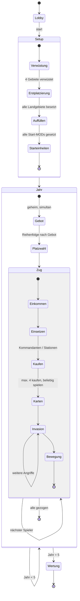
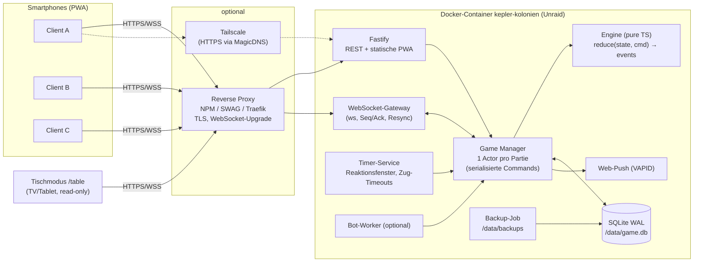
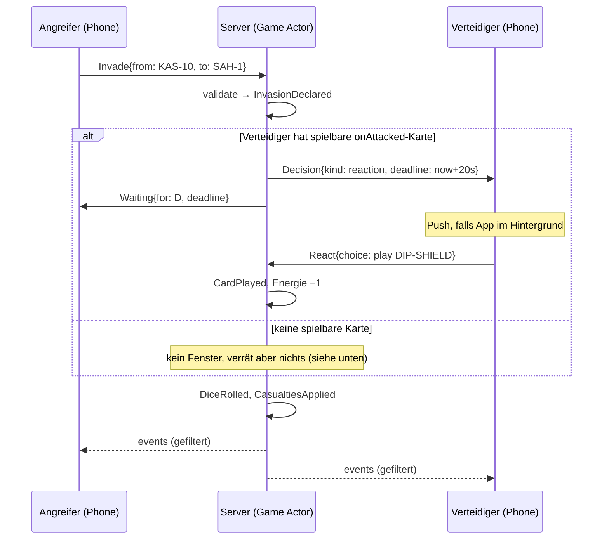

# Konzept: Selbst gehosteter Multiplayer-Server für ein 2210-artiges Strategiespiel (Unraid / Docker, Smartphone-Clients)

**Arbeitstitel:** *Kepler-Kolonien*
**Status:** Konzept v1.0 (2026-11-11). Es ist noch nichts implementiert.
**Zielplattform:** ein einzelner Docker-Container auf Unraid; Clients sind Smartphones (PWA im Browser, keine App-Store-Installation).

---

## Inhalt

0. [Kurzfassung und Kernentscheidungen](#0-kurzfassung-und-kernentscheidungen)
1. [Abgrenzung: Mechanik vs. geschützte Inhalte](#1-abgrenzung-mechanik-vs-geschützte-inhalte)
2. [Quellenlage und Verifikationsstatus der Regeln](#2-quellenlage-und-verifikationsstatus-der-regeln)
3. [Formales Regelmodell](#3-formales-regelmodell)
4. [Spielbrett: Unterlage, Datenmodell, Generator](#4-spielbrett-unterlage-datenmodell-generator)
5. [Kommandokarten: eigenes Kartensystem mit Effekt-DSL](#5-kommandokarten-eigenes-kartensystem-mit-effekt-dsl)
6. [Systemarchitektur](#6-systemarchitektur)
7. [Game-Engine](#7-game-engine)
8. [Netzwerkprotokoll und API](#8-netzwerkprotokoll-und-api)
9. [Client (PWA) und UX für Smartphones](#9-client-pwa-und-ux-für-smartphones)
10. [Persistenz, Backup, Migration](#10-persistenz-backup-migration)
11. [Sicherheit, Zugang, Netzwerk](#11-sicherheit-zugang-netzwerk)
12. [Docker-Image und Unraid-Integration](#12-docker-image-und-unraid-integration)
13. [Betrieb und Observability](#13-betrieb-und-observability)
14. [Teststrategie](#14-teststrategie)
15. [Roadmap und Aufwand](#15-roadmap-und-aufwand)
16. [Risiken, Limitationen, offene Entscheidungen](#16-risiken-limitationen-offene-entscheidungen)
17. [Quellen](#17-quellen)

---

## 0. Kurzfassung und Kernentscheidungen

| Thema | Entscheidung | Begründung / Trade-off |
|---|---|---|
| Spielinhalt | Regelmechanik nach *Risk 2210 A.D.* (Avalon Hill, 2001) als **parametrisierter Regelsatz**. Karte, Namen, Kartentexte und Grafik sind **eigene Inhalte**. | Spielmechaniken sind urheberrechtlich nicht geschützt, Marke, Spielbrett-Grafik und Kartentexte dagegen schon (siehe §1). Durch die Parametrisierung lassen sich Hausregeln und Regelvarianten ohne Codeänderung abbilden. |
| Laufzeit | **Ein** Container: Node.js 22 LTS (TypeScript), Fastify (HTTP) + `ws` (WebSocket), SQLite (WAL) unter `/data` | Kein separater DB-Container nötig, Backup per Dateikopie, sehr geringe Last (< 150 MB RAM). Der Preis ist ein einzelner Schreibprozess. Für private Runden mit weniger als 50 parallelen Partien ist das kein Engpass. |
| Engine | Rein funktionale, deterministische TypeScript-Bibliothek (`state + command → events`), läuft auf Server **und** Client | Der Server ist autoritativ. Der Client nutzt dieselbe Engine nur zur Vorschau (gültige Ziele, Wahrscheinlichkeiten). Ergebnis: eine Codebasis und replaybare Partien. |
| Persistenz | Event-Sourcing (Append-only-Eventlog plus Snapshots) | Lückenloses Audit, Replays, Crash-Sicherheit und Debugging von Regelstreitigkeiten. Etwas mehr Aufwand als reine State-Dumps. |
| Zufall | Server-RNG (ChaCha20) pro Partie mit Seed-Commitment: Der Hash wird beim Start veröffentlicht, der Seed nach Spielende. | Spieler können die Würfel im Nachhinein verifizieren. Keine Würfel auf dem Client, also auch keine Manipulation dort. |
| Client | PWA (React + Vite), SVG-Karte mit Pinch-Zoom, installierbar auf dem Homescreen, Web-Push | Läuft auf iOS und Android ohne App Store. Einschränkung: Push und Installation brauchen HTTPS, siehe §11. |
| Spielmodi | **Live** (alle gleichzeitig am Tisch, Reaktionsfenster in Sekunden) und **Asynchron** (über Tage, Push-Benachrichtigung „du bist dran“) | Beide Modi nutzen dieselbe Engine und unterscheiden sich nur in Timeouts und Benachrichtigung. |
| Tischmodus | Optionale Route `/table` für TV oder Tablet: zeigt die öffentliche Karte groß, private Infos bleiben auf den Handys | Entspricht dem Brettspielgefühl am Tisch. |
| Zugang | Keine Benutzerkonten. Wer eine Partie anlegt, braucht das `ADMIN_PASSWORD`; Spieler treten per Code, Link oder QR bei und erhalten ein Geräte-Token. | Minimaler Betriebsaufwand im Heimnetz. Wird Zugriff von außen gebraucht, laufen Rate-Limiting und Reverse-Proxy oder Tailscale davor (§11). |
| Unraid | Community-Applications-Template (XML), `/data` → `appdata`, Port 8210, PUID/PGID 99/100 | Unraid-Standardkonventionen. |

---

## 1. Abgrenzung: Mechanik vs. geschützte Inhalte

- **„RISK“ und „Risk 2210 A.D.“** sind Marken von Hasbro. Die Grafik des Spielbretts, die Kartentexte, die Artworks und das Regelheft sind urheberrechtlich geschützt.
- **Nicht geschützt** sind Spielmechaniken: Bieten um die Zugreihenfolge, Energie als Währung, Kommandanten mit W8-Würfeln, Wasser- und Mondgebiete, eine Spieldauer von fünf Jahren.
- **Folgerungen für dieses Projekt:**
  1. Es gibt **keine Screenshots oder Scans des Originalbretts** im Repository. Stattdessen enthält es eine **eigene, generierte Spielbrett-Unterlage** (§4) mit derselben *strukturellen* Topologie (42 Land-, 13 Wasser- und 14 Mondgebiete). Dadurch passt das Balancing grob zum Vorbild.
  2. **Kartentexte werden nicht übernommen.** Es gibt ein eigenes Kartensystem mit fünf Decks, das in der Funktion vergleichbar, im Inhalt aber eigenständig ist (§5).
  3. Projekt- und Imagename enthalten weder „Risk“ noch „2210“. Vorschlag: `kepler-kolonien`. Das Repository `risk_docker` sollte vor einer Veröffentlichung umbenannt werden.
  4. Die Regel-Engine ist als **generische Engine für Area-Control-Spiele** angelegt. Karte, Karten und Regelsatz sind austauschbare Inhaltspakete.

---

## 2. Quellenlage und Verifikationsstatus der Regeln

**Methodik und Limitation:** Der Wikipedia-Artikel und die offiziellen Regel-PDFs (Wizards of the Coast, Avalon Hill) waren aus der Recherche-Umgebung nicht direkt abrufbar (Netzwerkrichtlinie). Die Regeln wurden deshalb aus **indizierten Auszügen mehrerer unabhängiger Quellen** zusammengetragen: offizielles Regel-PDF (Auszüge), Wikipedia (Auszüge), BoardGameGeek-Regelzusammenfassung, Rezensionen, Fan-FAQ und Regel-Websites (§17). Jede Regel trägt einen Status:

- ✅ **belegt**: in mindestens zwei Quellen übereinstimmend, davon mindestens einmal offizieller Regeltext
- 🟡 **teilbelegt**: nur eine Quelle oder ein unvollständiger Auszug
- ⚠️ **unverifiziert**: Annahme oder Analogie zu Classic Risk

**Konsequenz:** *Jede* 🟡- oder ⚠️-Regel ist im Regelsatz ein **Parameter** (§3.6). Meilenstein M0 (§15) gleicht alle Parameter gegen ein physisches Regelheft (Avalon-Hill-Ausgabe von 2001) ab, bevor die Engine-Implementierung beginnt.

| # | Regel | Status | Parameter |
|---|---|---|---|
| R1 | 2–5 Spieler, Spiel endet nach 5 Jahren (Runden) | ✅ | `years: 5` |
| R2 | Brett: 42 Landgebiete auf 6 Kontinenten, 13 Wassergebiete in 5 Wasserkolonien, 14 Mondgebiete in 3 Mondkolonien | ✅ | Kartendatei |
| R3 | Jeder Spieler startet mit 3 Energie | ✅ | `startEnergy: 3` |
| R4 | Start-MODs: 3 Spieler 35, 4 Spieler 30, 5 Spieler 25 | 🟡 | `startMods: {3:35,4:30,5:25}` |
| R5 | Setup: 4 Gebietskarten ziehen; diese Landgebiete werden **verwüstet** (unbetretbar) | 🟡 | `devastatedAtSetup: 4` |
| R6 | Platzierung: reihum 1 MOD in leere, nicht verwüstete Landgebiete, bis alle besetzt sind; danach je 3 MODs in eigene Gebiete | 🟡 | `placement.*` |
| R7 | Startaufstellung: je ein Land-Kommandant, ein Diplomat und eine Raumstation | 🟡 | `startUnits` |
| R8 | Jahresbeginn: geheimes Energiegebot; gebotene Energie verfällt komplett; der Höchstbietende wählt seinen Zugplatz frei, dann der Nächste usw. | ✅ | `bidding.*` |
| R9 | Gleichstand beim Gebot: Würfelwurf | 🟡 | `bidding.tieBreak: "roll"` |
| R10 | Zugablauf: MODs und Energie einsammeln → Kommandanten/Stationen kaufen und platzieren → Karten kaufen und spielen → Invasionen → Truppenbewegung | ✅ (Reihenfolge) | `turnPhases` |
| R11 | MOD-Einkommen: ⌊Gebiete / 3⌋, mindestens 3, plus Boni für Kontinente und Kolonien | ⚠️ (Analogie Classic) | `income.mods` |
| R12 | Energie-Einkommen: entspricht dem MOD-Einkommen (eine Quelle nennt eine ⌊…/3⌋-Variante) | ⚠️ widersprüchlich | `income.energy` |
| R13 | Kommandant kostet 3 Energie, Raumstation 5 Energie | ✅ | `costs.*` |
| R14 | Raumstation nur auf eigenem Land, höchstens 1 pro Gebiet, höchstens 4 pro Spieler | ✅ / 🟡 (Max. 4) | `station.*` |
| R15 | Raumstation erzeugt pro Zug 1 MOD in ihrem Gebiet | 🟡 (eine Quelle) | `station.modProduction: 0` (Default aus) |
| R16 | Kommandokarte kostet 1 Energie; Kauf nur aus Decks, deren Kommandant im Spiel ist; höchstens 4 pro Zug; kein Handlimit | ✅ | `cards.*` |
| R17 | Karten haben eigene Aktivierungskosten („Power-up“) und einen Zeitpunkt; manche sind in fremden Zügen spielbar | ✅ | Kartendaten |
| R18 | Gespielte oder aufgedeckte Karten werden nie neu gemischt | ✅ | `cards.reshuffle: false` |
| R19 | Kampf: Angreifer bis 3 Würfel, Verteidiger bis 2, höchste Würfel paarweise vergleichen, Gleichstand gewinnt der Verteidiger | ✅ | – |
| R20 | Kommandanten ersetzen einen W6 durch einen W8: Nuklear überall, Land bei Landzielen, Marine bei Angriff von oder auf Wasser, Raum bei Mondzielen; Diplomat greift mit W6 an | ✅ / 🟡 (Diplomat) | `dice.commanderRules` |
| R21 | Verteidigung: Kommandanten verteidigen mit W8; in einem Gebiet mit Raumstation verteidigen **alle** Einheiten mit W8 | ✅ | `dice.defense*` |
| R22 | Wassergebiete angreifen nur mit Marine-Kommandant | ✅ (Bedingung) / 🟡 (Ort: im Spiel oder im Angriffsgebiet) | `water.requires` |
| R23 | Mond: Invasion nur von einem Gebiet mit Raumstation auf einen Mond-Landeplatz, Raum-Kommandant erforderlich | ✅ | `moon.*` |
| R24 | Mindestens 3 *gegnerisch besetzte* Gebiete in einem Zug erobert → +1 Energie und +1 Karte nach Wahl | ✅ | `conquestBonus.*` |
| R25 | Truppenbewegung am Zugende: eine Bewegung zu einem angrenzenden eigenen Gebiet | ⚠️ (Analogie) | `fortify.mode: "adjacent"` |
| R26 | Wertung nach Jahr 5: 1 Punkt pro Gebiet (Land, Wasser, Mond) + Kontinent- und Kolonieboni + Punkte von Karten (nur mit passendem Kommandant) | 🟡 | `scoring.*` |
| R27 | Zählen Raumstationen in der Wertung? | ⚠️ offen | `scoring.stationPoints: 0` |
| R28 | Zwei-Spieler-Variante mit neutralen MODs | 🟡 (unvollständig) | `twoPlayer.*` |
| R29 | Ausscheiden eines Spielers: Was passiert mit dessen Handkarten? | ⚠️ | `elimination.cards` |
| R30 | Angreifer kann nach erklärtem Angriff nicht abbrechen (versionsabhängig) | 🟡 | `combat.allowRetreat` |

---

## 3. Formales Regelmodell

### 3.1 Spielobjekte

```
Player      { id, color, energy, hand: CardId[], commanders: Map<CommanderType, TerritoryId|null>,
              stations: TerritoryId[], eliminated, turnOrderSlot, conquestsThisTurn }
Territory   { id, type: land|water|moon, region, owner|null, mods: int, commanders: CommanderType[],
              station: bool, devastated: bool, landingSite?: bool }
Commander   ∈ { LAND, NAVAL, SPACE, NUCLEAR, DIPLOMAT }   // max. 1 je Typ und Spieler
Region      { id, kind: continent|waterColony|lunarColony, bonus }
Decks       { [CommanderType]: CardId[] }                   // verdeckt, Reihenfolge = RNG
TerritoryDeck: TerritoryId[]                                 // nur für Verwüstung beim Setup
```

**Invarianten** (werden in jedem Test geprüft):
- Ein Gebiet mit Besitzer enthält ≥ 1 Einheit (MOD oder Kommandant).
- Energie ≥ 0 und MODs ≥ 0.
- In verwüsteten Gebieten gibt es weder Besitzer noch Einheiten.
- Jeder Kommandanten-Typ ist pro Spieler höchstens einmal auf dem Brett.
- Raumstationen stehen nur auf Land, höchstens eine pro Gebiet, höchstens `station.max` pro Spieler.

### 3.2 Ablauf (Zustandsautomat)



**Hinweis Karten-Phase:** In der Engine ist „Karten spielen“ keine harte Phase. Jede Karte trägt ein `timing` (§5). Die UI zeigt nur Karten an, die im aktuellen Zustand spielbar sind. So bleibt der Regelsatz flexibel.

### 3.3 Kampfauflösung

Ablauf einer Invasion von Gebiet A nach Gebiet B:

1. **Zulässigkeit:**
   - A gehört dem Angreifer, B gehört einem Gegner oder ist leer, B ist nicht verwüstet.
   - A und B sind benachbart, oder es besteht eine Spezialverbindung (Station → Landeplatz).
   - In A stehen ≥ 2 Einheiten (mindestens 1 muss zurückbleiben).
   - Ist B ein Wassergebiet, muss ein Marine-Kommandant die Bedingung `water.requires` erfüllen.
   - Ist B ein Mondgebiet und A liegt auf dem Planeten, braucht es eine Station in A, B muss ein Landeplatz sein und ein Raum-Kommandant muss die Bedingung erfüllen.
2. **Ankündigung:** Die Engine gibt das Event `InvasionDeclared` aus. Danach öffnet sich ein **Reaktionsfenster** für den Verteidiger, siehe §7.4.
3. **Würfelzahl:**
   - Angreifer: `a = min(3, units(A) − 1)`.
   - Verteidiger: `d = min(2, units(B))`. Default ist das Maximum; ein Verteidiger kann in den Einstellungen „immer manuell wählen“ aktivieren.
4. **Würfeltypen:**
   - Angreifer: Für jeden **anwesenden** Kommandanten in A, dessen Bedingung zum Ziel passt, wird ein W6 durch einen W8 ersetzt (höchstens a). Die Bedingungen stehen in `dice.commanderRules`.
   - Verteidiger: Jeder anwesende Kommandant ersetzt einen W6 durch einen W8. Steht in B eine Station, würfeln alle Verteidiger mit W8.
5. **Vergleich:** Würfel absteigend sortieren und paarweise vergleichen. Höherer Wert gewinnt; bei Gleichstand gewinnt der Verteidiger.
6. **Verluste:**
   - Der Verlierer entfernt Einheiten. Default ist **MODs zuerst**; Kommandanten fallen erst, wenn keine MODs mehr da sind.
   - Die Reihenfolge ist pro Spieler einstellbar (`casualtyPolicy`); optional kann ein Prompt erscheinen.
   - Gefallene Kommandanten kehren in den Kaufpool zurück und können für 3 Energie neu angeheuert werden.
7. **Eroberung:**
   - Ist B leer, zieht der Angreifer mindestens so viele Einheiten nach, wie Würfel im letzten Wurf geworfen wurden (höchstens `units(A) − 1`). Kommandanten können mitziehen.
   - Eine **gegnerische Station** in B wird zerstört und durch eine eigene ersetzt (R14 / Quelle: Wizards-Auszug), sofern `station.captureMode = "replace"` gesetzt ist.
   - `conquestsThisTurn++` zählt nur, wenn B vorher besetzt war (R24).
8. **„Blitz“-Option:** Automatisch wiederholen, bis eine der Bedingungen eintritt: B erobert, Angreifer hat nur noch ≤ k Einheiten (`k` wählbar), oder ein Reaktionsfenster öffnet sich. Jeder Einzelwurf landet trotzdem im Eventlog.

**Beispielrechnung** (in den Wireframes verwendet, Monte-Carlo mit 200 000 Läufen): Angreifer mit 6 MODs und Land-Kommandant (1×W8 + 2×W6) gegen 2 MODs (2×W6). Der Verteidiger verliert im Einzelwurf mit P ≈ 0,47 beide Einheiten. P(Eroberung im Blitz, Abbruch bei 2 verbleibenden Einheiten) ≈ 0,96. Der Client zeigt solche Werte live an; sie werden exakt per Markov-Kette berechnet (§9.3).

### 3.4 Einkommen und Wertung (Default, parametrisiert)

```
mods(p)   = max(income.minMods, floor(ownedTerritories(p) / income.divisor)) + Σ regionBonus(p)
energy(p) = income.energy == "equalMods"  ? mods(p)
          : income.energy == "divided"    ? floor(mods(p) / 3) + Σ regionBonus(p)
score(p)  = ownedTerritories(p) + Σ regionBonus(p) + Σ scoreCards(p | Kommandant im Spiel)
          + scoring.stationPoints × stations(p)
```

- `ownedTerritories` zählt Land, Wasser und Mond. Ob Wasser- und Mondgebiete beim *Einkommen* mitzählen, regelt `income.countWaterMoon` (⚠️).
- Gleichstand bei der Wertung wird über `scoring.tieBreak` aufgelöst: `["energy", "territories", "shared"]`.

### 3.5 Varianten (im Regelsatz schaltbar)

- **2 Spieler:** Ein neutraler Spieler besetzt Gebiete beim Setup. Er verteidigt, greift nie an und bietet nie (R28; Details folgen nach Regelheft-Abgleich).
- **Alternierende Phasen:** Alle Spieler durchlaufen jede Phase reihum (Fan-Variante, Quelle: donohoe.info). Das verkürzt Wartezeiten im Asynchron-Modus.
- **Schnellspiel:** 3 Jahre, mehr Start-Energie.
- **Komponentenlimit:** Die Anzahl von MODs, Kommandanten und Stationen ist auf die Bestände der Brettspielbox begrenzt. Default ist **aus**.

### 3.6 Regelsatz-Datei (Beispiel)

```yaml
# content/rulesets/klassisch-2210.yaml
id: klassisch-2210
version: 1
years: 5
players: { min: 2, max: 5 }
startEnergy: 3
startMods: { 2: 40, 3: 35, 4: 30, 5: 25 }   # 2er-Wert ⚠️ Platzhalter bis M0
devastatedAtSetup: 4
placement: { firstRound: 1, thenPerTurn: 3, landOnly: true }
startUnits: { commanders: [LAND, DIPLOMAT], stations: 1 }
bidding: { secret: true, refund: false, tieBreak: roll, highestPicksAnySlot: true }
income:
  minMods: 3
  divisor: 3
  energy: equalMods            # equalMods | divided  (⚠️ R12)
  countWaterMoon: true         # ⚠️
costs: { commander: 3, station: 5, card: 1 }
station: { max: 4, perTerritory: 1, landOnly: true, modProduction: 0, captureMode: replace }
cards: { maxBuyPerTurn: 4, handLimit: null, reshuffle: false, requireCommanderInPlay: true }
conquestBonus: { threshold: 3, energy: 1, cards: 1, onlyOccupied: true }
dice:
  attack: { maxDice: 3 }
  defense: { maxDice: 2, commanderD8: true, stationAllD8: true }
  commanderRules:
    LAND:     { attackD8When: "target.type == 'land'" }
    NAVAL:    { attackD8When: "source.type == 'water' || target.type == 'water'" }
    SPACE:    { attackD8When: "target.type == 'moon'" }
    NUCLEAR:  { attackD8When: "true" }
    DIPLOMAT: { attackD8When: "false" }
water: { requires: "NAVAL in play" }          # alternativ: "NAVAL in source"
moon:  { requires: "SPACE in play", launchFrom: "ownStation", target: "landingSite" }
fortify: { mode: adjacent, movesPerTurn: 1 }  # adjacent | connectedPath
combat: { allowRetreat: true, casualtyDefault: modsFirst }
scoring: { perTerritory: 1, regionBonus: true, stationPoints: 0, tieBreak: [energy, territories, shared] }
elimination: { cards: toConqueror }           # ⚠️ discard | toConqueror
```

Jede Partie speichert **ihre** Regelsatz-Version. Spätere Änderungen am Regelsatz betreffen laufende Partien nicht.

---

## 4. Spielbrett: Unterlage, Datenmodell, Generator

### 4.1 Planetenbrett (eigenes Design)


*Datei: [`assets/board/planet.svg`](assets/board/planet.svg) (Vektor, Grundlage für den Client), PNG nur als Vorschau.*

| Region | Typ | Gebiete | Bonus |
|---|---|---|---|
| Borea (BOR) | Kontinent | 9 | +4 |
| Vellor (VEL) | Kontinent | 7 | +4 |
| Kaskadia (KAS) | Kontinent | 10 | +6 |
| Meridia (MER) | Kontinent | 6 | +3 |
| Sahari (SAH) | Kontinent | 6 | +3 |
| Insula (INS) | Kontinent | 4 | +2 |
| Nordmeer, Pelagia, Abyssos (NOR/PEL/ABY) | Wasserkolonie | je 3 | +2 |
| Korallensee, Südmeer (KOR/SUD) | Wasserkolonie | je 2 | +2 |
| **Summe** | | **42 Land + 13 Wasser** | |

Topologie-Merkmale:
- **Zylinderwelt:** Die Karte ist an der Ost-West-Kante verbunden. Die Verbindungen sind durch ◀ ▶ markiert und betreffen hier nur Wassergebiete.
- **Seewege** (gestrichelt) verbinden isolierte Kontinente für Landinvasionen ohne Marine-Kommandant: BOR-8 ↔ MER-3 und VEL-7 ↔ INS-1.
- Wassergebiete grenzen an Küstengebiete. Über sie öffnen sich mit Marine-Kommandant zusätzliche Angriffswege, zum Beispiel KOR-1 Riffbank an KAS, SAH und INS.

### 4.2 Mondbrett (eigenes Design)


| Region | Gebiete | Bonus | Landeplatz |
|---|---|---|---|
| Selene-Hochland (HOC) | 5 | +3 | HOC-1 Landeplatz Alpha |
| Mare Tenebris (TEN) | 5 | +3 | TEN-1 Landeplatz Beta |
| Polarkappe (POL) | 4 | +3 | POL-1 Landeplatz Gamma |

Verbindung Planet ↔ Mond: von jeder eigenen Raumstation zu **jedem** Landeplatz. Das ist eine virtuelle Kante (`specialLinks.orbital`), keine geometrische Nachbarschaft.

### 4.3 Bonusberechnung

Die Boni stammen aus einer Heuristik, die an Classic-Risk-Kontinentwerten kalibriert wurde: `bonus = round(0,4 · Gebiete + 0,4 · Grenzgebiete)`, Minimum 1. Die Werte sind ein **Startpunkt fürs Balancing**. Sie sollten mit Bot-gegen-Bot-Simulationen geprüft werden (§14: Gewinnrate je Startregion) und stehen editierbar in `map.json`.

### 4.4 Datenformat `map.json` (Auszug)

```json
{
  "schema": "map/v1",
  "id": "kepler-colonies",
  "boards": [
    { "id": "planet", "width": 2000, "height": 1000, "svg": "planet.svg", "wrapX": true },
    { "id": "moon", "width": 1000, "height": 1000, "svg": "moon.svg" }
  ],
  "regions": [ { "id": "KAS", "name": "Kaskadia", "kind": "continent", "bonus": 6, "borderTerritories": 4 } ],
  "territories": [
    { "id": "KAS-10", "name": "Donnerkamm", "type": "land", "region": "KAS", "board": "planet",
      "label": [1021, 669], "adjacent": ["ABY-3","KAS-6","KAS-7","KAS-8","KAS-9","KOR-1","SAH-1"] },
    { "id": "HOC-1", "name": "Landeplatz Alpha", "type": "moon", "region": "HOC", "board": "moon",
      "landingSite": true, "label": [487, 117], "adjacent": ["HOC-2","HOC-3","HOC-4"] }
  ],
  "seaLanes": [["BOR-8","MER-3"], ["VEL-7","INS-1"]],
  "specialLinks": [ { "kind": "orbital", "from": "anySpaceStation", "to": "landingSites",
                      "requires": "spaceCommanderInPlay" } ]
}
```

Die Pfad-IDs im SVG entsprechen den Territorien-IDs (`<path id="KAS-10" …>`). Der Client lädt das SVG und färbt per CSS, eine zweite Geometriequelle gibt es nicht.

### 4.5 Generator

[`tools/board-generator/generate_board.py`](../tools/board-generator/generate_board.py) arbeitet deterministisch (Seed 2210):
1. Voronoi-Zellen mit Lloyd-Relaxation erzeugen.
2. Landmasken aus verrauschten Ellipsen ableiten.
3. Regionen balanciert wachsen lassen (Multi-Source-Region-Growing).
4. Adjazenzen über gemeinsame Zellkanten bestimmen, Seewege per Kruskal setzen, damit der Landgraph zusammenhängt.

[`generate_mockups.py`](../tools/board-generator/generate_mockups.py) erzeugt die Wireframes in §9.

Validierung beim Generieren: keine isolierten Gebiete, keine zerstückelten Polygone, Zielgrößen 42/13/14 eingehalten.

```bash
pip install numpy scipy shapely
python3 tools/board-generator/generate_board.py docs/assets/board
python3 tools/board-generator/generate_mockups.py docs/assets/board docs/assets/ui
```

Eigene Karten lassen sich ebenfalls laden, wenn sie gegen dasselbe Schema validieren. Ein Editor ist nicht Teil von v1.

---

## 5. Kommandokarten: eigenes Kartensystem mit Effekt-DSL

### 5.1 Struktur

Es gibt fünf Decks (Land, Marine, Raum, Nuklear, Diplomat) mit je **12–14 Karten**, insgesamt etwa 65. Jede Karte hat:

```yaml
- id: DIP-SHIELD
  deck: DIPLOMAT
  name: Schildgenerator
  activationCost: 1            # „Power-up“-Kosten beim Ausspielen
  timing: onAttacked           # playPhase | turnStart | onAttack | onAttacked | onConquered | instant | endOfGame
  requires: { commanderInPlay: DIPLOMAT, target: "defendingTerritory" }
  effect:
    - modifyDice: { side: defender, allTo: D8, scope: currentInvasion }
  text: "Bei Angriff auf dich: Der Verteidiger würfelt in dieser Invasion ausschließlich mit W8."
```

**Effekt-Primitiven der DSL** (kombinierbar, alle deterministisch über den Engine-RNG):
`addMods`, `removeMods`, `addEnergy`, `transferEnergy`, `modifyDice`, `limitDice`, `moveUnits`, `extendAdjacency`, `blockAttacks`, `devastate`, `destroyStation`, `drawCards`, `scorePoints`, `requireChoice` (Prompt an einen anderen Spieler), `roll` (Zwischenwurf mit Bedingung).

Bedingungen werden in einer kleinen, **sandboxed** Ausdruckssprache formuliert (z. B. `jexl` oder ein eigener Parser), **nicht als JavaScript-`eval`**.

### 5.2 Beispielkarten (eigene Inhalte, Balancing vorläufig)

| Deck | Karte | Kosten | Timing | Effekt |
|---|---|---|---|---|
| Land | Gezielte Mobilisierung | 0 | playPhase | +3 MODs in ein Gebiet mit eigenem Land-Kommandanten |
| Land | Tarnfeld | 2 | onAttacked | +2 MODs aus dem Vorrat in das angegriffene Landgebiet |
| Land | Grabenkrieg | 1 | onAttacked | Angreifer würfelt in dieser Invasion höchstens mit 2 Würfeln |
| Marine | Tiefsee-Raffinerie | 0 | turnStart | +1 Energie je eigenem Wassergebiet (max. 4) |
| Marine | Strömungsvorstoß | 1 | playPhase | In diesem Zug grenzen eigene Wassergebiete an alle Gebiete derselben Wasserkolonie |
| Marine | Minenfeld | 2 | onAttacked (Wasser) | Angreifer verliert vor dem ersten Wurf 1 MOD |
| Raum | Orbitaler Nachschub | 2 | playPhase | +3 MODs auf eine eigene Raumstation |
| Raum | Notevakuierung | 3 | onConquered (Station) | Bis zu 3 Einheiten auf eine andere eigene Station verlegen |
| Raum | Mondbasis-Ausbau | 1 | playPhase | Markiert ein eigenes Mondgebiet: +1 Wertungspunkt, solange es gehalten wird |
| Nuklear | Präzisionsschlag | 2 | playPhase | Gebiet in Reichweite 2: 3×W6, je 5–6 → −1 MOD |
| Nuklear | Flächenbombardement | 4 | playPhase | Alle Einheiten eines Gebiets halbiert (abgerundet); 1–2 auf W6 → Gebiet wird verwüstet |
| Nuklear | Abschreckung | 1 | onAttacked | Angreifer zahlt 1 Energie oder bricht ab (Prompt an den Angreifer) |
| Diplomat | Schildgenerator | 1 | onAttacked | Verteidiger würfelt nur mit W8 |
| Diplomat | Waffenstillstand | 2 | playPhase | Gewählter Spieler darf dich bis zu deinem nächsten Zug nicht angreifen |
| Diplomat | Handelsabkommen | 0 | playPhase | Du und ein Mitspieler erhaltet je 2 Energie (Zustimmung per Prompt) |

**Balancing-Vorgehen:** Bot-Simulationen (≥ 10 000 Partien je Iteration) messen pro Karte Ausspielrate, Gewinnrate bei Besitz und Δ-Score. Karten mit ΔGewinnrate > 5 Prozentpunkte werden angepasst.

---

## 6. Systemarchitektur



### 6.1 Repository-Struktur (Monorepo, pnpm Workspaces)

```
/packages
  /engine        # pure TS, keine I/O; Regeln, Kampf, Karten-DSL, Projektionen, RNG
  /protocol      # zod-Schemas für Commands, Events, WS-Nachrichten (Server + Client)
  /content       # map.json, SVGs, cards/*.yaml, rulesets/*.yaml + JSON-Schema-Validierung
  /bots          # Heuristik-Bots (gleiche Command-Schnittstelle wie Menschen)
/apps
  /server        # Fastify, ws, SQLite, Timer, Push, Backup, Migrationen
  /client        # React + Vite PWA, SVG-Karte, Service Worker
/tools
  /board-generator
/deploy
  Dockerfile, docker-compose.yml, unraid/kepler-kolonien.xml
/docs
```

### 6.2 Technologieauswahl und Alternativen

| Baustein | Wahl | Alternative | Warum nicht |
|---|---|---|---|
| Sprache | TypeScript (Server + Client) | Python (FastAPI) + TS-Client | Die Regel-Engine müsste dann doppelt existieren, die Vorschau auf dem Client wäre unsauber |
| HTTP | Fastify | Express, Hono | Express ist langsamer und hat ein schwächeres Typing; Hono wäre ebenfalls okay |
| Realtime | `ws` + eigenes Seq/Ack-Protokoll | Socket.IO | Socket.IO bringt Fallbacks und Overhead, die hier nicht gebraucht werden; Resync-Semantik soll selbst kontrolliert werden |
| DB | SQLite (better-sqlite3, WAL) | PostgreSQL-Container | Zweiter Container und mehr Betriebsaufwand bringen bei dieser Last keinen Nutzen |
| Client | React + Vite + Zustand | SvelteKit, Flutter | Svelte ginge auch (kleineres Bundle); Flutter bräuchte App-Store oder Sideloading |
| Kartengrafik | Inline-SVG + CSS, Gesten mit `@use-gesture` | Canvas/WebGL (Pixi) | 69 Polygone sind für SVG trivial; SVG ist barrierearm und skaliert sauber |

---

## 7. Game-Engine

### 7.1 Kernschnittstelle

```ts
type Command =
  | { t: "Bid"; amount: number }
  | { t: "PickSlot"; slot: number }
  | { t: "Deploy"; placements: Record<TerritoryId, number> }
  | { t: "HireCommander"; type: CommanderType; territory: TerritoryId }
  | { t: "BuildStation"; territory: TerritoryId }
  | { t: "BuyCards"; decks: CommanderType[] }               // ≤ 4 pro Zug gesamt
  | { t: "PlayCard"; card: CardId; targets?: TargetSpec }
  | { t: "Invade"; from: TerritoryId; to: TerritoryId; dice?: number; blitz?: { minRemaining: number } }
  | { t: "Advance"; units: UnitSelection }                  // Nachziehen nach Eroberung
  | { t: "React"; decisionId: string; choice: ReactionChoice } // Karte spielen | pass
  | { t: "Fortify"; from: TerritoryId; to: TerritoryId; units: UnitSelection }
  | { t: "EndPhase" } | { t: "EndTurn" };

interface Engine {
  validate(state: GameState, actor: PlayerId, cmd: Command): ValidationResult; // ohne Seiteneffekte
  decide(state: GameState, actor: PlayerId, cmd: Command, rng: Rng): DomainEvent[];
  apply(state: GameState, ev: DomainEvent): GameState;   // reiner Reducer
  project(state: GameState, viewer: PlayerId | "public"): PlayerView; // Informationsfilter
  legalActions(state: GameState, actor: PlayerId): ActionHint[];       // für die UI
}
```

- `decide` erzeugt Events und verbraucht dabei RNG-Werte. `apply` ist deterministisch und RNG-frei. Würfelergebnisse stehen deshalb **im Event** (`DiceRolled{att:[8,5,2], def:[6,1]}`) und ein Replay ist ohne RNG möglich.
- **Pending Decisions:** Der Zustand enthält eine Warteschlange `pending: Decision[]`. Jede Decision hat `id`, `player`, `kind`, `options`, `deadline` und `default`. Solange sie nicht leer ist, akzeptiert die Engine nur `React`-Commands der betroffenen Spieler. So werden Unterbrechungen sauber modelliert: Reaktionskarten, Zustimmungs-Prompts, Verlustauswahl.

### 7.2 Zufall und Fairness

- Beim Partiestart erzeugt der Server `seed = CSPRNG(32 Byte)` und veröffentlicht `commitment = SHA-256(seed)` im Spiel-Log.
- Würfel kommen aus einem ChaCha20-Stream; jede Ziehung erhält einen fortlaufenden Index. Kartenstapel werden per Fisher-Yates mit demselben Stream gemischt.
- Nach Spielende wird der Seed offengelegt. Jeder Client kann alle Würfe und Mischungen lokal nachrechnen („Fair-Play-Check“ im Log-Tab).
- Limitation: Das schützt Spieler vor manipulierten Würfeln, **nicht** vor dem Server-Admin. Der kennt den Seed während der Partie. Für private Runden ist das vertretbar; dokumentiert wird es trotzdem.

### 7.3 Verdeckte Informationen

| Information | Sichtbar für |
|---|---|
| Handkarten | Besitzer; andere sehen nur die Anzahl und das Deck jeder Karte (Rückseite) |
| Gebote | Bis alle geboten haben: nur „abgegeben ja/nein“. Danach alle (gebotene Energie ist öffentlich verbraucht) |
| Deck-Reihenfolge, RNG-Seed | niemand (Seed nach Spielende) |
| Energie | öffentlich (konfigurierbar: `hiddenEnergy`) |

`project()` ist die **einzige** Stelle, über die Zustand den Server verlässt. Der Test „keine Projektion enthält fremde Handkarten-IDs“ läuft als Property-Test über zufällige Partien (§14).

### 7.4 Reaktionsfenster: die schwierigste UX-Stelle



Kernprobleme und Lösungen:

1. **Informationsleck:** Öffnet sich das Fenster nur, wenn der Verteidiger eine spielbare Karte hat, verrät schon das Warten die Hand.
   - Lösung: `reactionWindow.policy = "always" | "ifPlayable" | "auto"`. Default im Live-Modus ist **`always` mit kurzer Mindestdauer (3 s)**, sobald der Verteidiger überhaupt Handkarten hat.
   - Im Asynchron-Modus ist der Default **`auto`**: Der Spieler hinterlegt vorab **Reaktionsregeln**, z. B. „Spiele Schildgenerator, wenn ein Gebiet mit ≥ 3 MODs angegriffen wird und Energie ≥ 2“. Die Engine wertet die Regeln synchron aus, ohne zu warten.
2. **Blitz-Angriffe** würden pro Wurf ein Fenster öffnen. Lösung: Ein Fenster pro Invasion, nicht pro Wurf. Karten mit Wirkung „diese Invasion“ gelten für alle Folgewürfe.
3. **Timeouts:** Nach Ablauf der Deadline greift `default = pass`. Live gilt eine Deadline von 20 s, asynchron von 2 h; beides ist pro Partie einstellbar.

### 7.5 Konsistenz und Nebenläufigkeit

- **Ein Actor pro Partie** (In-Memory-Queue): Commands werden strikt seriell verarbeitet. Es gibt keine Locks über Partien hinweg.
- **Optimistische Version:** Jeder Command trägt `expectedVersion`. Bei einem Konflikt antwortet der Server mit `Rejected{reason: "stale", currentVersion}` und der Client resynct.
- **Idempotenz:** Jeder Command trägt `clientCmdId` (UUIDv7). Mobile Retries nach Funklöchern führen so nicht zu Doppelangriffen; der Server speichert diese IDs 24 h.
- **Undo:** Erlaubt nur innerhalb der aktuellen Phase und nur bis zum letzten Event, das Zufall oder verdeckte Information enthält (Würfel, gezogene Karte, aufgedecktes Gebot). In Live-Partien lässt sich Undo komplett abschalten.

### 7.6 Bots

Die Bot-Schnittstelle entspricht der eines Menschen: `onDecision(view: PlayerView) → Command`.
- Stufe 1: Gierige Heuristik. Sie verstärkt Grenzen, greift bei positiver Erwartung an und kauft Karten nach einer Prioritätsliste.
- Stufe 2: Monte-Carlo-Rollouts für Invasionsentscheidungen und Bieten.

Bots spielen den neutralen Spieler in der 2er-Variante, füllen Partien auf und dienen als **Balancing-Werkzeug**.

---

## 8. Netzwerkprotokoll und API

### 8.1 REST

| Methode | Pfad | Zweck |
|---|---|---|
| `POST` | `/api/games` | Partie anlegen (Header `X-Admin-Password`, Body: Regelsatz, Karte, Modus, Timeouts) → `{gameId, joinCode, hostToken}` |
| `POST` | `/api/join` | `{joinCode, name, color}` → `{gameId, playerId, playerToken}` (Rate-Limit, siehe §11) |
| `GET` | `/api/games/:id/view` | Projizierter Zustand für das Token (Fallback ohne WebSocket) |
| `GET` | `/api/games/:id/log?from=` | Gefiltertes Eventlog (paginiert) |
| `GET` | `/api/games/:id/fairness` | Commitment, nach Spielende auch Seed |
| `POST` | `/api/push/subscribe` | Web-Push-Subscription speichern |
| `GET` | `/api/content/maps/:id` | Kartendaten und SVGs (immutable, gecacht) |
| `GET` | `/healthz`, `/readyz` | Docker-Healthcheck |
| `GET` | `/metrics` | Prometheus (optional, per Env aktivierbar) |

### 8.2 WebSocket `/ws`

Verbindung mit `Sec-WebSocket-Protocol: kk.v1, token.<playerToken>`. Das Token steht damit nicht in der URL und landet nicht in Proxy-Logs.

```jsonc
// Client → Server
{ "type": "hello", "gameId": "g_01J…", "lastSeq": 412 }
{ "type": "cmd", "clientCmdId": "0190…", "expectedVersion": 412,
  "cmd": { "t": "Invade", "from": "KAS-10", "to": "SAH-1", "blitz": { "minRemaining": 2 } } }
{ "type": "ping" }

// Server → Client
{ "type": "welcome", "version": 415, "view": { /* projizierter Snapshot */ } }   // wenn lastSeq zu alt
{ "type": "events", "fromSeq": 413, "events": [ /* gefilterte Events */ ], "version": 415 }
{ "type": "decision", "decision": { "id": "d_77", "kind": "reaction", "deadline": "…", "options": [ … ] } }
{ "type": "ack", "clientCmdId": "0190…", "ok": true }
{ "type": "rejected", "clientCmdId": "0190…", "reason": "illegal|stale|notYourTurn", "detail": "…" }
{ "type": "presence", "players": { "p2": "online", "p3": "background" } }
```

- Herzschlag alle 25 s. Proxys schließen inaktive Verbindungen oft nach 60 s.
- **Resync:** Hat der Server Events ab `lastSeq` noch im Ringpuffer (500 Events), schickt er sie als Delta, sonst einen kompletten projizierten Snapshot.
- Mobilgeräte schließen WebSockets im Hintergrund. Beim `visibilitychange → visible` baut der Client sofort neu auf und sendet `hello{lastSeq}`.

---

## 9. Client (PWA) und UX für Smartphones

### 9.1 Wireframes


*Vektordatei: [`assets/ui/mobile-wireframes.svg`](assets/ui/mobile-wireframes.svg). Screen 2 zeigt einen echten Ausschnitt des generierten Planetenbretts.*

| Screen | Inhalt | UX-Regeln |
|---|---|---|
| 1 Lobby | Beitrittscode, QR, Spielerliste mit Status, Einstellungen | Der Host sieht „Partie starten“ erst, wenn alle bereit sind; Bots lassen sich per Tap hinzufügen |
| 2 Karte | Kopfzeile (Jahr, Phase, Zugplatz), Ressourcen-Chips, SVG-Karte, Bottom Sheet für die Aktion | **Tap-Quelle → gültige Ziele leuchten → Tap-Ziel → Bottom Sheet**. Würfelvorschau inklusive W8-Ersetzungen und exakter Wahrscheinlichkeiten. Kein Drag & Drop, weil es auf kleinen Displays zu fehleranfällig ist |
| 3 Reaktion | Alarmkarte mit Countdown, nur spielbare Karten aktiv, Begründung bei inaktiven | Großer Primärbutton, „Nicht reagieren“ sekundär; Vibration (Android); Push, wenn die App im Hintergrund ist |
| 4 Kaufen & Hand | Kommandanten-Status (im Spiel / kaufen / gefallen), Station, Decks (gesperrt ohne Kommandant), Hand mit Spielbarkeit | Kaufzähler 1/4; Karten zeigen *warum* sie nicht spielbar sind |
| 5 Gebot | Slider, verfügbare Energie, Status der Mitspieler ohne Beträge | Zweistufige Bestätigung, weil das Gebot verbindlich ist und verfällt |

### 9.2 Kartenansicht im Detail

- Kartenumschalter **Planet ⇄ Mond** per Segment-Control oder Wisch. Ein Badge zeigt Aktivität auf dem Mond.
- Pinch-Zoom und Pan mit Trägheit. Doppeltipp zoomt auf ein Gebiet.
- Ost-West-Umlauf: Beim Pannen über die Kante wird die Karte nahtlos wiederholt (zwei SVG-Instanzen nebeneinander).
- Einheiten-Badges (Zahl) erscheinen in der Besitzerfarbe; Kommandanten als Buchstaben-Chip (L/M/R/N/D), Stationen als Raute.
- **Farbenblindheit:** Jede Spielerfarbe hat zusätzlich ein Muster (Schraffur, Punkte, Karo …) und ein Symbol im Badge. Paletten sind auf CVD-Unterscheidbarkeit geprüft.
- Verwüstete Gebiete sind grau schraffiert und tragen die Beschriftung „VERWÜSTET“.
- Die letzte Aktion jedes Gegners wird per Animation (Pfeil, Würfel) auf der Karte nachgespielt („Was ist passiert, seit ich weg war?“).

### 9.3 Wahrscheinlichkeiten

Die Kampfwahrscheinlichkeiten werden exakt berechnet: als Markov-Kette über die Zustände (Angreifer, Verteidiger), wobei die Übergangswahrscheinlichkeiten je Würfelkonstellation (W6/W8-Mischungen) per Enumeration vorab ermittelt und gecacht werden. Das ist auf dem Client in < 5 ms möglich. Keine Monte-Carlo-Simulation im UI, also kein Rauschen in der Anzeige.

### 9.4 PWA-Spezifika

- Ein Service Worker cached die App-Shell und die Kartenassets (immutable, mit Hash im Dateinamen). Spielzustand wird **nie** offline geändert, Commands brauchen eine Verbindung. Offline zeigt die App ein Banner und den letzten Stand nur lesend.
- **Web Push:**
  - Android/Chrome funktioniert direkt.
  - iOS/iPadOS ab 16.4 nur, wenn die PWA **zum Homescreen hinzugefügt** wurde. Das Onboarding enthält dafür eine Anleitung.
  - Push setzt HTTPS voraus (§11).
- Wake Lock im Live-Modus optional, damit der Bildschirm am Tisch nicht ausgeht.
- Sprache: Deutsch als Primärsprache, Englisch vorbereitet (i18n-Keys).

### 9.5 Tischmodus `/table`

Read-only-Projektion `public`: große Karte, Zugreihenfolge, Gebotsergebnisse, Würfelanimationen, Wertungstabelle. Der Zugang läuft über einen separaten `tableToken` mit QR-Code in der Lobby. Gedacht für Fire-TV- oder Chromecast-Browser bzw. ein Tablet.

---

## 10. Persistenz, Backup, Migration

### 10.1 Schema (SQLite)

```sql
CREATE TABLE games (
  id TEXT PRIMARY KEY, created_at INTEGER, status TEXT,          -- lobby|running|finished|aborted
  ruleset_id TEXT, ruleset_version INTEGER, map_id TEXT, content_hash TEXT,
  mode TEXT, settings_json TEXT, seed_commitment TEXT, seed_enc BLOB, -- Seed AES-GCM-verschlüsselt (Key in /data/secret.key)
  version INTEGER NOT NULL DEFAULT 0
);
CREATE TABLE players (
  id TEXT PRIMARY KEY, game_id TEXT REFERENCES games(id), name TEXT, color TEXT,
  token_hash TEXT, is_bot INTEGER, reaction_rules_json TEXT, joined_at INTEGER
);
CREATE TABLE events (
  game_id TEXT, seq INTEGER, type TEXT, payload_json TEXT, schema_v INTEGER, ts INTEGER,
  PRIMARY KEY (game_id, seq)
) WITHOUT ROWID;
CREATE TABLE snapshots (game_id TEXT, seq INTEGER, state_json TEXT, PRIMARY KEY (game_id, seq));
CREATE TABLE commands_seen (game_id TEXT, client_cmd_id TEXT, ts INTEGER, PRIMARY KEY (game_id, client_cmd_id));
CREATE TABLE push_subscriptions (player_id TEXT, endpoint TEXT PRIMARY KEY, keys_json TEXT, created_at INTEGER);
CREATE TABLE timers (game_id TEXT, decision_id TEXT PRIMARY KEY, due_at INTEGER, kind TEXT);
```

- Snapshot alle 100 Events. Der Recovery-Pfad lautet: letzter Snapshot plus Events danach.
- Eine typische Partie umfasst etwa 1 500–4 000 Events, also ≈ 0,5–2 MB. Selbst Hunderte Partien sind unkritisch.
- Timer stehen persistent in der Datenbank. Nach einem Container-Neustart werden fällige Timer sofort ausgeführt; der Ablauf der Deadline zählt nach Wanduhr.

### 10.2 Backup

- Täglicher Job über die SQLite Online-Backup-API (konsistent, auch während des Spiels) nach `/data/backups/game-YYYYMMDD.db`. Aufbewahrung: `BACKUP_RETENTION_DAYS` (Default 14).
- Empfehlung für Unraid: `appdata` zusätzlich mit dem Plugin *Appdata Backup* sichern. Der Container braucht dafür nicht gestoppt zu werden, weil der WAL-Checkpoint vor dem Backup läuft.
- Export einer Partie als `.kkgame` (JSON: Header + Events + Content-Hash), z. B. zum Archivieren oder für Bug-Reports.

### 10.3 Migrationen und Versionierung

- DB-Migrationen laufen beim Start in einer Transaktion, mit Versionstabelle (`umzug` oder eigene).
- **Event-Upcaster:** Events tragen `schema_v`. Neue Engine-Versionen bringen Upcaster für alte Events mit, sodass laufende Partien ein Update überleben.
- **Content-Pinning:** Jede Partie referenziert `ruleset_version` und `content_hash`. Das Image enthält alle bisherigen Content-Versionen (klein, wenige 100 KB).

---

## 11. Sicherheit, Zugang, Netzwerk

### 11.1 Zugangsmodell

| Rolle | Nachweis | Rechte |
|---|---|---|
| Server-Admin | `ADMIN_PASSWORD` (Env) | Partien anlegen, löschen, abbrechen; Spieler ersetzen (z. B. durch einen Bot); Backups |
| Host | `hostToken` (je Partie) | Lobby verwalten, Einstellungen ändern, Partie pausieren |
| Spieler | `playerToken` (256 bit, gespeichert als SHA-256-Hash) | eigene Commands, eigene Projektion |
| Tisch | `tableToken` | Projektion `public`, nur lesend |

- Tokens liegen im Client im `localStorage`. Ein „Gerät wechseln“-Link (Einmal-Link, 10 min gültig) überträgt die Identität auf ein anderes Gerät.
- Beitrittscode: 6 Zeichen aus 32 Symbolen (≈ 30 bit), gültig nur in der Lobby-Phase. Rate-Limit 10 Versuche pro Minute und IP.
- Eingaben werden strikt per zod-Schema validiert; Commands haben maximal 16 KB. CSP-Header, keine Inline-Skripte.

### 11.2 Netzwerkvarianten

| Variante | Setup | PWA-Install / Push | Empfehlung |
|---|---|---|---|
| **A: nur LAN, HTTP** | `http://unraid:8210` | ❌ Service Worker und Push brauchen einen Secure Context; das Spiel läuft trotzdem im Browser | Für den Spieleabend am selben WLAN ausreichend |
| **B: LAN + eigene Domain mit TLS** | Nginx Proxy Manager oder SWAG auf Unraid; Let's-Encrypt-Zertifikat per **DNS-Challenge** (funktioniert ohne offenen Port); lokaler DNS-Override (z. B. in der Fritz!Box oder in Pi-hole) | ✅ | Bestes Erlebnis im Heimnetz |
| **C: Tailscale** | Tailscale-Plugin auf Unraid + `tailscale serve --https=443 http://localhost:8210`; Mitspieler per Einladung (Node-Sharing) | ✅ (gültiges `*.ts.net`-Zertifikat) | **Empfohlen für Mitspieler außerhalb des Hauses**, weil kein Port geöffnet werden muss |
| D: öffentlich per Port-Forward | Reverse Proxy + TLS + Fail2ban/CrowdSec, `ADMIN_PASSWORD` Pflicht | ✅ | Nur bei Bedarf; größte Angriffsfläche |

Konfiguration für den Reverse Proxy (NPM: „Websockets Support“ aktivieren):

```nginx
location / {
  proxy_pass http://unraid-ip:8210;
  proxy_http_version 1.1;
  proxy_set_header Upgrade $http_upgrade;
  proxy_set_header Connection "upgrade";
  proxy_set_header X-Forwarded-For $proxy_add_x_forwarded_for;
  proxy_read_timeout 3600s;
}
```

`TRUST_PROXY=true` sorgt dafür, dass das Rate-Limit die echte Client-IP aus `X-Forwarded-For` nutzt.

---

## 12. Docker-Image und Unraid-Integration

### 12.1 Dockerfile (Skizze)

```dockerfile
# ---- Build ----
FROM node:22-alpine AS build
RUN apk add --no-cache python3 make g++          # für better-sqlite3 (falls kein Prebuild für musl)
WORKDIR /src
COPY pnpm-lock.yaml pnpm-workspace.yaml package.json ./
COPY packages ./packages
COPY apps ./apps
RUN corepack enable && pnpm install --frozen-lockfile \
 && pnpm -r build \
 && pnpm --filter server deploy --prod /out

# ---- Runtime ----
FROM node:22-alpine
RUN apk add --no-cache tini su-exec tzdata
ENV NODE_ENV=production PORT=8210 DATA_DIR=/data
WORKDIR /app
COPY --from=build /out ./
COPY --from=build /src/apps/client/dist ./public
COPY deploy/entrypoint.sh /entrypoint.sh
VOLUME ["/data"]
EXPOSE 8210
HEALTHCHECK --interval=30s --timeout=3s --start-period=10s \
  CMD wget -qO- http://127.0.0.1:8210/healthz || exit 1
ENTRYPOINT ["/sbin/tini", "--", "/entrypoint.sh"]
CMD ["node", "dist/main.js"]
```

`entrypoint.sh`:
- übernimmt `PUID`/`PGID` (Default 99/100, Unraid „nobody:users“),
- setzt `chown` auf `/data`, nur wenn nötig,
- startet den Prozess per `su-exec` ohne Root-Rechte,
- erzeugt beim ersten Start `secret.key` und die VAPID-Schlüssel in `/data`.

Zielgröße des Images: ≈ 120–160 MB. Multi-Arch-Build (`linux/amd64`, `linux/arm64`) per GitHub Actions und `docker buildx`, veröffentlicht unter `ghcr.io/<user>/kepler-kolonien:<semver>` und `:latest`.

### 12.2 Umgebungsvariablen

| Variable | Default | Beschreibung |
|---|---|---|
| `PUID` / `PGID` | `99` / `100` | Datei-Besitzer in `/data` |
| `TZ` | `Europe/Berlin` | Zeitzone für Logs und Timeouts |
| `PUBLIC_URL` | – | z. B. `https://kk.example.de`; wird für Einladungslinks, QR-Codes und Push benötigt |
| `ADMIN_PASSWORD` | – (Pflicht) | Anlegen von Partien und Admin-Funktionen |
| `TRUST_PROXY` | `false` | Hinter Reverse Proxy auf `true` |
| `LOG_LEVEL` | `info` | `debug` für Regel-Debugging |
| `BACKUP_RETENTION_DAYS` | `14` | |
| `MAX_ACTIVE_GAMES` | `20` | Schutz vor Missbrauch |
| `METRICS_ENABLED` | `false` | `/metrics` für Prometheus |
| `VAPID_SUBJECT` | `mailto:admin@localhost` | Pflichtangabe für Web Push; eigene Adresse eintragen |

### 12.3 docker-compose (zum Testen außerhalb von Unraid)

```yaml
services:
  kepler-kolonien:
    image: ghcr.io/<user>/kepler-kolonien:latest
    container_name: kepler-kolonien
    restart: unless-stopped
    ports: ["8210:8210"]
    environment:
      TZ: Europe/Berlin
      PUID: "99"
      PGID: "100"
      ADMIN_PASSWORD: "change-me"
      PUBLIC_URL: "https://kk.example.de"
      TRUST_PROXY: "true"
    volumes:
      - /mnt/user/appdata/kepler-kolonien:/data
```

### 12.4 Unraid-Template (`deploy/unraid/kepler-kolonien.xml`)

```xml
<?xml version="1.0"?>
<Container version="2">
  <Name>kepler-kolonien</Name>
  <Repository>ghcr.io/&lt;user&gt;/kepler-kolonien:latest</Repository>
  <Registry>https://ghcr.io</Registry>
  <Network>bridge</Network>
  <Privileged>false</Privileged>
  <Overview>Selbst gehosteter Multiplayer-Server für ein rundenbasiertes Strategiespiel (2–5 Spieler) mit Smartphone-Clients (PWA).</Overview>
  <Category>GameServers:</Category>
  <WebUI>http://[IP]:[PORT:8210]/</WebUI>
  <Icon>https://raw.githubusercontent.com/&lt;user&gt;/kepler-kolonien/main/deploy/unraid/icon.png</Icon>
  <Config Name="WebUI Port" Target="8210" Default="8210" Mode="tcp" Type="Port" Display="always" Required="true"/>
  <Config Name="Appdata" Target="/data" Default="/mnt/user/appdata/kepler-kolonien" Mode="rw" Type="Path" Display="always" Required="true"/>
  <Config Name="Admin-Passwort" Target="ADMIN_PASSWORD" Default="" Type="Variable" Display="always" Required="true" Mask="true"/>
  <Config Name="Öffentliche URL" Target="PUBLIC_URL" Default="" Type="Variable" Display="always" Required="false"/>
  <Config Name="Hinter Reverse Proxy" Target="TRUST_PROXY" Default="false" Type="Variable" Display="advanced"/>
  <Config Name="PUID" Target="PUID" Default="99" Type="Variable" Display="advanced"/>
  <Config Name="PGID" Target="PGID" Default="100" Type="Variable" Display="advanced"/>
  <Config Name="Zeitzone" Target="TZ" Default="Europe/Berlin" Type="Variable" Display="advanced"/>
  <Config Name="Log-Level" Target="LOG_LEVEL" Default="info" Type="Variable" Display="advanced"/>
  <Config Name="Backup-Aufbewahrung (Tage)" Target="BACKUP_RETENTION_DAYS" Default="14" Type="Variable" Display="advanced"/>
</Container>
```

**Installation ohne Community Applications:** XML nach `/boot/config/plugins/dockerMan/templates-user/` kopieren, dann unter *Docker → Add Container* das Template auswählen.

### 12.5 Ressourcenbedarf (Schätzung)

| | Leerlauf | 5 aktive Live-Partien |
|---|---|---|
| RAM | ≈ 60–80 MB | ≈ 120–180 MB |
| CPU | ≈ 0 % | < 2 % eines Kerns (Spitzen bei Bot-Rollouts) |
| Disk | ≈ 160 MB Image | + ≈ 2 MB pro Partie, plus Backups |

Bot-Rollouts (Stufe 2) laufen in einem `worker_thread` mit Zeitbudget (Default 500 ms pro Entscheidung). So blockieren sie den Event-Loop nicht.

---

## 13. Betrieb und Observability

- **Logs:** strukturiert (pino, JSON) nach stdout, also sichtbar im Unraid-Docker-Log. Jede Zeile trägt `gameId`, `seq` und `playerId`. Die Inhalte von Handkarten werden nie geloggt.
- **Admin-Seite** `/admin`: laufende Partien, Verbindungsstatus, hängende Decisions und Timer, Buttons für „Spieler durch Bot ersetzen“, „Zug überspringen“, „Partie exportieren“.
- **Metriken** (optional): aktive Partien, WS-Verbindungen, Command-Latenz p95, abgelehnte Commands nach Grund, Push-Fehler.
- **Updates:** Unraid-Update per „Check for Updates“. Migrationen laufen automatisch; vorher erstellt der Server ein Backup (`pre-migration-*.db`).
- **Graceful Shutdown:** SIGTERM → keine neuen Commands, laufende Commands committen, WS mit Code 1012 („Service Restart“) schließen. Clients reconnecten automatisch.

---

## 14. Teststrategie

| Ebene | Werkzeug | Inhalt |
|---|---|---|
| Regeln (Unit) | Vitest | Ein Testfall je Regel R1–R30 (§2) inklusive Parametervarianten, Kampfwürfel-Konstellationen, Kartenwirkungen |
| Invarianten (Property) | fast-check | Zufällige *legale* Command-Folgen bis Spielende. Geprüft werden die Invarianten aus §3.1, dass `project()` nichts leakt und dass `replay(events) == state` gilt |
| Determinismus | Golden Files | Festgelegte Seeds und Command-Skripte → Hash des Endzustands. Fängt unbeabsichtigte Regeländerungen ab |
| Wahrscheinlichkeiten | Statistik-Tests | χ²-Test der Würfelverteilung; Markov-Rechner gegen Monte-Carlo (Toleranz 3σ) |
| Protokoll | Vitest + ws | Reconnect mit Delta/Snapshot, Idempotenz, stale-Version, Timeout-Defaults |
| E2E | Playwright | 4 Browser-Kontexte mit Mobil-Emulation (iPhone, Pixel), komplette Kurzpartie (1 Jahr) inklusive Reaktionsfenster |
| Balancing | Bot-Simulation (CLI) | ≥ 10 000 Partien: Gewinnrate je Zugplatz, Startregion und Karte; Spieldauer |
| Container | CI | Image bauen, Healthcheck, Smoke-Test-Partie gegen das laufende Image |

---

## 15. Roadmap und Aufwand

Die Schätzung ist in Personentagen (PT) für eine erfahrene Entwicklerin bzw. einen erfahrenen Entwickler angegeben. Die Unsicherheit liegt bei ±30 %, getrieben vor allem durch die offenen Regelfragen und das Karten-Balancing.

| Meilenstein | Inhalt | PT |
|---|---|---|
| **M0 Regelabgleich** | Alle 🟡/⚠️-Regeln (§2) gegen das physische Regelheft prüfen; Regelsatz-YAML finalisieren; Kartenliste (≈ 65) entwerfen | 3–5 |
| **M1 Engine-Kern** | Datenmodell, Setup, Jahr/Gebot/Zugablauf, Kampf, Einkommen, Wertung, Projektion, RNG; Unit- und Property-Tests | 10–14 |
| **M2 Server** | Fastify, WS-Protokoll, Actor, SQLite/Event-Store, Snapshots, Timer, Lobby/Join, Tokens | 6–8 |
| **M3 Client-MVP** | Lobby, SVG-Karte (Zoom, Planet/Mond), Phasen-UI, Bottom Sheets, Log | 10–12 |
| **M4 Karten und Reaktionen** | Effekt-DSL, 65 Karten, Decision-Queue, Reaktionsfenster, Reaktionsregeln (async) | 8–10 |
| **M5 Async und Push** | Web Push, Timeouts, Tischmodus, Undo-Regeln, Fair-Play-Check | 4–6 |
| **M6 Packaging** | Dockerfile, Multi-Arch-CI, Unraid-Template, Backup, Admin-Seite, Doku | 3–4 |
| **M7 Bots und 2er-Variante** | Heuristik-Bot, MC-Bot, neutraler Spieler, Balancing-Läufe und -Anpassungen | 8–12 |
| **Summe** | | **≈ 52–71 PT** |

Ein **spielbares MVP** besteht aus M0–M3 plus vereinfachten Karten (nur `playPhase`, keine Reaktionen) und einem minimalen Teil von M6. Dafür sind ≈ 32–40 PT nötig.

---

## 16. Risiken, Limitationen, offene Entscheidungen

### 16.1 Risiken

| Risiko | Wahrscheinlichkeit | Wirkung | Maßnahme |
|---|---|---|---|
| Regel-Lücken durch fehlenden Volltext | hoch | mittel | Parametrisierung plus M0-Abgleich; Hausregeln explizit dokumentieren |
| Karten-Balancing (eigene Karten) | hoch | mittel | Bot-Simulationen, konservative Startwerte, Karten per YAML schnell anpassbar |
| Reaktionsfenster bremsen Async-Partien | mittel | hoch | Reaktionsregeln (`auto`), alternativ Variante ohne Reaktionskarten |
| iOS-Hintergrundverhalten (WS-Abbrüche, Push nur als installierte PWA) | hoch | mittel | Resync beim Fokus, Onboarding „Zum Homescreen“, im LAN-Live-Modus unkritisch |
| HTTPS-Hürde im Heimnetz | mittel | mittel | Variante C (Tailscale) als dokumentierter Standardweg |
| Marken- und Urheberrecht | gering bei eigenem Content | hoch | §1 strikt einhalten, keine Originalgrafiken oder -texte, neutraler Name |
| Scope Creep (Erweiterungen, Editor, Accounts) | mittel | mittel | Strikt nach Roadmap, Erweiterungen erst nach M7 |

### 16.2 Bewusste Limitationen in v1

- Kein Account-System und keine Statistiken über Partien hinweg; Elo und Ähnliches gibt es nicht.
- Kein Chat. Annahme: Die Runde nutzt ohnehin Signal oder WhatsApp. Optional sind Schnell-Emotes vorgesehen.
- Der Server-Admin kann theoretisch den Seed lesen (§7.2).
- Es gibt keine native App. Die PWA hat Einschränkungen bei Hintergrundprozessen.

### 16.3 Offene Entscheidungen

1. **Netzwerkvariante:** reines LAN (A), eigene Domain (B) oder Tailscale (C)? Davon hängen Push und Installation der PWA ab.
2. **Spielmodus-Fokus:** Primär live am Tisch oder primär asynchron über Tage? Das beeinflusst die Defaults der Reaktionsfenster und die Priorität von M5.
3. **Regelquelle:** Liegt ein physisches Regelheft vor (Ausgabe 2001 oder Neuauflage)? Es wird für M0 benötigt.
4. **Bots im MVP:** nötig, z. B. für 2-Spieler-Partien oder als Lückenfüller, oder erst später?
5. **Kartenumfang:** volle 65 Karten oder zum Start ein reduziertes Set (≈ 25) für schnelleres Balancing?

---

## 17. Quellen

Indizierte Auszüge über die Websuche, Stand 2026-11-11. Direktabrufe von Wikipedia und den Regel-PDFs waren in der Recherche-Umgebung blockiert (§2).

- Wikipedia: *Risk 2210 A.D.*: https://en.wikipedia.org/wiki/Risk_2210_A.D.
- Offizielles Regelheft (Wizards of the Coast, PDF): https://media.wizards.com/2015/rules/risk2210_rules.pdf
- Regelheft rev. 8/01 (Avalon Hill, PDF-Kopie): http://www.gamingcorner.nl/rules/boardgames/risk%202210%20ad_uk.pdf
- BoardGameGeek, Regelzusammenfassung: https://boardgamegeek.com/thread/1872820/risk-2210-forums-rules-summary
- BoardGameGeek, Dateien (Player Aids, deutsche Regelübersetzung): https://boardgamegeek.com/files/thing/1829
- Fan-FAQ: https://risk2210.net/resources/Risk_2210_AD_FAQ.pdf
- RulesPal (Online-Regelwerk): https://rulespal.com/risk-2210-ad/rulebook
- UltraBoardGames: https://www.ultraboardgames.com/risk/risk-2210.php
- TheRulebook: https://therulebook.com/board-games/risk-2210-ad/
- Donohoe (Variante „alternierende Phasen“): https://www.donohoe.info/games/risk.html
- RPGnet-Rezensionen: https://www.rpg.net/reviews/archive/classic/rev_4646.phtml, https://www.rpg.net/reviews/archive/11/11121.phtml
- Strategie Zugreihenfolge: http://riskplayers.blogspot.com/2009/04/strategy-tips-turn-order.html
- Grokipedia (Sekundärzusammenfassung): https://grokipedia.com/page/Risk_2210_A.D.
