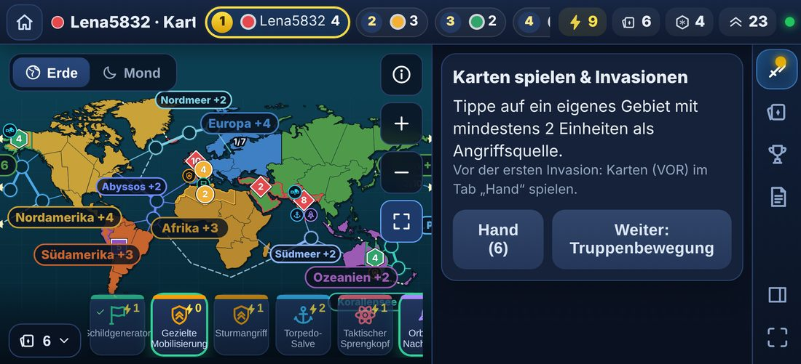
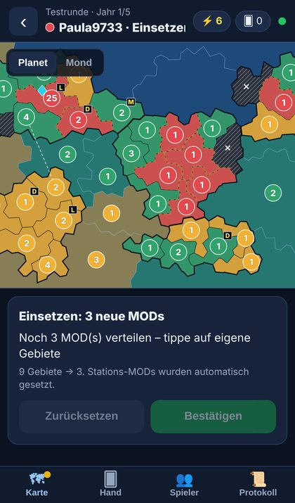
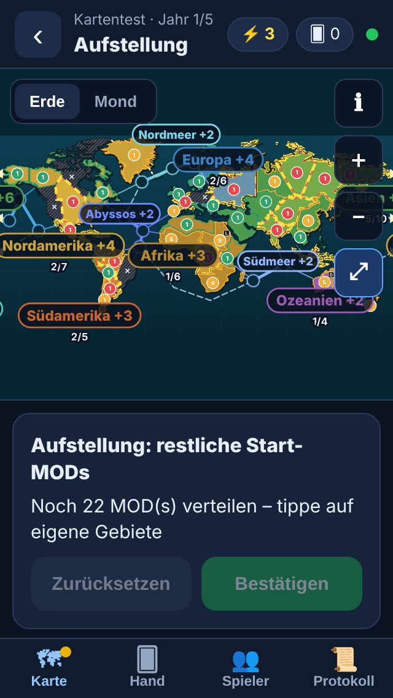
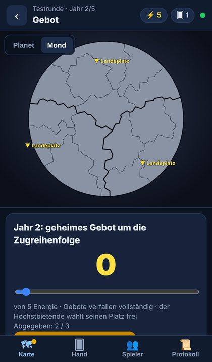
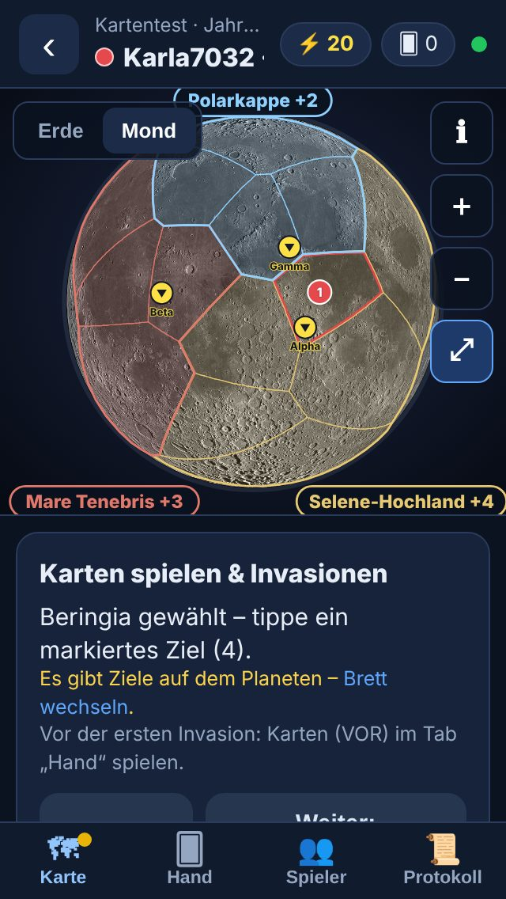
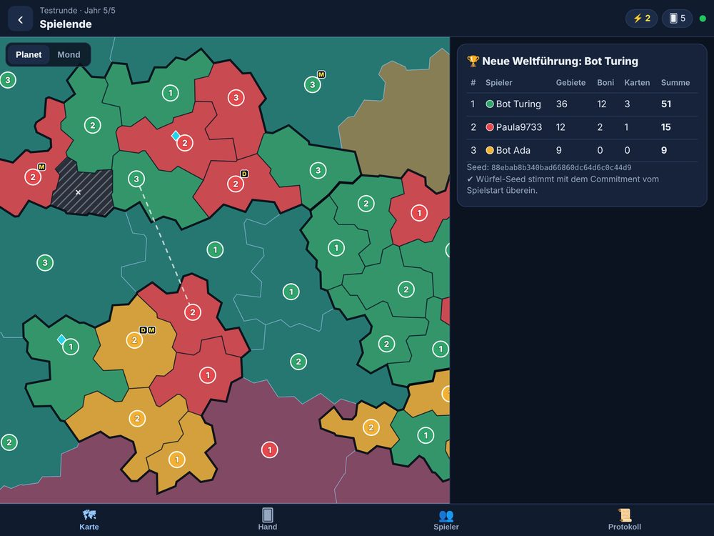
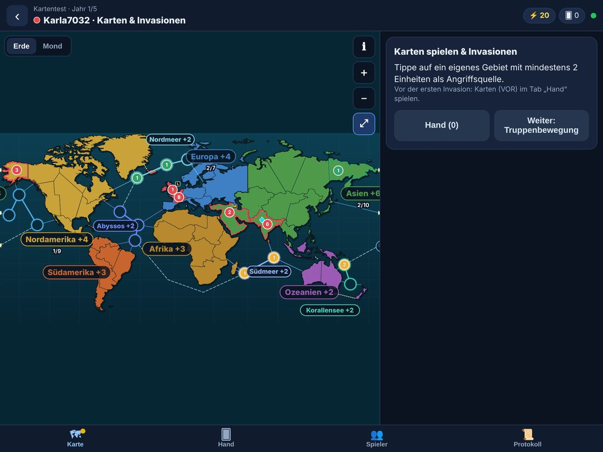

# Umsetzungsstand (v0.1.0)

Stand: 2026-11-12. Grundlage ist [`KONZEPT.md`](KONZEPT.md) v1.3. Dieses Dokument trennt ehrlich, was fertig und getestet ist, was vereinfacht umgesetzt wurde und was noch fehlt.

## 0000. Einsetzen und Scrollen (2026-11-13, drittes Update)

| Rückmeldung | Behebung |
|---|---|
| Beim Verteilen der Start-MODs fehlte eine schnelle Mengenwahl; +/− war umständlich | Antippen eines eigenen Gebiets öffnet das Menü mit **+1, +2, +3, +5, +10, −1** und **Alle übrigen (n)**; es zeigt „n gesetzt · m übrig“ und bleibt offen, bis alles verteilt ist. Antippen setzt nichts mehr von allein. Dieselbe Schnellwahl (+1 +2 +3 +5, Rest) steht auch im Aufstellungsfeld. Gilt für Schnellaufstellung, Verstärken und Einsetzen im Zug |
| Beim Anheuern ließ sich nicht scrollen, man kam nicht weiter | Die Hauptschaltfläche der Phase („Weiter …“, „Bestätigen“, „Zug beenden“) bleibt jetzt am unteren Rand des Aktionsfelds fixiert und ist immer erreichbar, auch ohne Scrollen. Die Kommandantenkarten sind kompakter, und Wischen im Aktionsfeld ist ausdrücklich freigegeben (`touch-action: pan-y`). In der Emulation scrollen Seitenleiste und schwebende Leiste per Touch; das Problem trat dort nicht auf, ich konnte es also nicht direkt nachstellen. Kommandanten lassen sich außerdem direkt im Gebietsmenü anheuern |

**Offen:** Falls das Scrollen auf deinem Gerät weiter hakt, hilft mir Gerät und Browser (z. B. iPhone/Safari oder Android/Chrome, App oder Browser).

## 000. Aktionsmenü am Gebiet und Atom-Symbol (2026-11-13)

| Anliegen | Umsetzung |
|---|---|
| Aktionen auch mit eingeklappter Seitenleiste | Bei eingeklappter Seitenleiste erscheint die Aktionsleiste als **schwebende Karte** über der Karte. Sie klappt automatisch auf, wenn eine Eingabe nötig ist (Würfeln, Bestätigen, Verteilen, Anheuern, Kartenkauf, Zielauswahl), sonst bleibt sie als schmale Zeile mit dem Status eingeklappt. Ein Tipp auf die Kopfzeile klappt sie auf bzw. zu |
| Optionen beim Antippen eines Gebiets | Ein kleines **Aktionsmenü** öffnet sich direkt am Gebiet. Es zeigt nur, was in diesem Moment möglich ist, und rutscht bei Platzmangel neben das Gebiet. Erneutes Tippen, Tippen auf freie Fläche oder ✕ schließt es |
| Was das Menü anbietet | **Besetzen** (freies Gebiet in der Platzwahl) · **+1 / +5 / Alle übrigen / −1 MOD** beim Einsetzen (Aufrüsten) · **Kommandant anheuern** (nur Typen, die noch nicht im Spiel sind und die du bezahlen kannst) und **Station bauen** · **Angreifen** (eigenes Gebiet mit mindestens 2 Einheiten, wenn es Ziele gibt) · **Zum Mond starten** (nur an Stationsgebieten mit Raum-Kommandant) · am Ziel **Angreifen**, **Einmarschieren …** oder **Truppen hinüber …** · in der Truppenbewegung **Truppen verlegen** |
| Atom-Symbol | Das Atom steht jetzt auf **kontaminierten Gebieten** (gelb-schwarz schraffiert, unpassierbar, vorher „verwüstet“ mit ✕). Der Text im Spiel heißt durchgehend „kontaminiert“. Der Nuklear-Kommandant hat dafür ein eigenes Symbol (Sprengkopf), damit beides nicht verwechselt wird. Die Legende (ℹ) erklärt beide |
| Außerdem | Der Hinweis-Toast sitzt jetzt oben und fängt keine Taps mehr ab (er verdeckte zuvor Gebiete in der Kartenmitte) |

Bilder: [Menü am Zielgebiet](assets/screenshots/vergleich/nachher-menue-ziel.jpg) · [Aufrüsten: Anheuern und Station](assets/screenshots/vergleich/nachher-menue-aufruesten.jpg) · [schwebende Aktionsleiste beim Würfeln](assets/screenshots/vergleich/nachher-schwebende-leiste.jpg) · [Atom auf kontaminierten Gebieten](assets/screenshots/vergleich/nachher-kontaminiert-atom.jpg)

Getestet in `tests/e2e/context-menu.cjs` (iPhone 13 quer, Seitenleiste eingeklappt): Atom auf kontaminierten Gebieten, Angriff über das Menü bis zum Würfeln, Mondlandung nur an der Station, Anheuern und Bezahlen, Einsetzen mit „Alle übrigen“ und Bestätigen in der schwebenden Leiste.

**Offen:** Kartenspielen mit Zielwahl und die Handkarten-Reaktionen laufen weiter über Handleiste und Aktionsleiste (nicht über das Gebietsmenü). Auf sehr kleinen Displays scrollt das Menü, wenn es mehr Einträge als Platz gibt.

## 00. Spieloberfläche im Querformat (2026-11-12, zweites Update)

| Anliegen | Umsetzung |
|---|---|
| Immer Querformat | Die Spielansicht versucht beim Öffnen, das Querformat zu sperren (`screen.orientation.lock`; wirkt in installierter App bzw. im Vollbild). Sonst zeigt sie im Hochformat den Hinweis „Bitte Gerät drehen“ ([Bild](assets/screenshots/vergleich/nachher-hochformat-hinweis.jpg)) mit einem Link „Trotzdem im Hochformat anzeigen“. Lobby und Profil bleiben in beiden Ausrichtungen nutzbar |
| Menü rechts, neue Icons | Menüleiste am rechten Rand: Aktion, Hand, Rang, Protokoll, Seitenleiste ein/aus, Vollbild. Alle Piktogramme sind ein eigener Icon-Satz (`src/client/ui/icons.tsx`), keine Emojis mehr |
| Statistik oben | Kopfleiste: Spielname und Phase, Rangliste (Platz, Spieler, Punkte; wer am Zug ist, leuchtet), dazu eigene Werte: Energie, Handkarten, Gebiete, Einheiten, Stationen |
| Rang-/Punkteliste sichtbar | Immer in der Kopfleiste. Antippen öffnet die Tabelle „Rangliste“ ([Bild](assets/screenshots/vergleich/nachher-rangliste-handy.jpg)) mit Gebieten, Regionsboni, Punkten, Energie, Einheiten, Stationen. Zwischenstand = Gebiete + Regionsboni; private Wertungskarten zählen erst am Ende |
| Handkarten unten | Leiste unten im Spielfeld: ein Piktogramm je Deck (Land, Marine, Raum, Nuklear, Diplomat), Kosten, grüner Rand = jetzt spielbar. Antippen zeigt Text und „Spielen“; einklappbar |
| Atom-Marker | Das Atom-Symbol (drei Bahnen mit Kern) kennzeichnet kontaminierte Gebiete; der Nuklear-Kommandant ist ein Sprengkopf-Symbol (siehe Abschnitt 000) |
| Mondbasen und Kommandanten erkennbar | Kommandanten sind runde Piktogramm-Marker unter der Einheitenzahl. Stationen tragen ein Satelliten-Symbol. Mond-Landeplätze sind ein gelber Landering mit Landeplatz-Symbol, gefüllt mit der Einheitenzahl des Besitzers. Die Legende (ℹ) erklärt alle Marker |
| Zoom passt zum Bildschirm | Die Gesamtansicht passt sich der Fenstergröße an, auch nach dem Drehen. Doppeltippen zoomt, Pinch und Mausrad funktionieren. Auf iOS wird der Seitenzoom verhindert, damit nur die Karte zoomt. Bei hohen Flächen läuft das Meer oben und unten weiter. Auf kleinen Displays wird die Seitenleiste automatisch eingeklappt |
| Logo | Neues Logo (Erde mit Orbit, Station und Mond) als SVG und PNG. Unraid zeigt es als Container-Symbol: Das Template verweist auf `deploy/unraid/icon.png`, zusätzlich trägt das Image das Label `net.unraid.docker.icon` |
| Optik allgemein | Dunkles Raumdesign mit Verläufen und Glaseffekt, Einheitenmarker mit Form je Spieler (Kreis, Sechseck, Quadrat, Raute, Fünfeck; hilft bei Farbschwäche), kontrastreiche Marker, Animationen |

**Zusätzlich behoben**
- Das Icon-URL im Unraid-Template zeigte auf den Zweig `main`, der nicht existiert. Deshalb erschien das Logo nie.
- Regionsbeschriftungen überlappen sich nicht mehr (verschieben, sonst ausblenden); die Legende nennt immer alle.
- Service-Worker-Cache auf v2 angehoben, damit die neue Oberfläche sicher geladen wird.
- Der Server lieferte JPEG als `application/octet-stream` aus.
- Piktogramme statt Buchstaben bei Anheuern, Aufstellung, Truppenauswahl und Territorium-Info.

**Offen / nicht geprüft**
- Echte Geräte: Sperre des Querformats, Vollbild und Pinch-Zoom auf iOS/Android sind nur mit Playwright-Emulation getestet. Auf dem iPhone gibt es keinen Vollbildmodus im Browser; dort hilft nur die installierte App.
- Das Icon-Template zeigt auf den Zweig `ccr-febc0e07-5171qs`; nach einem Merge nach `main` sollte die URL angepasst werden.
- Sehr kleine Geräte (iPhone SE 1. Generation, 568 × 320) sind bedienbar, aber eng; die Seitenleiste ist dort standardmäßig eingeklappt.
- Sprache und Beschriftungen der Hand-Registerkarte (Reaktionsregeln) sind unverändert.

## 0. Überarbeitung Spielbrett und Regelmechanik (2026-11-12)

### 0.1 Neues Brett: Erde & Mond (Kartenrevision 3)

| | Vorher (Rev. 1, Stand `c7e5bfb`) | Nachher (Rev. 3) |
|---|---|---|
| Planet, Handy (iPhone SE) |  |  |
| Mond, Handy |  |  |
| Tablet quer (iPad) |  |  |

Weitere Aufnahmen:
- [Beringstraße über den Kartenrand](assets/screenshots/vergleich/nachher-beringstrasse-handy.jpg)
- [Wasserkolonie mit Marine angreifen](assets/screenshots/vergleich/nachher-wasserkolonie-handy.jpg)
- [Mond auf dem Tablet](assets/screenshots/vergleich/nachher-tablet-mond.jpg)
- [Alte Partie behält ihre Karte](assets/screenshots/vergleich/nachher-alte-partie-handy.jpg)

- **Erde:**
  - Küsten aus Natural Earth (gemeinfrei);
  - **eigene** Aufteilung in 42 Gebiete aus ganzen Ländern bzw. geteilten Großstaaten, mit eigenen Namen;
  - Kontinente in kräftigen Farben, dunkles Meer mit Gradnetz;
  - 13 Wasserfelder als Ringe in 5 Kolonien, sparsam verbunden: 33 Wasserlinien statt 86, nur 9 gepunktete Seewege.

  Details stehen in KONZEPT §4.1.
- **Mond:**
  - NASA-LROC-Mosaik der Vorderseite (gemeinfrei), entnommen aus der bereitgestellten `moon.svg`;
  - 14 Gebiete an realen Formationen (Kopernikus, Kepler-Krater, Tycho …);
  - Landeplätze an den Apollo-Landestellen 11, 12 und 15.

  Details stehen in KONZEPT §4.2.
- **Bewusst nicht übernommen:** Gebietsaufteilung, Namen, Boni und Schriftzug der als Stilvorlage bereitgestellten Entwürfe. Deren Umrisse sind laut Metadaten vom Originalbrett abgezeichnet; Kepler-Kolonien nutzt nur den Stil (Farben, Ringe, Legende, Mondtextur).
- **Ost-West-Landroute:** In Rev. 3 ist es die Beringstraße (Beringia ↔ Fernost). Sie ist über den Kartenrand gezeichnet und braucht keinen Marine-Kommandanten.
- **Alte Partien:**
  - Spielstände mit `mapId` `kepler-colonies` (Rev. 1) und `kepler-colonies-2` (Rev. 2) behalten Graph, Gebietsnamen und Darstellung. Die Kepler-Fantasiekarte liegt unter `content/board/legacy/`.
  - Neue Partien starten mit `kepler-earth-3`.
  - Die IDs sind in allen Revisionen gleich; Spielstände brauchen keine Migration.
  - Abgesichert durch `tests/regression.test.ts` (Fixture `alte-partie-c7e5bfb.json` läuft bis zum Spielende) und den Browser-Schritt 9 in `tests/e2e/map-scenarios.cjs`.

### 0.2 Behobene Regelfehler (Abschnitt 3 der Anforderung)

| Nr. | Fehler | Behebung |
|---|---|---|
| 3.1 | Erdlandung auf eigenes Gebiet löste Kampf aus | Verlegung ohne Kampf. Gegner = normale Invasion, frei = Besetzung, ohne Raum-Kdt unzulässig |
| 3.2 | Taktischer Sprengkopf auf den letzten Verteidiger ließ das Gebiet in einem inkonsistenten Zustand | Nachrücken, danach Übernahme, Ausscheiden und Wertung; auch mit Station im Ziel |
| 3.3 | Fiel der Marine-/Raum-Kdt, durfte weitergewürfelt werden (auch im Blitz) | Prüfung vor jedem Wurf, sauberer Stopp mit Begründung |
| 3.4 | W8 wurde erzwungen | Angreifer wählt die W8-Kommandanten je Wurf (`Attack.d8`); Nachrückpflicht folgt dem letzten Wurf; altes Befehlsformat bleibt gültig |
| 3.5 | Bonuskarte nach 3 umkämpften Eroberungen ließ sich überspringen | serverseitig erzwungen; ohne verfügbares Deck nur Energie |
| 3.6 | Startspieler mit Sitzplatzverzerrung; öffentliche Befehle ungeprüft | W6 je Spieler mit Stechen; Laufzeitvalidierung aller Befehle (`validate.ts`) |
| – | Wertung ohne früher ausgeschiedene Spieler | korrigiert |

Jeder Fehler ist durch einen Regressionstest abgedeckt. Am Ausgangsstand `c7e5bfb` schlagen 10 von 15 dieser Tests fehl, nach der Behebung keiner.

### 0.3 Ausgeführte Prüfungen

- **Engine:** `npm run typecheck` ohne Fehler; `npm test` mit 45/45 Tests (Engine, Regression, Brett-Konsistenz für Rev. 1/2 und 3, Server-Integration).
- **Bot-Simulationen auf der Erdkarte** mit Invariantenprüfung nach jedem Befehl, ohne Fehler:
  - 40 Partien mit 2 Spielern, 40 mit 3, 40 mit 5 (Schnellaufstellung);
  - 15 Partien mit 4 Spielern (klassische Aufstellung).
- **Browser (Playwright, iPhone SE hoch und iPad quer):** `tests/e2e/map-scenarios.cjs`:
  - Gesamtansicht und Legende;
  - kleine Wasserfelder antippen;
  - Meerenge ohne Marine;
  - W6 statt W8;
  - Wasserangriff ohne/mit Marine;
  - Mondlandung;
  - Rückverlegung vom Mond;
  - Beringstraße über den Rand;
  - Tablet Erde/Mond;
  - alte Partie.

  Dazu laufen weitere Browser-Tests, beide bestanden:
  - `mobile-playthrough.cjs`: iPhone, von der Registrierung bis zur Wertung;
  - `multiplayer.cjs`: zwei Menschen, iPhone und Android.
- **Docker:** Das Image baut (inkl. Typprüfung und Engine-Tests im Build). Der Container startet; `/healthz` und `/board/moon.jpg` (als `image/jpeg`) werden ausgeliefert.

### 0.4 Offen bzw. nicht verifiziert

- **Balance der Erdkarte:** Die Kontinentboni (+4/+4/+6/+3/+3/+2) sind aus Rev. 1/2 übernommen. Auf dem neuen Graphen hat Europa 5 von 7 Grenzgebieten, Nordamerika 6 von 9. Eine Auswertung der Siegquoten je Startregion steht aus.
- **Lesbarkeit:**
  - In der Gesamtansicht am Handy werden verdeckte Beschriftungen von Wasserkolonien ausgeblendet; sie erscheinen beim Zoomen und stehen immer in der Legende.
  - Gebietsnamen erscheinen erst ab einer Zoomstufe.
  - Auf echten Geräten nicht geprüft.
- **Gebietsgrenzen in Russland, Kanada, USA, China und Australien** sind gerade Voronoi-Linien, keine Verwaltungsgrenzen. Das ist bewusst abstrahiert.
- **Zählung:** Die Anforderung nennt „71 IDs“. Die Karte hat in allen Revisionen 69 Gebiete (42 Land + 13 Wasser + 14 Mond); die Differenz ließ sich keinem Element zuordnen.
- Die Mondtextur wird vom Service Worker vorab geladen. Wird sie geändert, ändert sich der Cache-Schlüssel erst mit dem nächsten Client-Build.

## 1. Fertig und getestet

### Spiel-Engine (`src/engine`)
- **Alle Regeln R1–R38** aus KONZEPT §2:
  - Setup: 4 verwüstete Gebiete, Start-MODs, Starteinheiten; Schnell- und klassische Aufstellung; 2-Spieler-Variante mit neutraler Armee.
  - Gebot mit W6-Stichentscheid und freier Platzwahl.
  - Zugphasen in fester Reihenfolge.
  - Einkommen über die **Score-Chart-Tabelle** (inklusive 45 → 14), Boni für MODs und Energie, Stations-MODs.
  - Kommandanten und Stationen mit allen Limits; Kartenkauf in einem Vorgang.
  - Kampf mit W6/W8 nach der Regel „von oder in“, Stationsverteidigung, Verlustregeln, Nachzieh-Pflicht der W8-Kommandanten.
  - Leere Gebiete ohne Wurf; Wasser und Mond nur mit Kommandant im Spiel; Mond nur über Station → Landeplatz.
  - 3-Gebiete-Bonus, Abbruch erst nach einem Wurf, Ausscheiden mit Ablage der Karten.
  - Truppenbewegung über Pfad inklusive Station ↔ Landeplatz.
  - Wertung inklusive Wertungskarten; Gleichstand nach Energie, dann Einheiten.
- **100 Kommandokarten (67 Typen)** aus [`KARTEN.md`](KARTEN.md), alle ausführbar. Zeitpunkte VOR, ANG, ENDE (manuell) sowie REA, ERO, KAR (automatisch), GEBOT (mit dem Gebot) und WERT (bei Spielende).
- **Deterministischer RNG** (sfc32): Der Seed wird beim Start per SHA-256 festgeschrieben und nach Spielende offengelegt. Damit lässt sich jede Partie aus Seed und Befehlsfolge exakt reproduzieren.
- **Projektion:** fremde Handkarten, Gebote vor dem Aufdecken, Deck-Reihenfolge und RNG verlassen den Server nicht. Öffentlich sind Energie sowie Typ und Anzahl der Karten (RH S. 1).
- **Heuristik-Bot (Stufe 1)**: spielt alle Phasen und Kartenarten. Er wird für Gegner, die Vertretung bei Fristablauf und „Kontrolle abgeben“ genutzt.
- **Tests:**
  - 45 Tests (Engine, Regression 3.1–3.6, Brett-Konsistenz je Kartenrevision, Server); darunter darunter Score-Chart, W8-Regeln, Wasser/Mond, Pfadbewegung, Projektion ohne Leaks, Reaktionen.
  - Bot-gegen-Bot-Simulation mit Invarianten-Prüfung nach jedem Befehl: über 100 Partien mit 2–5 Spielern ohne Fehler.

### Server (`src/server`)
- **Profile** (Name und Passwort mit scrypt), Sitzungen per HttpOnly-Cookie. Das erste Profil wird Admin; weitere Admins per `ADMIN_PASSWORD`.
- **Profilseite:** Statistik (Partien, Siege, Ø Punkte), Verlauf, Wunschfarbe, Passwortwechsel. Dazu eine Rangliste.
- **Lobby:** Partien anlegen, beitreten, verlassen, Bots hinzufügen, starten, löschen; Zuschauen bei laufenden Partien.
- **Synchronisation:** WebSocket-Live-Sync (pro Spieler projizierter Zustand, Herzschlag 25 s, Reconnect); Befehle per REST mit Versionsprüfung.
- **Persistenz:** SQLite (WAL) mit Zustand nach jedem Befehl und vollständigem Befehlsprotokoll, Migrationen, tägliches Backup mit Aufbewahrung. Laufende Partien überstehen Neustarts.
- **Fristen:** Nach Ablauf übernimmt ein Bot den säumigen Spieler (Gebot, Aufstellung oder kompletter Zug).
- **Web Push (VAPID)** bei „du bist dran“ und bei Spielende, nur wenn der Spieler gerade nicht verbunden ist.
- **Absicherung:** Rate-Limits für Login, Registrierung, Befehle; Proxy-Modus `cloudflare`; Body-Limit; CSP-Header; optionaler Einladungscode.
- **Integrationstest:** echter Serverprozess, zwei Profile, Lobby, WebSocket, Partie bis zur Wertung, Statistik.

### Client (`src/client`)
- **PWA** (Preact): installierbar, Service Worker mit Offline-App-Shell, Push-Empfang, Icons.
- **Spielbrett:** SVG-Karte (Erde und Mond, Kartenrevision 3 aus `tools/board-generator/earth_board.py`; alte Partien mit der Kepler-Fantasiekarte).
  - Pinch-Zoom und Wischen, nahtloser Ost-West-Umlauf, im Hochformat auf volle Höhe skaliert.
  - Besitzerfarben, Einheiten, Kommandanten, Stationen, Landeplätze, verwüstete Gebiete.
  - Gültige Ziele werden hervorgehoben.
- **Aktionsleiste für alle Phasen:** Aufstellung, Gebot, Platzwahl, Einsetzen, Anheuern/Bauen, Kartenkauf, Karten mit allen Zielarten, Invasion mit Würfelvorschau und exakter Siegwahrscheinlichkeit (Markov), Blitz, Abschreckung, Nachziehen, Bonuskarte, Truppenbewegung, Zugende, Handelsangebote.
- **Weitere Tabs:** Hand (Spielbarkeit mit Begründung, Reaktionsregeln, Verteidigungswürfel), Spieler, Protokoll mit Würfeln.
- **Rückblick** beim Öffnen: „Seit deinem letzten Besuch …“ mit hervorgehobenen Gebieten.
- **Spielende** mit Wertungstabelle und automatischer Prüfung des Würfel-Seeds.
- **Layouts** für Smartphone (Hochformat), Querformat und Tablet.
- **E2E (Playwright gegen den Docker-Container):**
  - iPhone-Durchlauf von der Registrierung bis zum Spielende.
  - Zwei Menschen (iPhone und Android) gegeneinander mit Live-Übergabe des Zugs.

### Betrieb
- **Docker-Image:** baut inklusive Typprüfung und Engine-Tests. Es läuft als PUID:PGID (99:100), Healthcheck `/healthz`, Daten unter `/data`.
- **Deployment-Dateien:** `docker-compose.yml` mit optionalem `cloudflared`, Unraid-Template, GitHub Action für ein Multi-Arch-Image nach GHCR.

## 2. Bewusst vereinfacht

| Thema | Konzept | Umsetzung | Auswirkung |
|---|---|---|---|
| Reaktionskarten | Regel-Editor mit Bedingungen, Live-Fenster | Pro Kartentyp **an/aus**. Jede Karte bringt eine eingebaute, sinnvolle Bedingung mit (z. B. Schildgenerator nur bei mindestens 3 Angreifern). Kein Live-Reaktionsfenster | Keine Wartezeiten, aber weniger Feinsteuerung. Hilfe für Dritte (Tarnstellung für andere) wird nicht automatisch gespielt |
| Verteidigungswürfel | Wahl pro Wurf (RH S. 5) | Globale Einstellung: maximal oder 1 Würfel | Im Asynchron-Betrieb gewollt |
| Verlustauswahl | Betroffener wählt (RH S. 6) | Immer MODs vor Kommandanten | Entspricht fast immer der besten Wahl |
| Event-Sourcing | Events plus Upcaster | Zustands-Snapshot pro Befehl plus vollständiges Befehlsprotokoll (Replay aus Seed und Befehlen möglich) | Kein Replay-Werkzeug in der UI |
| RNG | ChaCha20 | sfc32 (deterministisch, Seed-Commitment wie geplant) | Für ein Spiel ausreichend; der Admin kann den Seed weiterhin lesen |
| Monorepo | pnpm-Workspaces, React, Fastify | Ein Paket, Preact, Node-`http` + `ws`, Node-Type-Stripping | Weniger Abhängigkeiten; Server ohne Build-Schritt |
| Rückblick | Animierte Wiedergabe | Zusammenfassung plus Aufblinken der Gebiete | – |
| Startplatzierung | klassisch reihum | zusätzlich „Schnell“ (Standard): Gebiete zufällig, Rest gleichzeitig | Klassisch ist asynchron sehr langwierig (ein Befehl pro Gebiet) |

## 3. Noch nicht umgesetzt

1. **Ruhezeiten** (keine Pushes bzw. pausierte Fristen nachts), **Erinnerungen** bei 50 % und 90 % der Frist, **Urlaubsmodus**, **ntfy** als zweiter Kanal.
2. **Undo** innerhalb einer Phase.
3. **Tischmodus `/table`** ohne Login. Zuschauen ist für angemeldete Profile möglich.
4. **Bot Stufe 2** (Monte-Carlo) und Schwierigkeitsgrade.
5. **Systematisches Balancing** von Karten und Kontinentboni. Das Werkzeug `src/tools/simulate.ts` existiert, eine Auswertung je Karte fehlt noch.
6. **Barrierefreiheit:** Muster bzw. Symbole zusätzlich zu den Spielerfarben (Farbsehschwäche).
7. **Admin-Seite:** Passwort zurücksetzen, Spieler ersetzen, Fristen verlängern. Bisher kann der Admin nur Partien löschen.
8. **Englische Übersetzung.**
9. **Profil löschen** oder umbenennen.

## 4. Hier nicht verifizierbar

- **Cloudflare Tunnel:** keine Domain in der Testumgebung. Konfiguration und Einstellungen sind dokumentiert, der Server unterstützt `CF-Connecting-IP`, und der WebSocket-Herzschlag ist auf das Cloudflare-Timeout abgestimmt.
- **Web Push:** braucht HTTPS und die echten Push-Dienste von Google, Apple und Mozilla. Schlüsselverwaltung, Abo-Speicherung und der Push-Handler im Service Worker sind implementiert; eine Ende-zu-Ende-Zustellung ist ungetestet.
- **arm64-Image:** lokal wurde nur amd64 gebaut. Die GitHub Action baut beide Architekturen, ist aber noch nicht gelaufen.
- **Echte iOS-/Android-Geräte:** getestet wurde mit Playwright-Geräteemulation (iPhone 13, Pixel 7, iPad). Safari-Eigenheiten (PWA-Push, Pinch-Gesten) sind auf echten Geräten noch zu prüfen.
